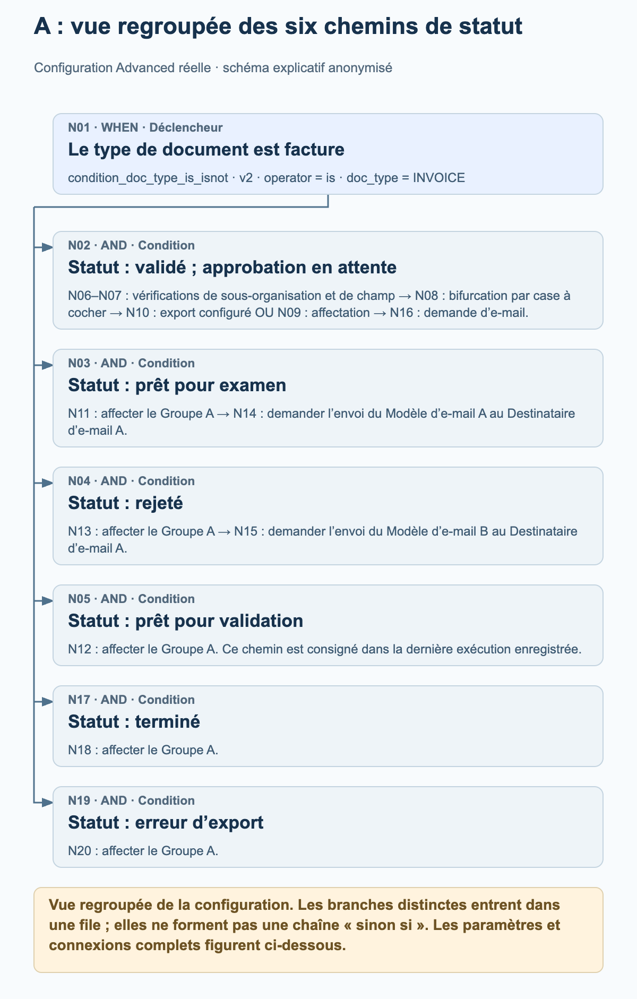
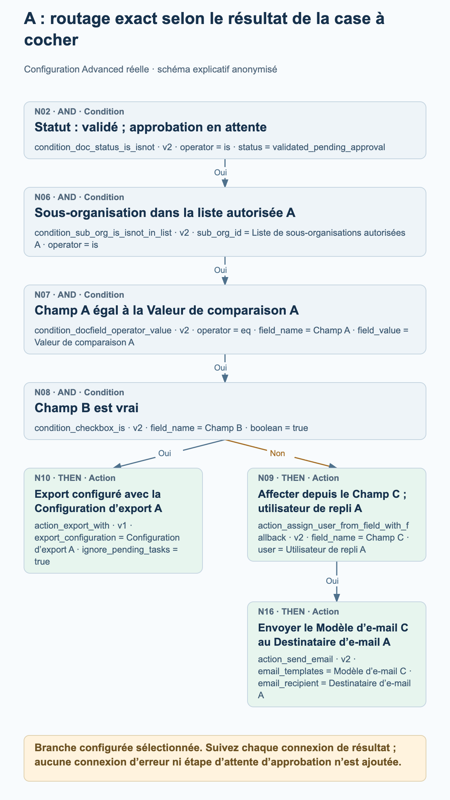
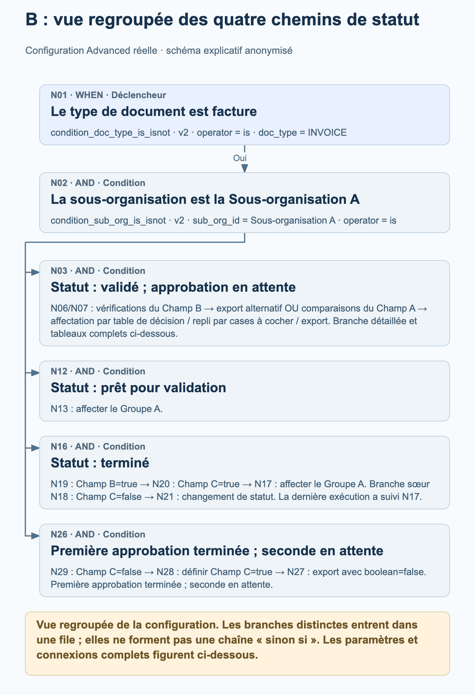
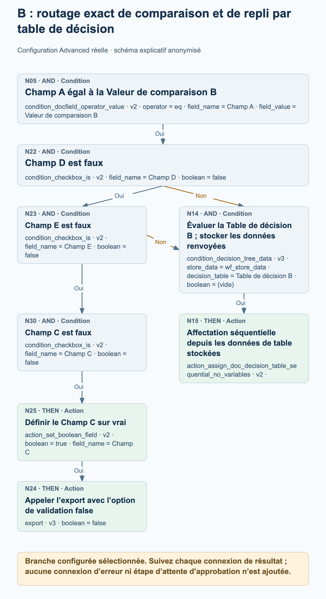

# Exemples réels de workflows Advanced en production

Deux workflows Advanced actifs en production montrent comment le routage réel des factures associe des branches de statut, des décisions par cases à cocher, des affectations et des actions d’export configurées. Les quatre schémas de processus expliquent certaines parties de chaque graphe ; les paramètres complets des nœuds et les connexions sont présentés séparément.

Examen des sources en lecture seule le 27 octobre 2026 : les deux configurations actuelles correspondent aux données des nœuds, cartes, versions, paramètres et connexions enregistrées avec leur dernière exécution consignée. L’exemple A comporte 20 nœuds et 19 connexions ; l’exemple B comporte 30 nœuds et 30 connexions. Les deux exécutions enregistrées ont le statut global failed_condition, bien que chacune contienne une action d’affectation à un groupe réussie. Il s’agit de configurations observées et de traces d’exécution enregistrées, pas de nouveaux tests exécutés. Les valeurs d’organisation, de champ, d’utilisateur, de groupe, de table, de modèle et de destinataire sont anonymisées. Les alias préservent les distinctions au sein de chaque exemple et ne désignent pas la même entité réelle d’un exemple à l’autre.

## Comment lire ces graphes

Chaque connexion suit un résultat précis : success, failed_condition ou error. Ces exemples contiennent des connexions success et failed_condition ; aucun des deux graphes ne configure de connexion error. Une condition non remplie est un résultat normal et ne doit pas être interprétée comme une erreur technique.

Plusieurs connexions success sortantes ajoutent plusieurs destinations à la file d’exécution. Elles ne créent pas de chaîne « sinon si » et ne signifient pas que les actions s’exécutent en parallèle. Une destination est traitée au maximum une fois pendant une exécution du graphe. Suivez les connexions réelles au lieu de déduire le déroulement de la position d’une carte.

Une destination possédant plusieurs connexions entrantes n’attend pas automatiquement toutes les entrées. Dans l’exemple B, chacune des deux connexions failed_condition configurées peut mettre en file la carte de condition ordinaire N14 ; ce n’est pas une passerelle ALL ou ANY distincte.

Les affectations ne prouvent pas qu’une personne a approuvé un document. Une affectation ou une carte d’export configurée ne permet de déduire ni étape d’attente, ni approbation terminée, ni accusé de réception d’un système externe. Les schémas n’ajoutent aucune de ces étapes.

Les vues d’ensemble regroupées résument les chemins de statut et regroupent explicitement les nœuds en aval. Les schémas détaillés développent les chemins sélectionnés de cases à cocher ou de repli. Utilisez les listes complètes des nœuds et des connexions pour examiner l’intégralité du graphe configuré.

## A. Routage par statut avec un chemin d’export ou d’affectation commandé par une case à cocher

Une facture se ramifie vers six vérifications de statut. La branche des documents validés en attente d’approbation vérifie également une liste de sous-organisations autorisées, compare le Champ A et teste le Champ B. Le résultat de la case à cocher sélectionne une carte d’export configurée ou une action d’affectation depuis un champ suivie d’un e-mail. Les autres chemins de statut affectent le Groupe A, et deux de ces chemins envoient ensuite un e-mail configuré.

### A : vue regroupée des six chemins de statut

<figure><figcaption>N01 se ramifie vers six vérifications de statut distinctes. La vue regroupe la branche N02, plus longue, et montre les chemins d’affectation et d’e-mail configurés pour les autres statuts. Il s’agit d’une vue regroupée de la configuration, pas d’une trace d’exécution ni d’une chaîne « sinon si ».</figcaption></figure>

### A : routage exact selon le résultat de la case à cocher

<figure><figcaption>Branche développée N02 → N06 → N07 → N08. Champ B=true suit success vers la carte d’export configurée N10 avec ignore_pending_tasks=true. La connexion failed_condition mène à la carte d’affectation depuis un champ N09, dont success mène à la carte d’e-mail N16. Cela n’implique ni résultat d’export, ni approbation humaine, ni étape d’attente.</figcaption></figure>

### Ce que montre réellement la dernière exécution enregistrée

Exécution enregistrée : 26 octobre 2026, 12:01:54 UTC. N01 et la vérification ready_for_validation N05 ont renvoyé success ; l’affectation N12 a ensuite renvoyé success. Les cinq autres vérifications de statut ont renvoyé failed_condition, et les nœuds restants n’ont aucun résultat consigné pour cette exécution. Le résultat global est failed_condition. Cette exécution démontre donc le chemin d’affectation au groupe N01 → N05 → N12 ; elle ne démontre pas les chemins de case à cocher, d’export ou d’e-mail.

- Après la réussite de N01, les vérifications de statut N02, N03, N04, N05, N17 et N19 sont mises en file via des connexions success distinctes. Elles ne constituent pas une chaîne « sinon si ».
- La branche d’approbation détaillée suit N02 → N06 → N07 → N08 sur success. N08 teste le Champ B par rapport à true. Sa connexion success mène à N10 ; sa connexion failed_condition mène à N09.
- N10 est action_export_with v1, configurée avec la Configuration d’export A et ignore_pending_tasks=true. Le schéma indique la configuration et n’affirme ni réussite de l’export ni réception externe. Dans cette carte, ignore_pending_tasks=true désactive la vérification des tâches en attente pour la demande d’export ; cette option est propre à cet exemple.
- N09 est configurée pour affecter depuis le Champ C avec l’Utilisateur de repli A. Seule sa connexion success mène à N16, configurée avec le Modèle d’e-mail C et le Destinataire d’e-mail A.
- Le Champ C doit contenir un identifiant utilisateur. Un identifiant utilisateur sans correspondance peut utiliser le repli configuré ; un champ de document absent peut provoquer un échec avant que le repli soit atteint. Le repli ne garantit pas une affectation dans tous les cas de champ manquant.
- N11, N12, N13, N18 et N20 configurent tous le même Groupe A au sein de cet exemple. Seuls N11 et N13 possèdent des nœuds d’e-mail suivants connectés, N14 et N15.

Configuration complète des nœuds

| Nœud | Carte | Configuration |
| --- | --- | --- |
| N01 | condition_doc_type_is_isnot · v2 | operator = is; doc_type = INVOICE |
| N02 | condition_doc_status_is_isnot · v2 | operator = is; status = validated_pending_approval |
| N03 | condition_doc_status_is_isnot · v2 | operator = is; status = ready_for_review |
| N04 | condition_doc_status_is_isnot · v2 | operator = is; status = rejected |
| N05 | condition_doc_status_is_isnot · v2 | operator = is; status = ready_for_validation |
| N06 | condition_sub_org_is_isnot_in_list · v2 | sub_org_id = Liste de sous-organisations autorisées A; operator = is |
| N07 | condition_docfield_operator_value · v2 | operator = eq; field_name = Champ A; field_value = Valeur de comparaison A |
| N08 | condition_checkbox_is · v2 | field_name = Champ B; boolean = true |
| N09 | action_assign_user_from_field_with_fallback · v2 | field_name = Champ C; user = Utilisateur de repli A |
| N10 | action_export_with · v1 | export_configuration = Configuration d’export A; ignore_pending_tasks = true |
| N11 | doc_group_assign · v2 | groups = Groupe A; use_decision_table = (vide) |
| N12 | doc_group_assign · v2 | groups = Groupe A; use_decision_table = (vide) |
| N13 | doc_group_assign · v2 | groups = Groupe A; use_decision_table = (vide) |
| N14 | action_send_email · v2 | email_templates = Modèle d’e-mail A; email_recipient = Destinataire d’e-mail A |
| N15 | action_send_email · v2 | email_templates = Modèle d’e-mail B; email_recipient = Destinataire d’e-mail A |
| N16 | action_send_email · v2 | email_templates = Modèle d’e-mail C; email_recipient = Destinataire d’e-mail A |
| N17 | condition_doc_status_is_isnot · v2 | operator = is; status = finished |
| N18 | doc_group_assign · v2 | groups = Groupe A; use_decision_table = (vide) |
| N19 | condition_doc_status_is_isnot · v2 | operator = is; status = export_error |
| N20 | doc_group_assign · v2 | groups = Groupe A; use_decision_table = (vide) |

Connexions configurées complètes

| Nœud | Chemin du résultat | Nœud |
| --- | --- | --- |
| N01 | success | N02 |
| N01 | success | N03 |
| N01 | success | N04 |
| N01 | success | N05 |
| N08 | failed_condition | N09 |
| N08 | success | N10 |
| N07 | success | N08 |
| N06 | success | N07 |
| N02 | success | N06 |
| N03 | success | N11 |
| N04 | success | N13 |
| N05 | success | N12 |
| N13 | success | N15 |
| N11 | success | N14 |
| N09 | success | N16 |
| N01 | success | N17 |
| N17 | success | N18 |
| N19 | success | N20 |
| N01 | success | N19 |

## B. Routage par tables de décision avec replis par cases à cocher et branches de statut

Une facture de la Sous-organisation A se ramifie vers quatre vérifications de statut. Le chemin des documents validés en attente d’approbation utilise le Champ B, deux comparaisons alternatives du Champ A, des tables de décision et des vérifications supplémentaires de cases à cocher. Le chemin des documents terminés utilise les Champs B et C avant l’affectation au Groupe A ou un changement de statut configuré. Un chemin distinct en attente de seconde approbation définit le Champ C et appelle l’export lorsque sa condition configurée est remplie.

### B : vue regroupée des quatre chemins de statut

<figure><figcaption>N01 et N02 mènent à quatre vérifications de statut connectées séparément. La vue regroupe la branche de tables de décision, plus grande, conserve le chemin d’affectation avant validation et la bifurcation par cases à cocher des documents terminés, et résume le chemin d’export en attente de seconde approbation. Les listes complètes des nœuds et des connexions préservent les 30 nœuds et les 30 connexions.</figcaption></figure>

### B : routage exact de comparaison et de repli par table de décision

<figure><figcaption>Branche configurée sélectionnée après N01 → N02 → N03 → N07 : N05 compare le Champ A à la Valeur de comparaison B. Chacune des connexions failed_condition de N22 (Champ D=false) ou N23 (Champ E=false) peut mettre en file la Table de décision B dans la carte de condition ordinaire N14, puis l’affectation séquentielle N15. Sur success, N23 poursuit plutôt vers N30 → N25 → N24. Cela n’implique ni jonction ALL, ni carte ANY, ni approbation terminée, ni réception externe.</figcaption></figure>

### Ce que montre réellement la dernière exécution enregistrée

Exécution enregistrée : 27 octobre 2026, 11:56:25 UTC. N01, N02, la vérification du statut finished N16, la vérification Champ B=true N19, la vérification Champ C=true N20 et l’affectation au groupe N17 ont renvoyé success. N03, N12, N18 et N26 ont renvoyé failed_condition ; les autres nœuds n’ont aucun résultat consigné pour cette exécution. Le résultat global est failed_condition. Cette exécution démontre le chemin d’affectation des documents terminés, pas les chemins des tables de décision, un changement de statut ou un export.

- Après la réussite des vérifications de facture et de Sous-organisation A, N02 met en file les vérifications de statut N03, N12, N16 et N26. Le graphe n’attend pas qu’une branche de statut soit terminée avant d’en définir une autre.
- Sur success de N03, N06 teste Champ B=false et N07 teste Champ B=true. Sur success, N06 mène à la définition de Champ B=true dans N10 puis à la carte d’export alternatif N11. Sur success, N07 met en file les deux comparaisons du Champ A, N04 et N05.
- N06 et N07 sont mises en file avant la mise à jour du Champ B par N10. Les deux vérifications sont évaluées avant cette mise à jour ; définir Champ B=true ne fait pas réussir N07 plus tard dans le même parcours. Les cartes mises en file ultérieurement peuvent voir les valeurs renvoyées par les actions précédentes ; les branches ne sont pas des instantanés isolés.
- Le chemin de la Valeur de comparaison A mène à la Table de décision A dans N08 et à l’affectation séquentielle N09. Le chemin de la Valeur de comparaison B vérifie Champ D=false dans N22, Champ E=false dans N23 et Champ C=false dans N30 avant de définir Champ C=true dans N25 et d’appeler l’export N24.
- Un résultat failed_condition de N22 ou N23 peut mettre en file N14, la carte de condition ordinaire pour la Table de décision B. N14 n’attend pas toutes les entrées et n’est pas une nouvelle carte ANY. Sa connexion success mène à l’affectation séquentielle N15.
- Pour les documents terminés, N19 teste Champ B=true puis met en file N18 et N20. Champ C=true dans N20 mène à l’affectation au Groupe A dans N17. Champ C=false dans N18 mène à la carte de changement de statut N21, configurée avec validated_pending_approval et trigger_docflow=true. Il ne s’agit pas d’une étape d’attente.
- Le chemin approved_pending_second_approval suit N29 → N28 → N27 sur success : tester Champ C=false, définir Champ C=true, puis appeler l’export. Les cartes d’export N24 et N27 conservent boolean=false. Il s’agit d’une option de validation, pas d’une instruction visant à désactiver l’appel d’export.
- Les deux cartes de condition de table de décision stockent les données sous wf_store_data. Leurs actions d’affectation séquentielle ne possèdent aucun paramètre propre. Les règles des tables et les destinataires réels ne sont pas publiés, et le graphe ne prouve pas l’achèvement de l’approbation.
- L’export alternatif N11 dépend des attributs d’export du type de document. Ses paramètres de nœud vides ne permettent de déduire aucune configuration d’export ni destination. Le changement de statut N21 demande le déclenchement ultérieur de workflows ; il n’ajoute aucune connexion implicite vers ce même parcours.

Configuration complète des nœuds

| Nœud | Carte | Configuration |
| --- | --- | --- |
| N01 | condition_doc_type_is_isnot · v2 | operator = is; doc_type = INVOICE |
| N02 | condition_sub_org_is_isnot · v2 | sub_org_id = Sous-organisation A; operator = is |
| N03 | condition_doc_status_is_isnot · v2 | operator = is; status = validated_pending_approval |
| N04 | condition_docfield_operator_value · v2 | operator = eq; field_name = Champ A; field_value = Valeur de comparaison A |
| N05 | condition_docfield_operator_value · v2 | operator = eq; field_name = Champ A; field_value = Valeur de comparaison B |
| N06 | condition_checkbox_is · v2 | field_name = Champ B; boolean = false |
| N07 | condition_checkbox_is · v2 | field_name = Champ B; boolean = true |
| N08 | condition_decision_tree_data · v3 | store_data = wf_store_data; decision_table = Table de décision A; boolean = (vide) |
| N09 | action_assign_doc_decision_table_sequential_no_variables · v2 | — |
| N10 | action_set_boolean_field · v2 | boolean = true; field_name = Champ B |
| N11 | action_alternate_export · v2 | — |
| N12 | condition_doc_status_is_isnot_in_list · v2 | operator = is; status = ready_for_validation |
| N13 | doc_group_assign · v2 | groups = Groupe A; use_decision_table = (vide) |
| N14 | condition_decision_tree_data · v3 | store_data = wf_store_data; decision_table = Table de décision B; boolean = (vide) |
| N15 | action_assign_doc_decision_table_sequential_no_variables · v2 | — |
| N16 | condition_doc_status_is_isnot_in_list · v2 | operator = is; status = finished |
| N17 | doc_group_assign · v2 | groups = Groupe A; use_decision_table = (vide) |
| N18 | condition_checkbox_is · v2 | field_name = Champ C; boolean = false |
| N19 | condition_checkbox_is · v2 | field_name = Champ B; boolean = true |
| N20 | condition_checkbox_is · v2 | field_name = Champ C; boolean = true |
| N21 | staus_change · v3 | status = validated_pending_approval; trigger_docflow = true |
| N22 | condition_checkbox_is · v2 | field_name = Champ D; boolean = false |
| N23 | condition_checkbox_is · v2 | field_name = Champ E; boolean = false |
| N24 | export · v3 | boolean = false |
| N25 | action_set_boolean_field · v2 | boolean = true; field_name = Champ C |
| N26 | condition_doc_status_is_isnot_in_list · v2 | operator = is; status = approved_pending_second_approval |
| N27 | export · v3 | boolean = false |
| N28 | action_set_boolean_field · v2 | boolean = true; field_name = Champ C |
| N29 | condition_checkbox_is · v2 | field_name = Champ C; boolean = false |
| N30 | condition_checkbox_is · v2 | field_name = Champ C; boolean = false |

Connexions configurées complètes

| Nœud | Chemin du résultat | Nœud |
| --- | --- | --- |
| N01 | success | N02 |
| N02 | success | N03 |
| N03 | success | N06 |
| N03 | success | N07 |
| N07 | success | N04 |
| N07 | success | N05 |
| N06 | success | N10 |
| N10 | success | N11 |
| N02 | success | N12 |
| N12 | success | N13 |
| N16 | success | N19 |
| N20 | success | N17 |
| N19 | success | N20 |
| N19 | success | N18 |
| N18 | success | N21 |
| N04 | success | N08 |
| N02 | success | N16 |
| N05 | success | N22 |
| N22 | success | N23 |
| N25 | success | N24 |
| N02 | success | N26 |
| N22 | failed_condition | N14 |
| N23 | failed_condition | N14 |
| N28 | success | N27 |
| N26 | success | N29 |
| N29 | success | N28 |
| N23 | success | N30 |
| N30 | success | N25 |
| N08 | success | N09 |
| N14 | success | N15 |

## Avant d’adapter un exemple

Remplacez chaque alias neutre par une valeur appropriée de votre organisation. Préservez les références à un même champ et celles à des champs distincts ; n’utilisez pas ces valeurs fictives comme identifiants réels.

Vérifiez explicitement chaque connexion de résultat, y compris le routage failed_condition et les destinations possédant plusieurs connexions entrantes. Choisissez la gestion des erreurs adaptée à votre processus au lieu de supposer que le graphe traite un chemin d’erreur non connecté.

Examinez les paramètres d’export, les choix de validation et le traitement des tâches en attente selon vos exigences. Une action d’export configurée ou une trace de nœud réussie ne prouve pas la réception par un système externe.

Validez le workflow adapté dans un environnement de test autorisé, y compris chaque résultat de condition pertinent et les données d’affectation manquantes. Ces exemples de production ont été lus sans être modifiés ni réexécutés.
