# Modèle logique de décision

**Type de modèle :** Routage & logique conditionnels **Complexité :** Moyenne **Mise en place estimée :** 30-45 minutes **Cas d'usage courants :** Routage multi-chemins, traitement conditionnel, arbres de décision, mise en œuvre de règles métier

***

Dans le concepteur Standard, ouvrez **Ajouter une carte** dans le groupe **Et....**, puis la catégorie **Logique**. La vue partielle ci-dessous présente une carte de condition fondée sur une table de décision, affichée dans la bibliothèque avant sa sélection et sa configuration. La table à utiliser et le stockage des résultats pour les cartes suivantes restent à configurer. Les autres conditions, actions et connexions du modèle restent à définir et à vérifier. La condition porte sur les résultats renvoyés par la table pour le document ou l’organisation du fournisseur.

<figure>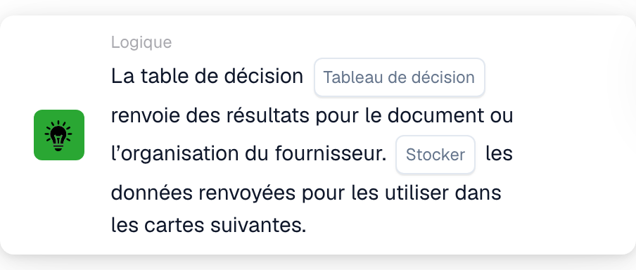<figcaption><p>Carte de condition de la catégorie « Logique » dans la bibliothèque, avant sa sélection et sa configuration. La table de décision et le stockage des résultats restent à configurer.</p></figcaption></figure>

***

## Vue d'ensemble du modèle

Ces schémas présentent les règles métier à configurer. Ils complètent la carte de bibliothèque ci-dessus, affichée avant sélection et configuration. Dans Advanced, reliez explicitement chaque chemin. Dans une séquence Standard linéaire, définissez les conditions qui autorisent ses actions.

#### Schéma : vue générale

<figure>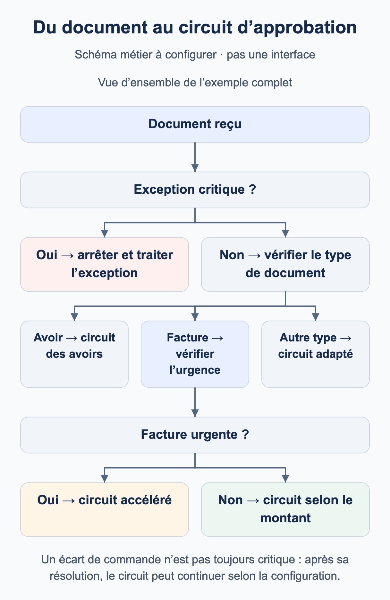<figcaption><p>Vue d’ensemble de l’exemple complet : contrôler les exceptions critiques, le type de document et l’urgence avant de choisir le circuit d’approbation. Chaque traitement et chaque connexion doivent être configurés ; le schéma ne représente pas un comportement automatique du produit.</p></figcaption></figure>

Ce modèle montre comment mettre en place une logique de décision complexe dans les workflows DocBits à l'aide de cartes de condition pour acheminer les documents par différents chemins de traitement en fonction des attributs des documents, des valeurs de champs et des règles métier.

**Ce que fait ce modèle :**

1. Évalue plusieurs conditions de façon séquentielle ou parallèle
2. Route les documents vers différents chemins en fonction des conditions
3. Met en œuvre des règles et des politiques métier
4. Traite des arbres de décision complexes
5. Combine plusieurs critères pour les décisions de routage

***

## Quand utiliser ce modèle

Utilisez ce modèle lorsque vous devez :

* ✅ Router les documents par seuils de montant
* ✅ Appliquer des règles différentes selon les types de documents
* ✅ Mettre en œuvre une logique d'approbation à plusieurs niveaux
* ✅ Gérer des politiques métier complexes
* ✅ Créer un routage dynamique basé sur plusieurs critères
* ✅ Mettre en œuvre une logique de gestion des exceptions
* ✅ Créer des matrices d'approbation

**N'utilisez pas ce modèle lorsque :**

* ❌ un workflow linéaire simple suffit
* ❌ tous les documents suivent le même chemin
* ❌ aucun traitement conditionnel n'est nécessaire

***

## Types de logique de décision

Les exemples IF-THEN, ET, OU et imbriqués ci-dessous sont indépendants. Leurs seuils illustrent chaque principe ; ils ne constituent pas une seule matrice d’approbation. La matrice complète plus loin utilise quatre tranches sans chevauchement. Une donnée inconnue ou une erreur d’évaluation n’est pas automatiquement Faux : définissez et testez son traitement séparément.

### 1. Logique IF-THEN simple

#### Schéma : condition simple

<figure>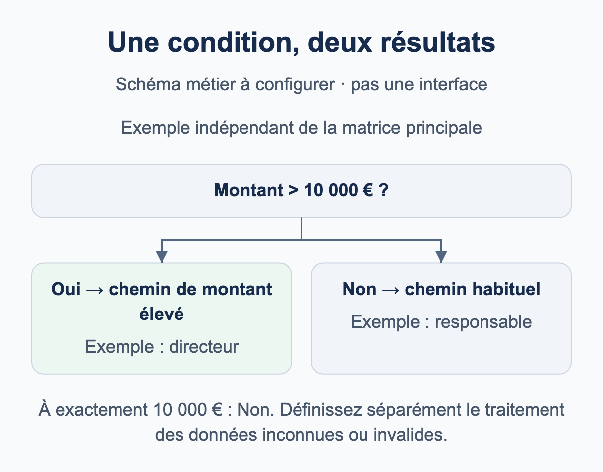<figcaption><p>Exemple IF-THEN indépendant : un montant strictement supérieur à 10 000 € choisit le directeur ; sinon, le responsable. L’égalité reste dans la seconde branche. Les destinations sont à configurer.</p></figcaption></figure>

<details>
<summary>Principe IF-THEN : une condition, deux résultats</summary>

```
IF condition:
  → Action A
ELSE:
  → Action B
```

</details>

**Exemple :**

Lecture visuelle de cet exemple : [condition simple](#schema-condition-simple).

<details>
<summary>Exemple IF-THEN : seuil de montant</summary>

```
IF Amount > €10,000:
  → Affecter au directeur
ELSE:
  → Affecter au responsable
```

</details>

#### Schéma : critères ET et OU

<figure>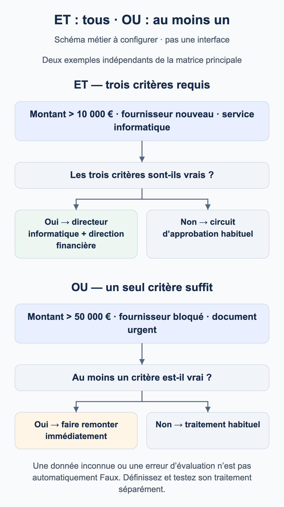<figcaption><p>Deux exemples indépendants : ET exige les trois critères ; OU en exige au moins un. Leurs seuils illustratifs ne remplacent pas les tranches de la matrice complète. Les sorties et le traitement des données inconnues ou des erreurs doivent être configurés.</p></figcaption></figure>

### 2. Plusieurs critères (logique ET)

Lecture visuelle de cet exemple : [critères ET et OU](#schema-criteres-et-et-ou).

<details>
<summary>Principe ET : tous les critères</summary>

```
IF condition1 AND condition2 AND condition3:
  → Action A
ELSE:
  → Action B
```

</details>

**Exemple :**

Lecture visuelle de cet exemple : [critères ET et OU](#schema-criteres-et-et-ou).

<details>
<summary>Exemple ET : trois critères</summary>

```
IF Amount > €10,000 AND Supplier = "New" AND Department = "IT":
  → Affecter au directeur informatique + CFO (double approbation)
ELSE:
  → Flux d’approbation habituel
```

</details>

### 3. Critères alternatifs (logique OU)

Lecture visuelle de cet exemple : [critères ET et OU](#schema-criteres-et-et-ou).

<details>
<summary>Principe OU : au moins un critère</summary>

```
IF condition1 OR condition2 OR condition3:
  → Action A
ELSE:
  → Action B
```

</details>

**Exemple :**

Lecture visuelle de cet exemple : [critères ET et OU](#schema-criteres-et-et-ou).

<details>
<summary>Exemple OU : montant, blocage ou urgence</summary>

```
IF Amount > €50,000 OR Supplier is "Blocked" OR Document has l’indicateur "Urgent":
  → Faire remonter immédiatement
ELSE:
  → Traitement habituel
```

</details>

### 4. Arbre de décision imbriqué

#### Schéma : décisions imbriquées

<figure>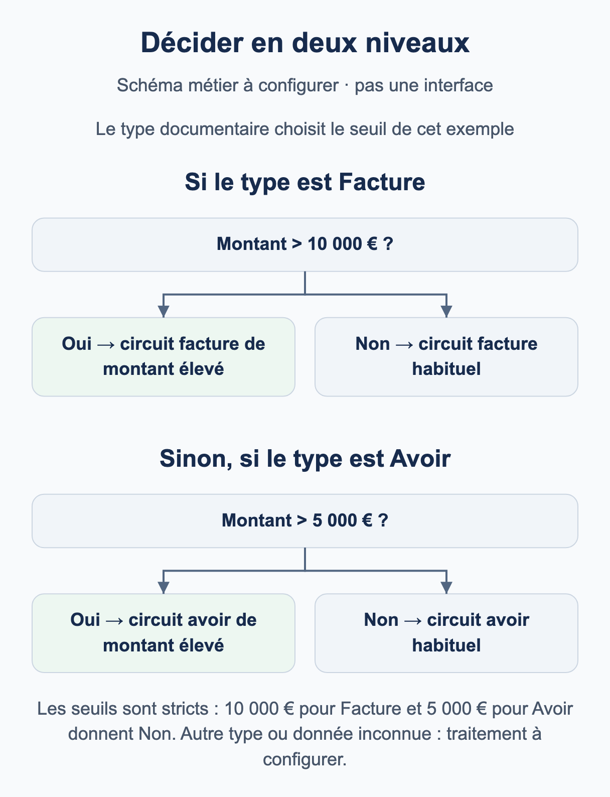<figcaption><p>Exemple imbriqué indépendant : le type documentaire sélectionne un test de montant. Les seuils sont stricts : 10 000 € pour une facture et 5 000 € pour un avoir ne satisfont pas le test « supérieur à ». Le traitement des autres types et des données inconnues doit être défini.</p></figcaption></figure>

<details>
<summary>Principe de décision imbriquée</summary>

```
IF condition1:
  IF condition2:
    → Action A
  ELSE:
    → Action B
ELSE:
  IF condition3:
    → Action C
  ELSE:
    → Action D
```

</details>

**Exemple :**

Lecture visuelle de cet exemple : [décisions imbriquées](#schema-decisions-imbriquees).

<details>
<summary>Exemple imbriqué : facture et avoir</summary>

```
IF Document_Type = "Invoice":
  IF Amount > €10,000:
    → Flux de factures de montant élevé
  ELSE:
    → Flux habituel de factures
ELSE IF Document_Type = "Credit Note":
  IF Amount > €5,000:
    → Flux d’avoirs de montant élevé
  ELSE:
    → Flux habituel d’avoirs
```

</details>

***

## Exemple complet de workflow

### Scénario : Matrice d'approbation des factures

**Règles métier :**

1. Avant tout routage par montant, arrêter et traiter les exceptions critiques, notamment un fournisseur bloqué. Un écart de commande n’est pas toujours critique : après sa résolution par les achats, le circuit peut continuer selon la configuration. Vérifier ensuite le type de document.
2. Pour une facture urgente, suivre le circuit accéléré décrit dans cet exemple plutôt que les tranches ordinaires.
3. Pour une facture non urgente avec un montant valide :
   * montant < 1 000 € : approbation automatique ;
   * 1 000 € ≤ montant < 10 000 € : approbation par la responsable ;
   * 10 000 € ≤ montant < 50 000 € : contrôle du fournisseur puis circuit du directeur ; un fournisseur non bloqué de moins de 180 jours nécessite l’accord du directeur, puis celui de la direction financière ; les autres fournisseurs passent aussi au contrôle du risque ;
   * montant ≥ 50 000 € : circuit de direction générale détaillé au chemin D.
4. Un montant absent ou invalide mène ici à un contrôle manuel explicitement configuré. C’est une politique de cet exemple, pas un comportement de repli automatique du produit.
5. Après création d’une tâche, attendre son résultat. Un refus arrête la chaîne et suit le traitement configuré ; un résultat en attente ne permet pas de poursuivre. La tâche de la direction financière n’est créée qu’après l’accord du directeur.

#### Schéma : tranches de montant

<figure>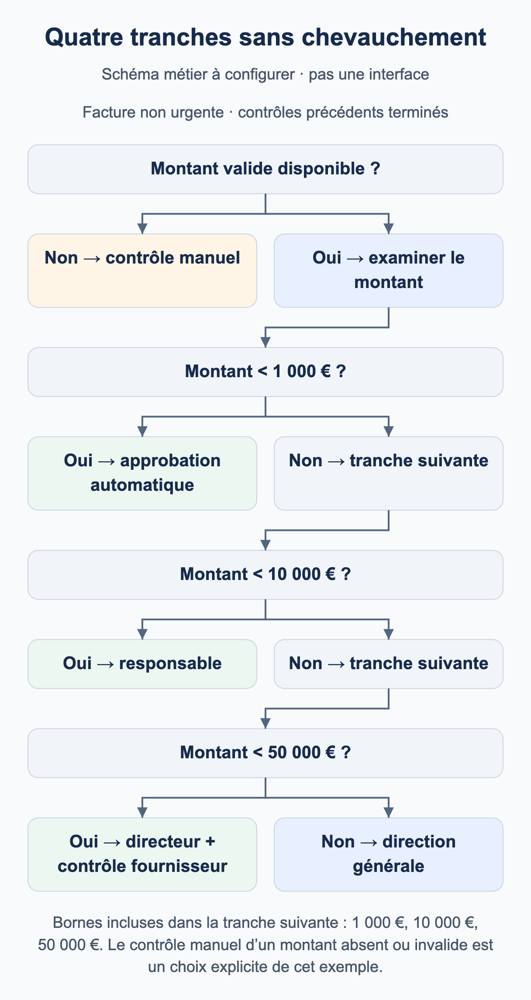<figcaption><p>Seuils du niveau 2 : moins de 1 000 € ; de 1 000 € inclus à 10 000 € exclu ; de 10 000 € inclus à 50 000 € exclu ; 50 000 € ou plus. Chaque test suit le résultat négatif du précédent. Le contrôle manuel pour un montant absent ou invalide doit être configuré explicitement.</p></figcaption></figure>

Les valeurs de 1 000 €, 10 000 € et 50 000 € appartiennent à la tranche supérieure. Les contrôles précédents, l’attente d’un résultat et les connexions entre chemins doivent être configurés et testés. Une tâche créée ne prouve ni son approbation ni l’export du document.

**Mise en œuvre illustrative :** adaptez les noms techniques et le pseudocode aux cartes réellement disponibles dans votre version. Ces blocs décrivent un exemple à configurer, plutôt qu’un fichier prêt à importer. Vérifiez les résultats d’exécution et les effets de votre configuration.

Lecture visuelle de cet exemple : [vue générale](#schema-vue-generale), [tranches de montant](#schema-tranches-de-montant), [analyse du fournisseur](#schema-analyse-du-fournisseur), [chemin automatique](#schema-chemin-automatique), [tâche de la responsable](#schema-tache-de-la-responsable), [direction générale](#schema-direction-generale), [fiche de règle](#schema-fiche-de-regle).

<details>
<summary>Pseudocode de la matrice complète</summary>

```
CONTRÔLE PRÉALABLE : Exceptions critiques
  IF Critical_Exception = TRUE OR Supplier_Status = "BLOCKED":
    → Arrêter et traiter l’exception avant l’orientation

ÉTAPE 1 : Vérifier les écarts avec la commande
  IF PO_Match_Status = "FAIL":
    → Orienter vers les achats pour résoudre l’écart avec la commande
    → Après résolution, continuer ci-dessous selon la configuration

ÉTAPE 1b : Vérifier le type de document
  IF Document_Type = "Credit Note":
    → Flux configuré pour les avoirs
  ELSE IF Document_Type is not "Invoice":
    → Flux configuré pour ce type de document
  ELSE:
    → Continuer ci-dessous

ÉTAPE 2 : Vérifier l’indicateur d’urgence
  IF Urgent_Flag = TRUE:
    → Ignorer les contrôles de montant
    → Adresser à l’approbateur de niveau le plus élevé
    → Définir la priorité = URGENT
    → Délai de 1 jour

ÉTAPE 3 : Orientation par montant (Invoice, hors urgence)
  IF Amount est absent ou invalide:
    → Vérification manuelle (politique explicite de l’exemple)
    → Ne pas entrer dans les tranches de montant

  ELSE IF Amount < €1,000:
    → Approuver automatiquement
    → Exporter immédiatement

  ELSE IF Amount < €10,000:
    → Créer une tâche pour le responsable
    → Priorité : Moyenne
    → Délai : 3 jours

  ELSE IF Amount < €50,000:
    VÉRIFIER le statut et le risque du fournisseur:
      IF Supplier_Status = "BLOCKED":
        → Arrêter et traiter l’exception
      ELSE IF Supplier_Age < 180 jours (nouveau):
        → Créer une tâche pour le directeur (tâche 1)
        → Attendre l’approbation positive du directeur avant de créer la tâche du CFO (tâche 2)
        → Attendre l’approbation positive du CFO avant de continuer
        → Tout rejet : arrêter la chaîne et traiter le rejet selon la configuration
        → En attente : ne pas continuer
        → Priorité : Élevée
        → Délai : 2 jours chacune
      ELSE IF Supplier_Risk_Rating = "HIGH":
        → Contrôles supplémentaires et approbation préalable du responsable
        → Attendre l’approbation positive du responsable avant celle du directeur
        → En attente ou rejet : ne pas poursuivre la chaîne d’approbation
      ELSE (fournisseur existant):
        → Créer une tâche pour le directeur uniquement
        → Priorité : Élevée
        → Délai : 2 jours

  ELSE (Amount ≥ €50,000):
    → Circuit d’approbation de la direction (voir le circuit D)
```

</details>

***

## Mise en œuvre étape par étape

### Étape 1 : Définir les cartes de condition

**Condition 1 : Seuil de montant**

#### Schéma : paramètres indépendants

<figure>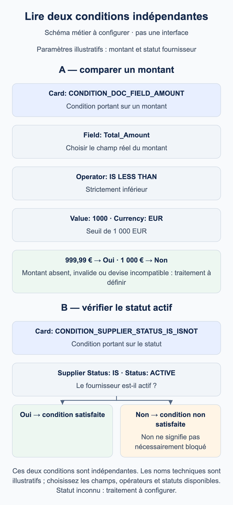<figcaption><p>Deux conditions indépendantes : un montant strictement inférieur à 1 000 EUR et un fournisseur de statut actif. L’égalité du montant donne Non ; un fournisseur non actif n’est pas nécessairement bloqué. Les paramètres techniques sont illustratifs et doivent être adaptés à la configuration réelle.</p></figcaption></figure>

<details>
<summary>Paramètres illustratifs : seuil de montant</summary>

```
Card: CONDITION_DOC_FIELD_AMOUNT
Field: Total_Amount
Operator: IS LESS THAN
Value: 1000
Currency: EUR
```

</details>

**Condition 2 : Vérification du type de document**

#### Schéma : types documentaires

<figure>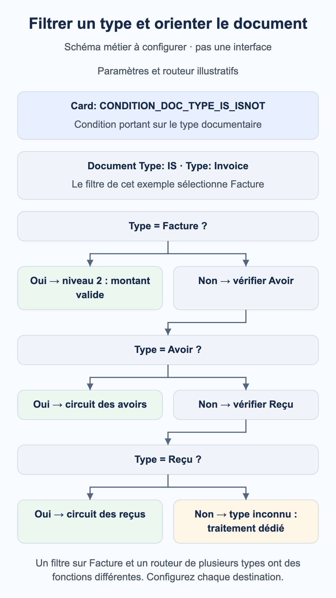<figcaption><p>Le filtre « Facture » et le routeur de types sont deux lectures complémentaires de cet exemple. Le routeur distingue facture, avoir, reçu et type inconnu. Les noms de carte et de workflow sont illustratifs ; chaque destination doit être configurée.</p></figcaption></figure>

<details>
<summary>Paramètres illustratifs : type documentaire</summary>

```
Card: CONDITION_DOC_TYPE_IS_ISNOT
Document Type: IS
Type: Invoice
```

</details>

**Condition 3 : Statut du fournisseur**

Lecture visuelle de cet exemple : [paramètres indépendants](#schema-parametres-independants).

<details>
<summary>Paramètres illustratifs : statut actif</summary>

```
Card: CONDITION_SUPPLIER_STATUS_IS_ISNOT
Supplier Status: IS
Status: ACTIVE
```

</details>

**Condition 4 : Vérification d'un nouveau fournisseur**

Pour cet exemple, calculez la date située 180 jours avant la date d’évaluation, puis comparez la première transaction à cette limite. « IS AFTER » signifie strictement après : une date égale à la limite donne Non. Choisissez le champ réel et calculez ou renseignez la date limite ; les noms de carte et de champ et le repère {{TODAY_MINUS_180_DAYS}} sont illustratifs. Vérifiez séparément que la date de première transaction est valide et ne dépasse pas la date d’évaluation ; configurez le traitement des valeurs absentes ou invalides.

#### Schéma : condition des 180 jours

<figure>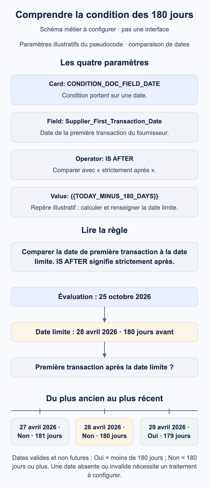<figcaption><p>Exemple de comparaison : au 25 octobre 2026, la date limite est le 28 avril 2026. « IS AFTER » exclut l’égalité : le 29 avril donne Oui, les 28 et 27 avril donnent Non. Les noms de carte et de champ et le repère {{TODAY_MINUS_180_DAYS}} sont illustratifs : choisissez le champ réel et calculez ou renseignez la date limite. Les dates sont supposées valides et non futures ; le traitement d’une date absente ou invalide reste à configurer.</p></figcaption></figure>

<details>
<summary>Copier les paramètres illustratifs de cet exemple</summary>

```
Card: CONDITION_DOC_FIELD_DATE
Field: Supplier_First_Transaction_Date
Operator: IS AFTER
Value: {{TODAY_MINUS_180_DAYS}}
```

</details>

**Référence du guide :** [Guide complet des cartes de condition](../and/condition-cards-complete-guide.md)

***

### Étape 2 : Construire l'arbre de décision

**Niveau 1 : Type de document**

Lecture visuelle de cet exemple : [types documentaires](#schema-types-documentaires).

<details>
<summary>Routeur illustratif des types documentaires</summary>

```
Workflow: "Invoice Processing"

IF Document_Type = "Invoice":
  → Continuer au niveau 2

ELSE IF Document_Type = "Credit Note":
  → Brancher vers "Credit Note Processing"

ELSE IF Document_Type = "Receipt":
  → Brancher vers "Receipt Processing"

ELSE:
  → Orienter vers le traitement "Unknown Document Type"
```

</details>

**Niveau 2 : Seuils de montant (factures non urgentes, montant valide)**

Lecture visuelle de cet exemple : [tranches de montant](#schema-tranches-de-montant).

<details>
<summary>Pseudocode des quatre tranches de montant</summary>

```
IF Amount < €1,000:
  → Brancher vers "Auto-Approve Path"

ELSE IF Amount < €10,000:
  → Brancher vers "Manager Approval Path"

ELSE IF Amount < €50,000:
  → Brancher vers "Director Approval Path"
  → Vérifier les conditions du niveau 3

ELSE (Amount ≥ €50,000):
  → Brancher vers "Executive Approval Path"
  → Double ou triple approbation requise
```

</details>

**Niveau 3 : Analyse du fournisseur (pour les factures de montant élevé)**

#### Schéma : analyse du fournisseur

<figure>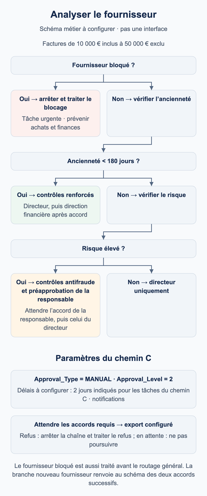<figcaption><p>Extrait du circuit fournisseur : traiter le blocage, puis l’ancienneté, puis le risque. La branche de moins de 180 jours renvoie au schéma des deux approbations successives. Les tâches, délais, notifications et actions du chemin C restent à configurer.</p></figcaption></figure>

<details>
<summary>Analyse du fournisseur : blocage, ancienneté et risque</summary>

```
IF Supplier_Status = "BLOCKED":
  → ARRÊTER le traitement
  → Créer une tâche urgente de remontée
  → Notifier les achats et les finances

ELSE IF Supplier_Age < 180 jours (nouveau):
  → Approbation supplémentaire requise
  → Ajouter le CFO à la chaîne d’approbation
  → Vérification renforcée

ELSE IF Supplier_Risk_Rating = "HIGH":
  → Contrôles supplémentaires requis
  → Vérification pour détecter la fraude
  → Approbation préalable du responsable ; attendre une approbation positive
  → Approbation du directeur ; attendre une approbation positive

ELSE:
  → Flux habituel de montant élevé
```

</details>

***

### Étape 3 : Créer les actions de routage

**Chemin A : Approbation automatique (montant < 1 000 €)**

#### Schéma : chemin automatique

<figure>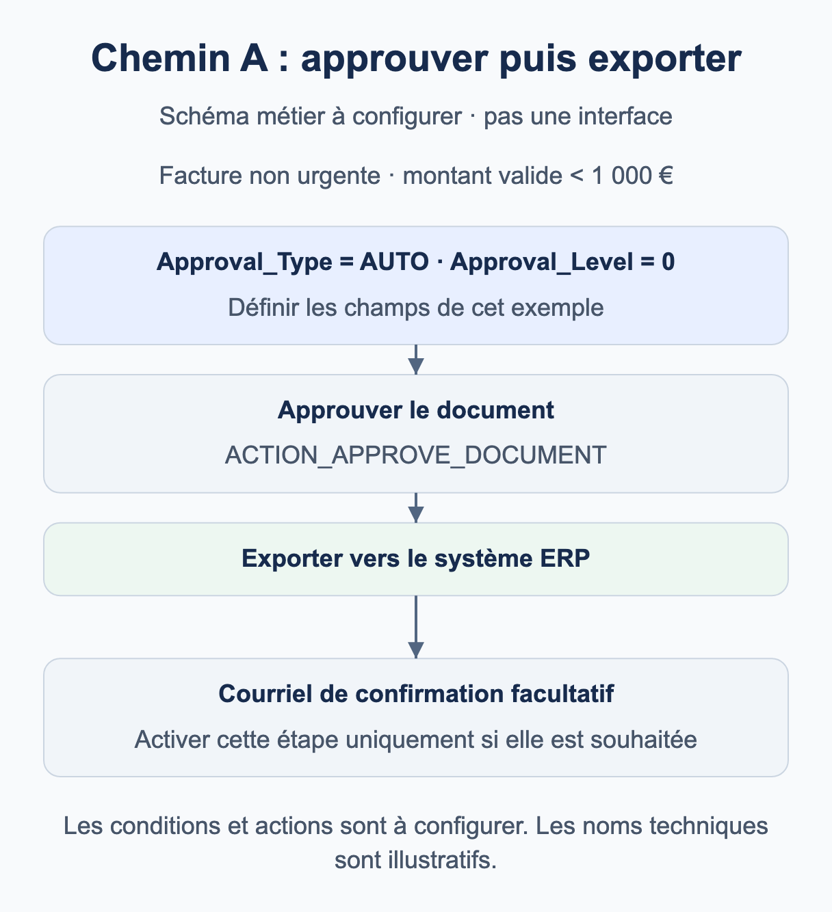<figcaption><p>Chemin A de l’exemple : définir les champs d’approbation, approuver le document puis exporter. Le courriel de confirmation est facultatif. Ce schéma décrit les actions à configurer, pas une exécution observée.</p></figcaption></figure>

<details>
<summary>Actions du chemin A : approbation automatique</summary>

```
Actions:
1. Définir le champ "Approval_Type" = "AUTO"
2. Définir le champ "Approval_Level" = "0"
3. ACTION_APPROVE_DOCUMENT
4. Exporter vers l’ERP
5. Envoyer un courriel de confirmation (facultatif)
```

</details>

**Chemin B : Approbation par la responsable (1 000 € ≤ montant < 10 000 €)**

#### Schéma : tâche de la responsable

<figure>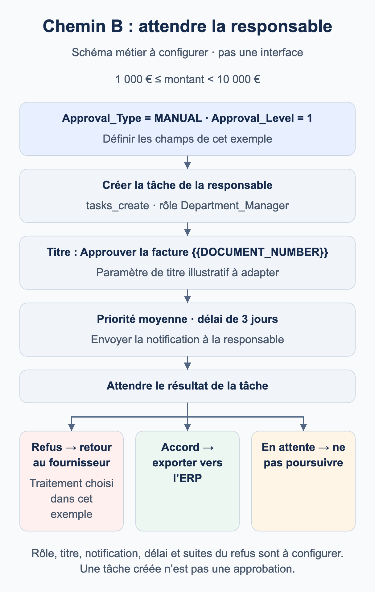<figcaption><p>Chemin B de l’exemple : créer une tâche pour la responsable, notifier et attendre son résultat. Seul l’accord permet l’export ; un refus renvoie ici au fournisseur. Le délai de trois jours et les destinataires sont des choix de configuration.</p></figcaption></figure>

<details>
<summary>Actions du chemin B : tâche de la responsable</summary>

```
Actions:
1. Définir le champ "Approval_Type" = "MANUAL"
2. Définir le champ "Approval_Level" = "1"
3. tasks_create:
   - Title: "Approuver la facture {{DOCUMENT_NUMBER}}"
   - Assign to: Department_Manager
   - Priority: Medium
   - Deadline: 3 jours
4. Envoyer une notification par courriel au responsable
5. Attendre la fin de la tâche
6. Si approuvé : exporter vers l’ERP
7. Si rejeté : retourner au fournisseur
```

</details>

**Chemin C : Approbation par le directeur (10 000 € ≤ montant < 50 000 €)**

Lecture visuelle de cet exemple : [analyse du fournisseur](#schema-analyse-du-fournisseur), [accords successifs](#schema-accords-successifs).

<details>
<summary>Actions du chemin C : contrôles et accords requis</summary>

```
Actions:
1. Définir le champ "Approval_Type" = "MANUAL"
2. Définir le champ "Approval_Level" = "2"
3. Vérifier Supplier_Age et Supplier_Risk_Rating:
   IF New (< 180 jours):
     - Créer la tâche 1 : approbation du directeur
     - Attendre l’approbation positive de la tâche 1 avant de créer la tâche 2 : approbation du CFO
     - Attendre l’approbation positive de la tâche 2 avant de continuer
     - En attente : ne pas continuer
     - Tout rejet : arrêter la chaîne et traiter le rejet selon la configuration
     - Les deux approbations positives sont requises
   ELSE IF Supplier_Risk_Rating = "HIGH":
     - Contrôles de risque supplémentaires et approbation préalable du responsable
     - Attendre l’approbation positive du responsable avant celle du directeur
     - Attendre l’approbation positive du directeur avant l’export
     - En attente ou rejet : arrêter la progression et traiter le résultat selon la configuration
   ELSE:
     - Créer une tâche : approbation du directeur uniquement
4. Priorité : Élevée
5. Délai : 2 jours pour les tâches d’approbation du circuit C ; configurer séparément les délais des contrôles de risque
6. Envoyer les notifications par courriel
7. Attendre leur achèvement
8. Si tout est approuvé : exporter
9. Si l’une est rejetée : retourner au fournisseur
```

</details>

#### Schéma : accords successifs

<figure>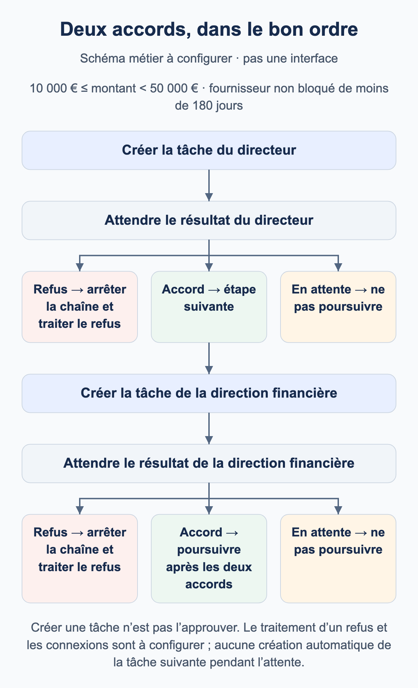<figcaption><p>Exemple d’approbations successives : créer la tâche de la direction financière seulement après l’accord du directeur, puis attendre son résultat. Poursuivre uniquement après les deux accords. Un refus arrête la chaîne et suit le traitement configuré ; un résultat en attente ne permet pas de continuer.</p></figcaption></figure>

Le traitement d’un refus peut, selon votre configuration, renvoyer le document au fournisseur ou suivre un autre circuit. Ce schéma impose seulement l’arrêt de la chaîne d’approbation concernée ; il ne prescrit pas un contrôle manuel dans tous les cas.

**Chemin D : Approbation par la direction générale (≥ 50 000 €)**

#### Schéma : direction générale

<figure>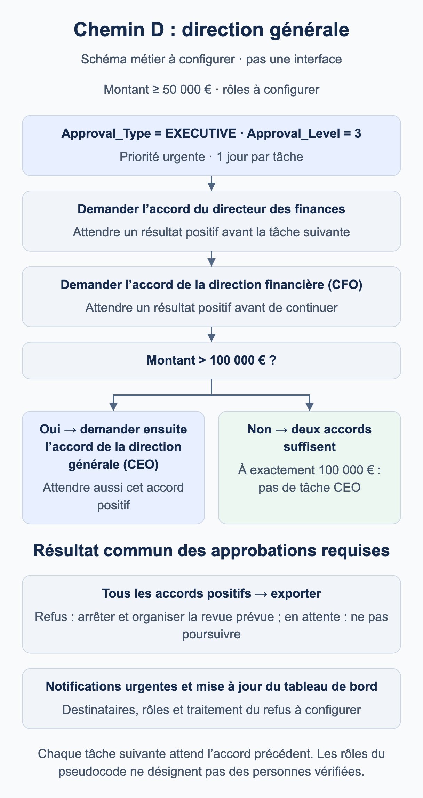<figcaption><p>Chemin D de l’exemple : deux approbations successives à partir de 50 000 €, puis une troisième seulement au-delà de 100 000 €. Chaque tâche suivante attend l’accord précédent. Les rôles, délais, notifications et suites d’un refus doivent être configurés.</p></figcaption></figure>

<details>
<summary>Actions du chemin D : direction générale</summary>

```
Actions:
1. Définir le champ "Approval_Type" = "EXECUTIVE"
2. Définir le champ "Approval_Level" = "3"
3. Approbations successives:
   - Tâche 1 : directeur des finances
   - Tâche 2 : CFO
   - Tâche 3 : CEO (si > €100,000)
4. Priorité : Urgente
5. Délai : 1 jour chacune
6. Envoyer les notifications urgentes
7. Mettre à jour le tableau de bord de la direction
8. Attendre toutes les approbations
9. Si tout est approuvé : exporter
10. Si l’une est rejetée : réunion de révision de la direction
```

</details>

***

## Modèles avancés de logique de décision

Les modèles suivants sont des variantes indépendantes. Le score, les seuils par service et les règles temporelles ne s’ajoutent pas automatiquement à la matrice complète précédente ; choisissez et configurez les règles applicables à votre cas.

### Modèle 1 : Routage basé sur un score

**Calculer un score de risque entier et router en conséquence dans cet exemple :**

#### Schéma : score de risque

<figure>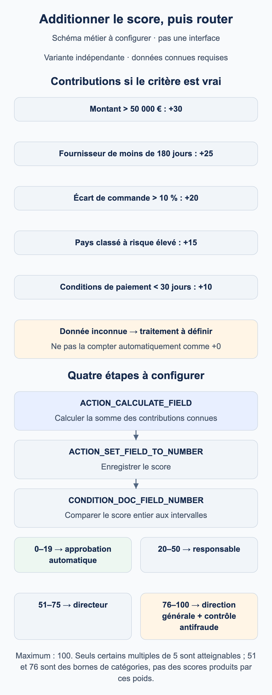<figcaption><p>Variante indépendante : les cinq contributions connues donnent un score entier de 0 à 100, puis un circuit. Les bornes 51 et 76 délimitent des catégories ; elles ne sont pas des scores effectivement produits par ces cinq poids. Définissez séparément le traitement des données inconnues.</p></figcaption></figure>

<details>
<summary>Calcul du score de risque et ses intervalles</summary>

```
Calcul du score de risque:
  Score = 0

  IF Amount > €50,000: Score += 30
  IF Supplier_Age < 180 jours: Score += 25
  IF PO_Variance > 10%: Score += 20
  IF Supplier_Country = "High Risk Country": Score += 15
  IF Payment_Terms < 30 jours: Score += 10

  Plage du score total : 0-100

Orientation:
  IF Score < 20: approbation automatique
  IF Score 20-50: approbation du responsable
  IF Score 51-75: approbation du directeur
  IF Score > 75: approbation de la direction + contrôle de fraude
```

</details>

**Mise en œuvre :**

Lecture visuelle de cet exemple : [score de risque](#schema-score-de-risque).

<details>
<summary>Mise en œuvre illustrative du score</summary>

```
1. ACTION_CALCULATE_FIELD: calculer le score de risque
2. ACTION_SET_FIELD_TO_NUMBER: enregistrer le score
3. CONDITION_DOC_FIELD_NUMBER: vérifier les seuils du score
4. Orienter selon le score
```

</details>

***

### Modèle 2 : Matrice basée sur le service

**Règles d'approbation différentes par service :**

#### Schéma : matrice par service

<figure>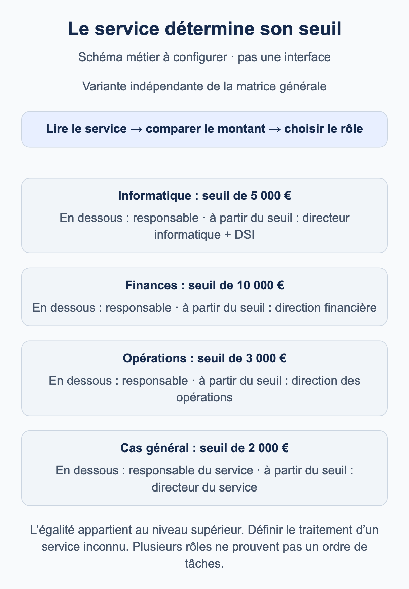<figcaption><p>Matrice indépendante par service : le seuil varie entre informatique, finances, opérations et cas général. L’égalité choisit la tranche supérieure. Les rôles multiples doivent être configurés ; leur présence ne prouve pas une approbation séquentielle.</p></figcaption></figure>

<details>
<summary>Matrice de seuils par service</summary>

```
Matrice par département:

  Département informatique:
    Amount < €5,000: responsable informatique
    Amount ≥ €5,000: directeur informatique + CIO

  Département des finances:
    Amount < €10,000: responsable financier
    Amount ≥ €10,000: CFO

  Département des opérations:
    Amount < €3,000: responsable des opérations
    Amount ≥ €3,000: COO

  Cas général:
    Amount < €2,000: responsable du département
    Amount ≥ €2,000: directeur du département
```

</details>

**Mise en œuvre :**

Lecture visuelle de cet exemple : [matrice par service](#schema-matrice-par-service).

<details>
<summary>Mise en œuvre illustrative de la matrice par service</summary>

```
1. Vérifier le champ Department
2. Selon le département, vérifier le seuil de montant
3. Orienter vers l’approbateur approprié
4. Seuils différents selon le département
```

</details>

***

### Modèle 3 : Logique basée sur le temps

**Règles différentes selon le moment :**

#### Schéma : variantes temporelles

<figure>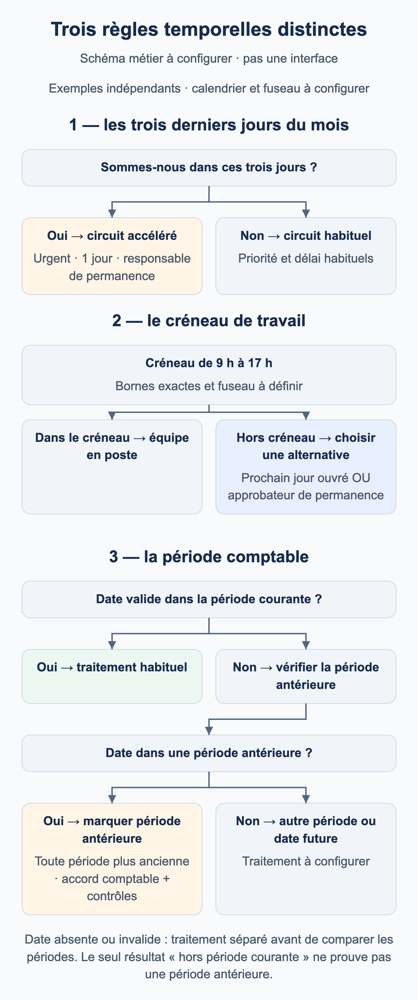<figcaption><p>Trois variantes indépendantes : fin de mois, créneau de travail et période comptable. File d’attente et permanence sont des alternatives à choisir. Une date hors période courante n’est pas nécessairement antérieure ; son cas doit être vérifié séparément.</p></figcaption></figure>

<details>
<summary>Trois variantes temporelles indépendantes</summary>

```
Traitement de fin de mois (3 derniers jours du mois):
  IF Today se situe dans les 3 derniers jours du mois:
    - Priorité : URGENT
    - Délai : 1 jour
    - Approbateur : responsable financier de permanence
    - Flux accéléré
  ELSE:
    - Priorité habituelle
    - Délai habituel
    - Flux habituel

Heures de travail et hors horaires:
  IF Time se situe entre 9 AM - 5 PM:
    - Affecter à l’équipe en service
  ELSE:
    - Mettre en attente pour le jour ouvré suivant
    - OR orienter vers l’approbateur de permanence

Période comptable (politique illustrative indépendante):
  IF Document_Date est absent ou invalide:
    - Traiter la date invalide ou inconnue selon la configuration
  ELSE IF Document_Date in Current_Fiscal_Period:
    - Traitement habituel
  ELSE IF Document_Date in toute Fiscal_Period before Current_Fiscal_Period:
    - Marquer comme "Prior Period"
    - Exiger une approbation comptable
    - Contrôles supplémentaires
  ELSE:
    - Période future ou autre : traiter selon la configuration
```

</details>

***

### Modèle 4 : Routage basé sur les exceptions

**Acheminer les exceptions séparément :**

#### Schéma : gravité des exceptions

<figure>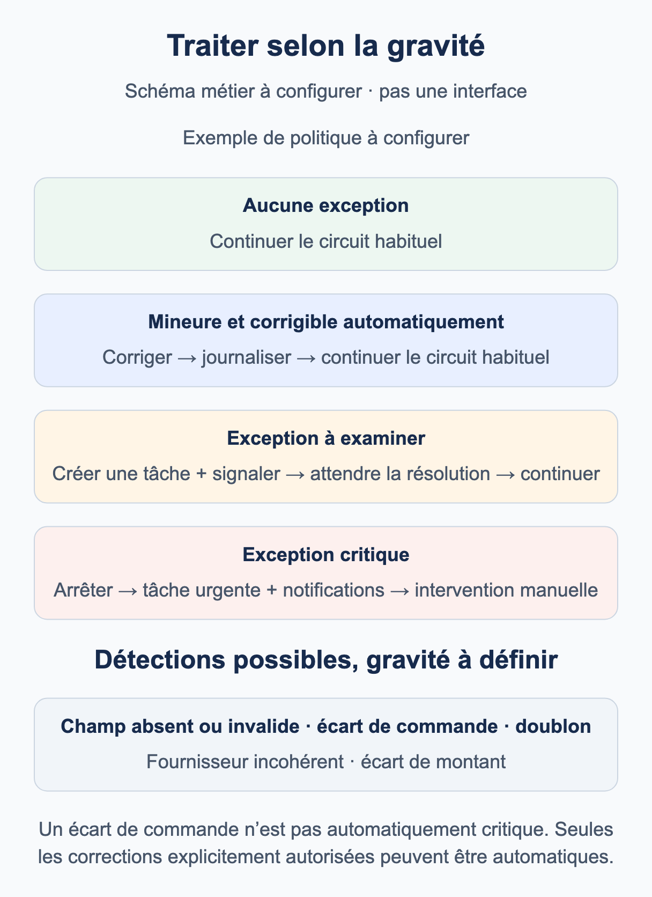<figcaption><p>Exemple de politique de gravité : continuer seulement après la correction prévue ou la résolution attendue. Une exception critique arrête le traitement. Les exemples de détection ne fixent pas, à eux seuls, leur gravité.</p></figcaption></figure>

<details>
<summary>Politique de gravité des exceptions</summary>

```
Détection des exceptions:

  Aucune exception:
    → Flux habituel

  Exception mineure (corrigeable automatiquement):
    → Corriger automatiquement
    → Journaliser la correction
    → Continuer le flux habituel

  Exception moyenne (nécessite une révision):
    → Créer une tâche de révision
    → Marquer le document
    → Après correction : continuer le flux

  Exception majeure (nécessite une remontée):
    → Arrêter le traitement
    → Créer une tâche urgente
    → Notifier plusieurs niveaux
    → Intervention manuelle requise

Types d’exception:
  - Champ obligatoire absent
  - Valeur de champ invalide
  - Écart avec la commande
  - Facture en double
  - Écart de fournisseur
  - Écart de montant
```

</details>

***

## Diagramme complet de logique de décision

Les graphiques présentent les étapes essentielles. L’arbre textuel ci-dessous conserve le détail technique de l’exemple ; ses destinations restent à configurer.

Les explications visuelles du même exemple sont : [vue générale](#schema-vue-generale), [tranches de montant](#schema-tranches-de-montant), [analyse du fournisseur](#schema-analyse-du-fournisseur), [accords successifs](#schema-accords-successifs), [chemin automatique](#schema-chemin-automatique), [tâche de la responsable](#schema-tache-de-la-responsable), [direction générale](#schema-direction-generale).

<details>
<summary>Consulter l’arbre textuel détaillé de l’exemple complet</summary>

```
LA FACTURE ARRIVE
│
├─ NIVEAU 1 : CONTRÔLE DES EXCEPTIONS
│  │
│  ├─ Exception critique ou fournisseur BLOCKED ?
│  │  (La gravité doit être configurée ; tout écart avec la commande n’est pas critique.)
│  │  │
│  │  ├─ OUI → Arrêter et faire remonter
│  │  │        Créer une tâche urgente
│  │  │        Notifier l’administrateur
│  │  │        → FIN (traitement des exceptions)
│  │  │
│  │  └─ NON → Continuer au niveau 2
│
├─ NIVEAU 2 : TYPE DE DOCUMENT
│  │
│  ├─ Type = Invoice ?
│  │  └─ OUI → Continuer au niveau 3
│  │
│  ├─ Type = Credit Note ?
│  │  └─ OUI → Brancher vers le flux des avoirs
│  │           → FIN (circuit des avoirs)
│  │
│  └─ Autre type ?
│     └─ OUI → Brancher vers le flux approprié
│              → FIN (circuit d’un autre type)
│
├─ NIVEAU 3 : CONTRÔLE D’URGENCE (pour les factures)
│  │
│  ├─ Urgent Flag = TRUE ?
│  │  │
│  │  ├─ OUI → Flux accéléré
│  │  │        Priorité : URGENT
│  │  │        Délai : 1 jour
│  │  │        Affecter à : approbateur de niveau le plus élevé
│  │  │        → FIN (circuit accéléré)
│  │  │
│  │  └─ NON → Continuer au niveau 4
│
├─ NIVEAU 4 : SEUILS DE MONTANT
│  │
│  ├─ Amount absent ou invalide ?
│  │  ├─ OUI → Vérification manuelle (politique explicite de l’exemple)
│  │  └─ NON → Continuer aux seuils de montant ci-dessous
│  │
│  ├─ Amount < €1,000 ?
│  │  │
│  │  ├─ OUI → CIRCUIT D’APPROBATION AUTOMATIQUE
│  │  │        Définir Approval_Type = "AUTO"
│  │  │        Approuver immédiatement
│  │  │        Exporter vers l’ERP
│  │  │        → FIN (approuvé automatiquement)
│  │  │
│  │  └─ NON → Continuer
│  │
│  ├─ Amount < €10,000 ?
│  │  │
│  │  ├─ OUI → CIRCUIT D’APPROBATION DU RESPONSABLE
│  │  │        Créer une tâche pour le responsable
│  │  │        Priorité : Moyenne
│  │  │        Délai : 3 jours
│  │  │        → ATTENDRE le résultat ; ne pas continuer s’il est en attente
│  │  │           → Approuvé : continuer le traitement configuré
│  │  │           → Rejeté : arrêter la chaîne et traiter le rejet selon la configuration
│  │  │
│  │  └─ NON → Continuer
│  │
│  ├─ Amount < €50,000 ?
│  │  │
│  │  ├─ OUI → CIRCUIT D’APPROBATION DU DIRECTEUR
│  │  │        Continuer au niveau 5 (contrôle du fournisseur)
│  │  │
│  │  └─ NON → Continuer
│  │
│  └─ Amount ≥ €50,000 ?
│     │
│     └─ OUI → CIRCUIT D’APPROBATION DE LA DIRECTION
│              Créer les tâches successives:
│              - Directeur des finances
│              - CFO
│              - CEO (si > €100,000)
│              Priorité : URGENT
│              Délai : 1 jour chacune
│              → ATTENDRE tous les résultats requis
│                 → Tous approuvés : continuer le traitement configuré
│                 → En attente : ne pas continuer
│                 → Tout rejet : arrêter la chaîne et traiter le rejet selon la configuration
│
├─ NIVEAU 5 : ANALYSE DU FOURNISSEUR (€10,000 ≤ Amount < €50,000)
│  │
│  ├─ Supplier Status = "BLOCKED" ?
│  │  │
│  │  ├─ OUI → BLOQUER ET FAIRE REMONTER
│  │  │        Arrêter le traitement
│  │  │        Créer une tâche urgente
│  │  │        Notifier les achats et les finances
│  │  │        → FIN (fournisseur bloqué)
│  │  │
│  │  └─ NON → Continuer
│  │
│  ├─ Supplier Age < 180 jours (nouveau) ?
│  │  │
│  │  ├─ OUI → DOUBLE APPROBATION REQUISE
│  │  │        Tâche 1 : directeur (2 jours)
│  │  │        → ATTENDRE la tâche 1
│  │  │           IF tâche 1 approuvée:
│  │  │             Tâche 2 : CFO (2 jours)
│  │  │             → ATTENDRE la tâche 2
│  │  │                → En attente : ne pas continuer
│  │  │                → Approuvé : continuer seulement après les deux approbations positives
│  │  │                → Rejeté : arrêter la chaîne et traiter le rejet selon la configuration
│  │  │           IF tâche 1 rejetée:
│  │  │             → Arrêter la chaîne et traiter le rejet selon la configuration
│  │  │           IF tâche 1 en attente:
│  │  │             → Ne pas créer la tâche 2 ni continuer
│  │  │
│  │  └─ NON → Continuer
│  │
│  ├─ Supplier Risk Rating = "HIGH" ?
│  │  │
│  │  ├─ OUI → APPROBATION RENFORCÉE
│  │  │        Contrôles supplémentaires de fraude
│  │  │        Approbation préalable du responsable, puis approbation du directeur
│  │  │        Attendre chaque résultat positif ; ne pas continuer en cas d’attente ou de rejet
│  │  │        Configurer les délais des contrôles de risque ; les tâches d’approbation du circuit C indiquent 2 jours
│  │  │        → FIN (circuit renforcé)
│  │  │
│  │  └─ NON → APPROBATION HABITUELLE DU DIRECTEUR
│  │           Créer une tâche pour le directeur
│  │           Priorité : Élevée
│  │           Délai : 2 jours
│  │           → ATTENDRE le résultat ; ne pas continuer s’il est en attente
│  │              → Approuvé : continuer le traitement configuré
│  │              → Rejeté : arrêter la chaîne et traiter le rejet selon la configuration
│  │
│  └─ [Analyse du fournisseur terminée]
│
└─ [Tous les niveaux de décision traités]
```

</details>

***

## Bonnes pratiques de configuration

### 1. Garder la logique claire et maintenable

La comparaison suivante présente une condition simple, une condition dense et une autre politique en étapes. Le schéma distingue leurs objectifs sans affirmer une équivalence.

#### Schéma : décisions maintenables

<figure>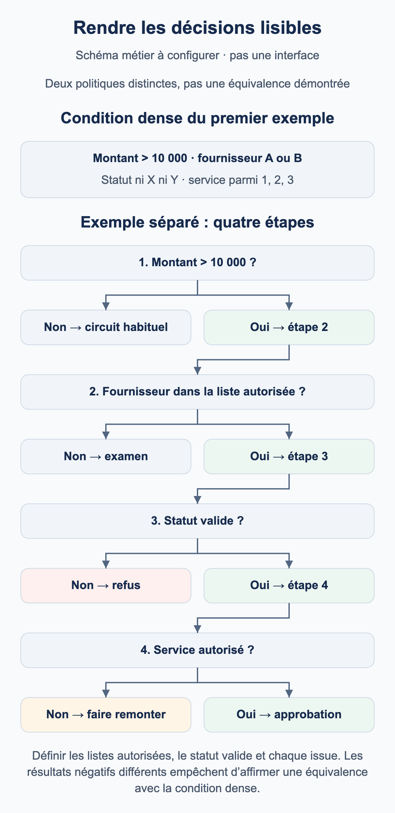<figcaption><p>L’exemple en quatre étapes illustre une politique distincte de la condition dense. Il rend chaque résultat négatif visible ; ce n’est pas une transformation logiquement équivalente démontrée. Définissez les listes autorisées et les traitements de sortie.</p></figcaption></figure>

✅ **Bon :**

Lecture visuelle de cet exemple : [condition simple](#schema-condition-simple).

<details>
<summary>Exemple simple : chemin de montant élevé</summary>

```
IF Amount > 10000:
  → Circuit de montant élevé
ELSE:
  → Circuit habituel
```

</details>

❌ **Mauvais (trop complexe) :**

Lecture visuelle de cet exemple : [décisions maintenables](#schema-decisions-maintenables).

<details>
<summary>Exemple de condition dense</summary>

```
IF (Amount > 10000 AND (Supplier = "A" OR Supplier = "B") AND NOT (Status = "X" OR Status = "Y") AND Department IN [1,2,3]):
  → Circuit complexe
```

</details>

**Autre exemple : une politique distincte en quatre étapes :**

Cet exemple distingue les issues à chaque étape. Il ne constitue pas une réécriture logiquement équivalente de la condition dense ci-dessus : les listes de fournisseurs, les statuts valides, les services autorisés et les traitements des résultats négatifs doivent être définis pour ce second exemple.

Lecture visuelle de cet exemple : [décisions maintenables](#schema-decisions-maintenables).

<details>
<summary>Autre exemple : politique en quatre étapes</summary>

```
Étape 1: IF Amount > 10000: continuer, ELSE: circuit habituel
Étape 2: IF Supplier in liste autorisée: continuer, ELSE: réviser
Étape 3: IF Status valide: continuer, ELSE: rejeter
Étape 4: IF Department autorisé: approuver, ELSE: faire remonter
```

</details>

***

### 2. Documenter la logique de décision

**Toujours inclure :**

* L'objectif de chaque point de décision
* La règle métier mise en œuvre
* Les résultats attendus
* La gestion des exceptions

**Exemple de documentation :**

#### Schéma : fiche de règle

<figure>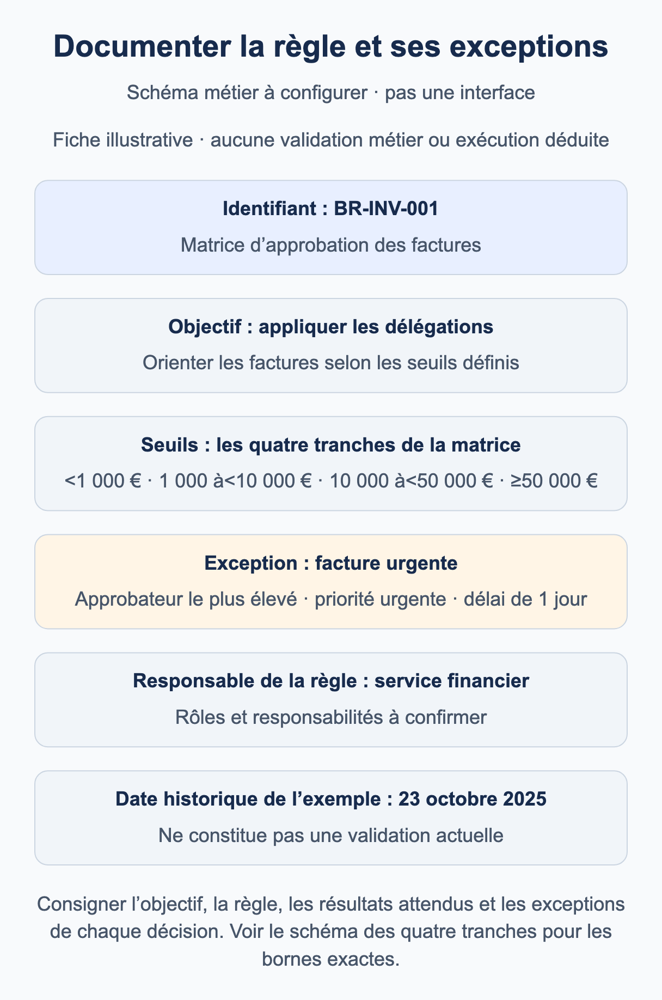<figcaption><p>Fiche illustrative de la règle BR-INV-001 : objectif, seuils, exception, responsable et date de référence. Le renvoi aux quatre tranches évite de dupliquer la règle ; cette fiche ne prouve ni son approbation ni son exécution.</p></figcaption></figure>

<details>
<summary>Fiche illustrative de la règle BR-INV-001</summary>

```
Point de décision : contrôle du seuil de montant
Règle de gestion : BR-INV-001 (matrice d’approbation des factures)
Objectif : orienter les factures selon les seuils de montant de la politique de l’entreprise
Seuils:
  < €1,000: approbation automatique (seuil approuvé par le CFO)
  €1,000 ≤ Amount < €10,000: approbation du responsable (matrice de délégation)
  €10,000 ≤ Amount < €50,000: approbation du directeur avec contrôles du fournisseur
  Amount ≥ €50,000: approbation de la direction
Exceptions : les factures urgentes passent directement au niveau le plus élevé
Mise à jour : 2025-10-23
Responsable : département des finances
```

</details>

***

### 3. Tester tous les chemins

**Matrice de tests proposés — résultats attendus, pas des tests exécutés :**

Ces résultats sont attendus et restent à vérifier dans votre configuration. Renseignez les résultats observés après vos tests.

| Cas de test | Montant  | Type        | Fournisseur | Chemin attendu  | Vérification |
| ----------- | -------- | ----------- | ----------- | --------------- | ------ |
| TC1         | €500     | Facture     | Existant    | Approbation automatique    | À tester      |
| TC2         | €5,000   | Facture     | Existant    | Responsable         | À tester      |
| TC3         | €15,000  | Facture     | Nouveau     | Directeur puis direction financière    | À tester      |
| TC4         | €60,000  | Facture     | Existant    | Direction générale       | À tester      |
| TC5         | €2,000   | Note de crédit | Existant    | Flux de travail de crédit | À tester      |
| TC6         | €100,000 | Facture     | Bloqué     | Arrêter et escalader | À tester      |
| TC7 | 999,99 € | Facture | Existant | Approbation automatique | À tester |
| TC8 | 1 000 € | Facture | Existant | Responsable | À tester |
| TC9 | 9 999,99 € | Facture | Existant | Responsable | À tester |
| TC10 | 10 000 € | Facture | Existant | Directeur + contrôle fournisseur | À tester |
| TC11 | 49 999,99 € | Facture | Existant | Directeur + contrôle fournisseur | À tester |
| TC12 | 50 000 € | Facture | Existant | Direction générale | À tester |
| TC13 | Absent ou invalide | Facture | Existant | Contrôle manuel choisi pour cet exemple | À tester |
| TC14 | 15 000 € | Facture | Nouveau | Directeur en attente : ne pas créer la tâche suivante | À tester |
| TC15 | 15 000 € | Facture | Nouveau | Refus du directeur ou de la direction financière : arrêter la chaîne et traiter le refus | À tester |
| TC16 | 15 000 € | Facture | Nouveau | Deux accords positifs : poursuivre le traitement prévu | À tester |

***

### 4. Surveiller les indicateurs de décision

**Suivre :**

* La répartition sur les chemins de décision
* Le taux d'approbation automatique
* Le taux de révision manuelle
* Le temps de traitement moyen par chemin
* Les taux d'exception
* L'utilisation des chemins

**Exemple fictif d’indicateurs :** les valeurs ci-dessous illustrent un rapport ; elles ne prouvent ni les performances actuelles ni l’exécution de ce workflow.

#### Schéma : indicateurs fictifs

<figure>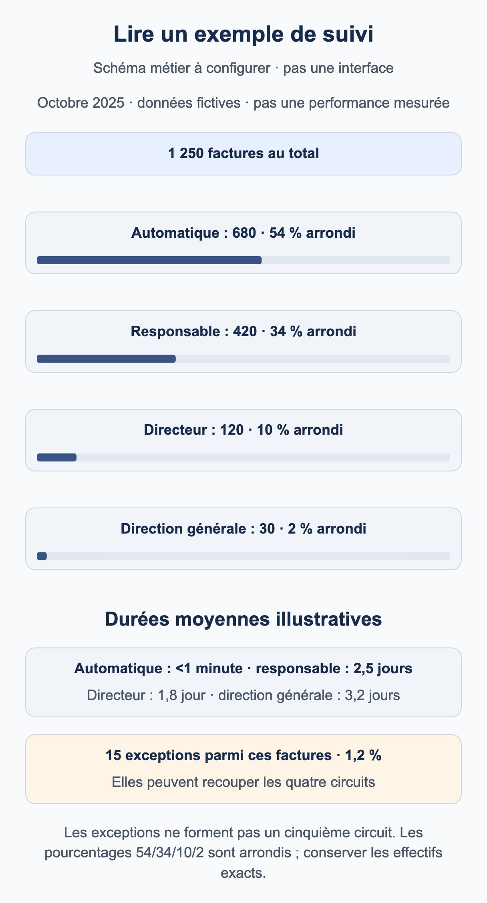<figcaption><p>Exemple fictif : les quatre circuits totalisent 1 250 factures. Les pourcentages de circuit sont arrondis. Les 15 exceptions, soit 1,2 %, peuvent concerner ces mêmes factures ; elles ne forment pas un cinquième circuit. Les durées ne sont pas des performances mesurées de DocBits.</p></figcaption></figure>

<details>
<summary>Exemple fictif de répartition et de durées</summary>

```
Mois : octobre 2025
Total des factures : 1250

Répartition des circuits de décision:
- Approbation automatique (< €1k): 680 (54 %)
- Circuit du responsable (€1k ≤ Amount < €10k): 420 (34 %)
- Circuit du directeur (€10k ≤ Amount < €50k): 120 (10 %)
- Circuit de la direction (Amount ≥ €50k): 30 (2 %)

Temps de traitement:
- Approbation automatique : < 1 minute
- Circuit du responsable : 2,5 jours en moyenne
- Circuit du directeur : 1,8 jours en moyenne
- Circuit de la direction : 3,2 jours en moyenne

Exceptions : 15 (1,2 %)
```

</details>

***

## Modèles connexes

### Modèles qui fonctionnent bien ensemble :

* [**Modèle de gestion des tâches**](task-management-pattern.md) – Créer des tâches en fonction des décisions
* [**Modèle d'intégration d'API**](api-integration-pattern.md) – Récupérer des données pour la prise de décision
* [**Modèle de rapprochement de commandes (PO Matching)**](po-matching-pattern.md) – Utiliser les résultats de commande dans les décisions
* [**Modèle de transformation des données**](data-transformation-pattern.md) – Transformer les données avant les décisions

***

## Guides connexes

### Prérequis

* [Guide complet des cartes de condition](../and/condition-cards-complete-guide.md) – Toutes les cartes de condition
* [Guide de manipulation des champs](../then/document-field/field-manipulation-guide.md) – Opérations sur les champs
* [Guide d'affectation](../then/assignee/assignment-user-guide.md) – Logique de routage

### Cartes connexes

* **CONDITION\_DOC\_FIELD\_AMOUNT** – [Guide des cartes de condition](../and/condition-cards-complete-guide.md)
* **CONDITION\_DOC\_TYPE\_IS\_ISNOT** – [Guide des cartes de condition](../and/condition-cards-complete-guide.md)
* **CONDITION\_SUPPLIER\_STATUS\_IS\_ISNOT** – [Guide des cartes de condition](../and/condition-cards-complete-guide.md)
* **ACTION\_ASSIGN\_TO\_USER** – [Guide d'affectation](../then/assignee/assignment-user-guide.md)
* **tasks\_create** – [Guide d'affectation des tâches](../then/task/task-assignment-guide.md)

### Prochaines étapes

* Créer des tâches : [Modèle de gestion des tâches](task-management-pattern.md)
* Ajouter un rapprochement complexe : [Modèle de rapprochement de commandes (PO Matching)](po-matching-pattern.md)
* Intégrer des API : [Modèle d'intégration d'API](api-integration-pattern.md)

***

**Métadonnées historiques de l’exemple :**

**Version du modèle :** 1.0 **Dernière mise à jour :** 23 octobre 2025 **Difficulté :** Moyenne **Temps estimé :** 30-45 minutes


[Exemples concrets de workflows utilisés en production](production-workflow-examples.md)
