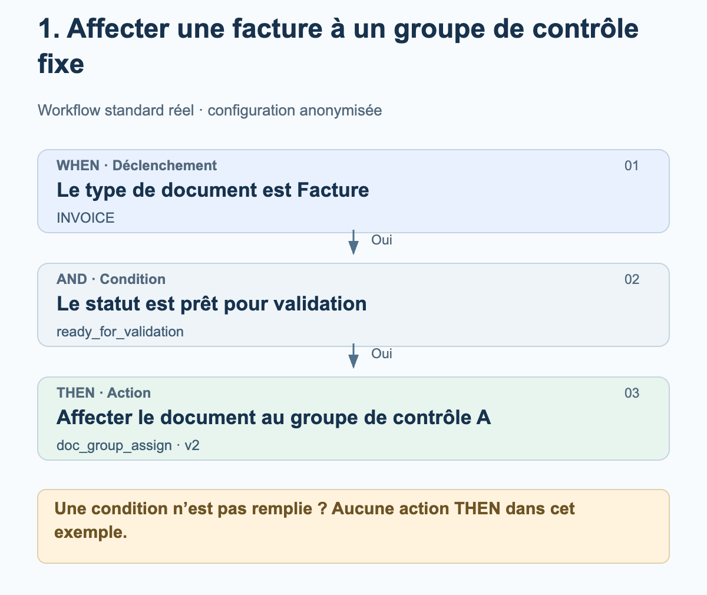
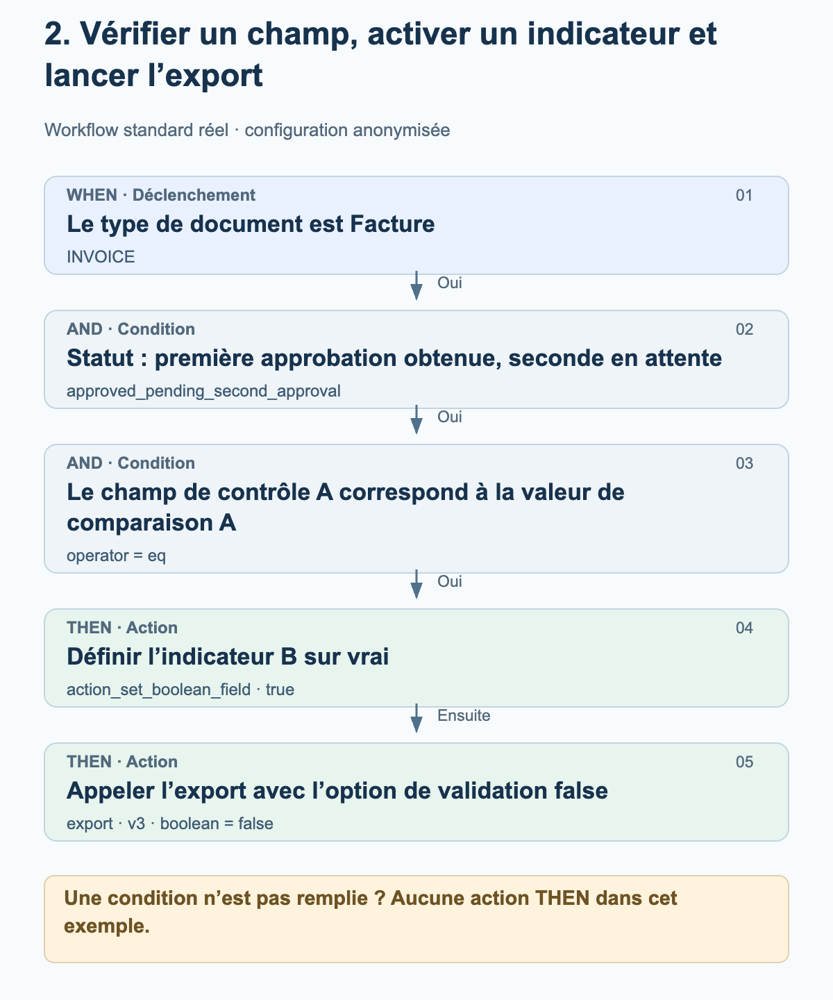
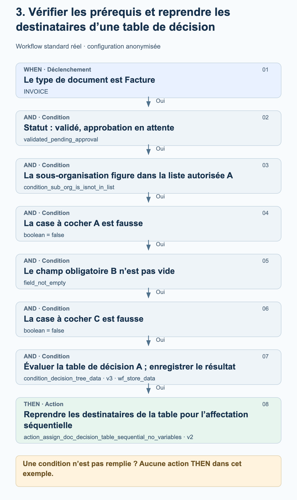

# Exemples concrets de workflows utilisés en production

Ces trois exemples proviennent de workflows standard activés dans l’environnement de production. Ils montrent l’ordre réellement configuré des cartes WHEN, AND et THEN. Les groupes, organisations, noms de champs, valeurs de comparaison et tables de décision sont remplacés par des désignations neutres. Les schémas expliquent la configuration ; ce ne sont pas des captures d’écran.

État au 27 octobre 2026. Les cartes utilisées, leurs versions, leurs paramètres et leur ordre ont été comparés aux configurations enregistrées de workflows exécutés avec succès en production. Un journal de workflow indiquant success ne confirme ni une approbation humaine ni la réception dans l’ERP. Aucun workflow n’a été modifié ni exécuté à des fins de test.

## Comment lire les schémas

Les exemples utilisent le mode standard. WHEN limite le périmètre au type de document ; toutes les conditions AND doivent être remplies avant l’exécution des actions THEN. Si une condition n’est pas remplie, aucune action THEN n’est exécutée dans ces exemples. Les flèches entre les actions indiquent leur ordre de configuration. Elles n’ajoutent aucune étape de contrôle de réussite ou d’approbation. Une exécution peut aussi se terminer par une erreur.

## 1. Affecter une facture à un groupe de contrôle fixe

Une facture doit être affectée pour vérification à un groupe prédéfini dès qu’elle atteint le statut prêt pour validation. Cet exemple ne nécessite aucune table de décision.

<figure><figcaption>Facture et statut attendu : le document est affecté au groupe de contrôle A prédéfini. Cette affectation ne constitue pas encore une approbation.</figcaption></figure>

Cartes et paramètres

| Phase / Carte | Paramètre dans l’exemple | Signification |
| --- | --- | --- |
| WHEN · condition_doc_type_is_isnot_list · v2 | operator = is; doc_type = INVOICE | Seules les factures remplissent cette condition. |
| AND · condition_doc_status_is_isnot · v2 | operator = is; status = ready_for_validation | Le document est prêt pour validation. |
| THEN · doc_group_assign · v2 | groups = Groupe de contrôle A | La version 2 utilise le groupe configuré. L’option relative aux tables de décision n’est pas déterminante dans cette version de la carte. |

### À vérifier avant de reproduire l’exemple

- Groupe de contrôle A est une désignation anonymisée. Choisissez un groupe de votre organisation et vérifiez ses responsabilités.
- Vérifiez séparément le type de document et le statut : une facture ayant un autre statut ne remplit pas les conditions de cet exemple.
- L’affectation d’un document, une tâche et une approbation sont des opérations différentes. Cette configuration ne contient que l’affectation.

## 2. Vérifier un champ, activer un indicateur et lancer l’export

Une facture ayant un statut d’approbation précis n’est traitée que si son champ de contrôle A correspond exactement à la valeur de comparaison A. Le workflow tente ensuite de définir l’indicateur B sur vrai, puis appelle l’export. Les noms des champs et la valeur de comparaison d’origine sont anonymisés.

<figure><figcaption>Le contrôle du champ permet l’exécution des deux actions. La définition de l’indicateur est appelée en premier ; l’appel d’export vient ensuite. Le statut et la désactivation des contrôles de validation font partie de cette configuration précise.</figcaption></figure>

Cartes et paramètres

| Phase / Carte | Paramètre dans l’exemple | Signification |
| --- | --- | --- |
| WHEN · condition_doc_type_is_isnot_list · v2 | operator = is; doc_type = INVOICE | Seules les factures remplissent cette condition. |
| AND · condition_doc_status_is_isnot · v2 | operator = is; status = approved_pending_second_approval | Le statut configuré indique que la première approbation a été obtenue et que la seconde est en attente. Il n’est pas remplacé ici par un statut d’approbation plus général. |
| AND · condition_docfield_operator_value · v2 | field_name = Champ de contrôle A; operator = eq; field_value = Valeur de comparaison A | Le contenu du champ doit correspondre à la valeur configurée ; cette condition ne vérifie pas simplement que le champ est renseigné. |
| THEN 1 · action_set_boolean_field · v2 | field_name = Indicateur B; boolean = true | Tente de définir le champ booléen configuré sur vrai. |
| THEN 2 · export · v3 | boolean = false | Lance l’export avec ignore_field_validation_errors = true et validate_po_match = false. Ici, false désactive les contrôles de validation, et non l’export. |

### À vérifier avant de reproduire l’exemple

- L’option d’export false est un paramètre propre à un client, et non une recommandation générale. Avant de reproduire l’exemple, vérifiez notamment la validation des champs, le rapprochement avec la commande et les exigences d’approbation.
- Aucune condition supplémentaire n’est configurée entre la définition de l’indicateur et l’export. L’ordre seul ne garantit pas la réussite de la première action ; les exceptions et les erreurs d’action doivent être vérifiées séparément.
- Le workflow ne comporte aucune étape d’attente d’une seconde approbation humaine. Une exécution réussie du workflow ne remplace pas une preuve de réception dans l’ERP.

## 3. Vérifier les prérequis et reprendre les destinataires d’une table de décision

Une facture ne doit être affectée à partir d’une table de décision que si l’organisation, le statut, deux cases à cocher et un champ obligatoire remplissent les conditions. Le workflow enregistre les données renvoyées par la table de décision afin que l’affectation séquentielle qui suit puisse les utiliser.

<figure><figcaption>Les six conditions AND doivent être remplies. Les données renvoyées par la table de décision sont enregistrées, puis utilisées pour l’affectation séquentielle du document. Le schéma n’invente aucun destinataire ni niveau d’approbation.</figcaption></figure>

Cartes et paramètres

| Phase / Carte | Paramètre dans l’exemple | Signification |
| --- | --- | --- |
| WHEN · condition_doc_type_is_isnot_list · v2 | operator = is; doc_type = INVOICE | Limite l’exemple aux factures. |
| AND 1 · condition_doc_status_is_isnot · v2 | operator = is; status = validated_pending_approval | Le document est validé ; une approbation est en attente. |
| AND 2 · condition_sub_org_is_isnot_in_list · v2 | operator = is; sub_org_id = Liste autorisée A | Seules les sous-organisations configurées entrent dans le périmètre. |
| AND 3 · condition_checkbox_is · v2 | field_name = Case à cocher A; boolean = false | La première case à cocher configurée doit être fausse. |
| AND 4 · condition_docfield_status · v2 | field_name = Champ obligatoire B; field_status = field_not_empty | Le champ configuré doit être renseigné. |
| AND 5 · condition_checkbox_is · v2 | field_name = Case à cocher C; boolean = false | La seconde case à cocher doit également être fausse. |
| AND 6 · condition_decision_tree_data · v3 | decision_table = Table de décision A; store_data = wf_store_data | La table est évaluée pour le document. Les données renvoyées sont enregistrées pour les cartes suivantes. Le champ boolean supplémentaire, plus ancien, est vide et ne pilote pas cette version. |
| THEN · action_assign_doc_decision_table_sequential_no_variables · v2 | aucune variable propre à la carte | Reprend les destinataires des données enregistrées renvoyées par la table pour l’affectation séquentielle. Les destinataires et les priorités dépendent de la table. |

### À vérifier avant de reproduire l’exemple

- Case à cocher A, Champ obligatoire B et Case à cocher C désignent trois champs configurés distincts. Ces désignations neutres remplacent les noms d’origine.
- Vérifier qu’un champ n’est pas vide ne confirme pas encore la validité métier de son contenu.
- Vérifiez la table de décision réelle, y compris ses destinataires et ses priorités. Ses règles ne sont pas publiées ici ; aucun seuil de montant ni rôle n’est ajouté.
- Une évaluation réussie de la table ne garantit pas encore des destinataires exploitables. L’affectation qui suit nécessite des utilisateurs ou des groupes valides dans les données renvoyées.
- Une affectation séquentielle ne prouve pas qu’une approbation humaine a été obtenue. Ce workflow ne contient aucun appel d’export.

## De l’exemple à votre propre configuration

Définissez les champs, groupes et tables de décision adaptés dans votre propre organisation. Ne considérez pas les désignations neutres comme des champs existants du produit. Vérifiez chaque cas où une condition est remplie ou non, ainsi que les erreurs d’action, dans un environnement de test adapté. Vérifiez les approbations et les exports à partir de leurs résultats réels ; n’activez un workflow qu’après validation métier.

[Exemples réels de workflows Advanced en production](advanced-production-workflow-examples.md)
