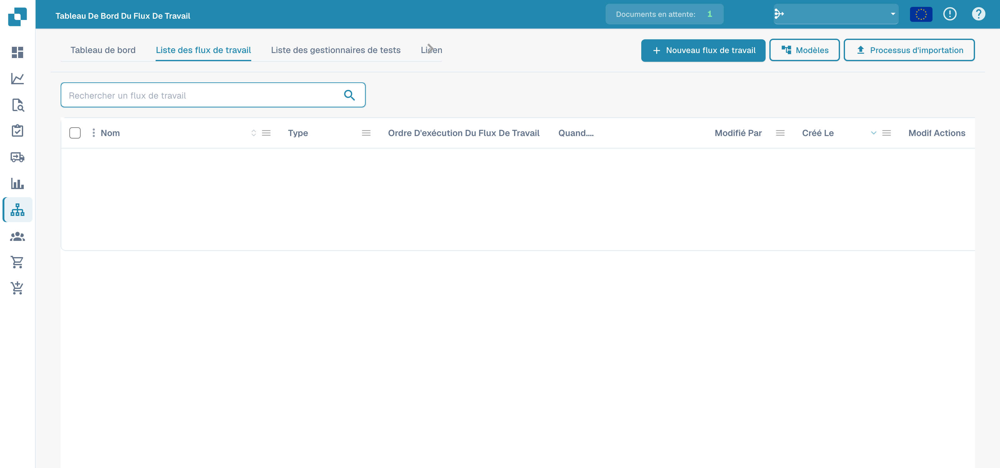
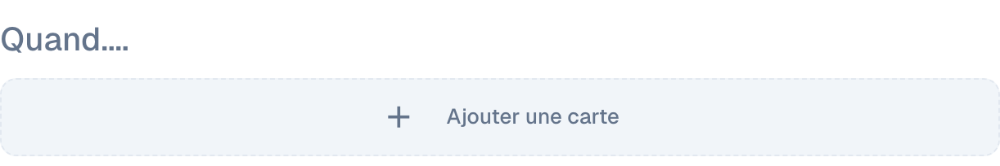
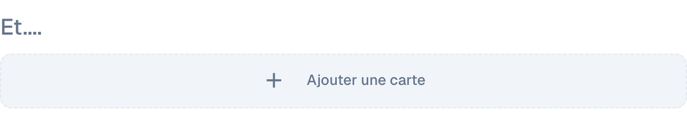
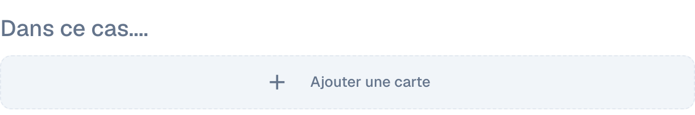
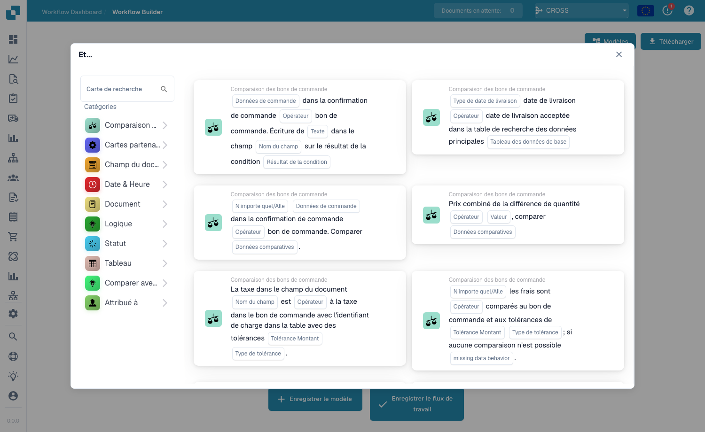

# Flux standard

Le constructeur **Flux standard** utilise des cartes pour automatiser le traitement des documents. Dans la disposition simple illustrée ici, le workflow comporte trois groupes : **Quand....** pour le déclenchement, **Et....** pour les conditions supplémentaires et **Dans ce cas....** pour les actions. Lorsque le document satisfait le déclencheur et les conditions supplémentaires, les actions s’exécutent dans l’ordre défini.

## Créer et tester un Standard Workflow 

Créez un Standard Workflow complet dans la véritable interface DocBits : sélectionnez la facture, vérifiez son numéro et un montant supérieur à 1000, affectez un vérificateur et modifiez le statut. Enregistrez la règle, exécutez trois scénarios de test et confirmez le résultat réel sur le document.



[Regarder avec les sous-titres](https://docbits-videos.fra1.cdn.digitaloceanspaces.com/settings-assistant/standard-workflow-admin/v2/fr.html) · [Ouvrir la vidéo](https://docbits-videos.fra1.cdn.digitaloceanspaces.com/settings-assistant/standard-workflow-admin/v2/fr.mp4) · [Sous-titres (WebVTT)](https://docbits-videos.fra1.cdn.digitaloceanspaces.com/settings-assistant/standard-workflow-admin/v2/fr.vtt) · [Transcription](https://docbits-videos.fra1.cdn.digitaloceanspaces.com/settings-assistant/standard-workflow-admin/v2/fr.txt) · 4:10

Chapitres et transcription

| Chapitre | Début |
| --- | --- |
| Rôle de ce workflow | [0:00](https://docbits-videos.fra1.cdn.digitaloceanspaces.com/settings-assistant/standard-workflow-admin/v2/fr.mp4#t=0.000) |
| Nommer le workflow | [0:14](https://docbits-videos.fra1.cdn.digitaloceanspaces.com/settings-assistant/standard-workflow-admin/v2/fr.mp4#t=14.917) |
| When : type de document | [0:25](https://docbits-videos.fra1.cdn.digitaloceanspaces.com/settings-assistant/standard-workflow-admin/v2/fr.mp4#t=25.792) |
| And : numéro de facture | [0:38](https://docbits-videos.fra1.cdn.digitaloceanspaces.com/settings-assistant/standard-workflow-admin/v2/fr.mp4#t=38.292) |
| And : montant supérieur à 1000 | [0:52](https://docbits-videos.fra1.cdn.digitaloceanspaces.com/settings-assistant/standard-workflow-admin/v2/fr.mp4#t=52.833) |
| Then : affecter un vérificateur | [1:12](https://docbits-videos.fra1.cdn.digitaloceanspaces.com/settings-assistant/standard-workflow-admin/v2/fr.mp4#t=72.500) |
| Then : modifier le statut | [1:28](https://docbits-videos.fra1.cdn.digitaloceanspaces.com/settings-assistant/standard-workflow-admin/v2/fr.mp4#t=88.542) |
| Vérifier et enregistrer | [1:41](https://docbits-videos.fra1.cdn.digitaloceanspaces.com/settings-assistant/standard-workflow-admin/v2/fr.mp4#t=101.792) |
| Vérifier la règle enregistrée | [1:58](https://docbits-videos.fra1.cdn.digitaloceanspaces.com/settings-assistant/standard-workflow-admin/v2/fr.mp4#t=118.958) |
| Préparer le scénario de test | [2:11](https://docbits-videos.fra1.cdn.digitaloceanspaces.com/settings-assistant/standard-workflow-admin/v2/fr.mp4#t=131.667) |
| Exécuter le cas positif | [2:34](https://docbits-videos.fra1.cdn.digitaloceanspaces.com/settings-assistant/standard-workflow-admin/v2/fr.mp4#t=154.542) |
| Tester la valeur limite | [2:55](https://docbits-videos.fra1.cdn.digitaloceanspaces.com/settings-assistant/standard-workflow-admin/v2/fr.mp4#t=175.000) |
| Tester un autre numéro de facture | [3:13](https://docbits-videos.fra1.cdn.digitaloceanspaces.com/settings-assistant/standard-workflow-admin/v2/fr.mp4#t=193.917) |
| Vérifier le résultat sur le document | [3:33](https://docbits-videos.fra1.cdn.digitaloceanspaces.com/settings-assistant/standard-workflow-admin/v2/fr.mp4#t=213.042) |
| Activer la règle testée | [3:53](https://docbits-videos.fra1.cdn.digitaloceanspaces.com/settings-assistant/standard-workflow-admin/v2/fr.mp4#t=233.042) |

**Rôle de ce workflow**

Bon, je crée un Standard Workflow complet pour une facture de formation. Au-dessus de mille, elle doit être confiée à un vérificateur et attendre une approbation. Un numéro de facture dédié limite cet exemple au document prévu.

**Nommer le workflow**

Dans la liste, je clique sur Nouveau workflow. Je lui donne un nom clair avant d’ajouter des cartes. Cette organisation ouvre directement le concepteur Standard.

**When : type de document**

Dans Quand, j’ouvre la bibliothèque et choisis la carte du type de document. Je règle l’opérateur sur Est et sélectionne Facture. Cela définit le type de document contrôlé par la règle.

**And : numéro de facture**

Dans Et, j’ajoute une condition sur un champ du document. Je sélectionne invoice_id, choisis Égal et saisis notre numéro de facture de formation. Cette condition limite la démonstration à la facture prévue.

**And : montant supérieur à 1000**

Une autre condition Et contrôle total_amount. Pour le montant, je sélectionne l’opérateur Supérieur à. Je saisis la valeur mille. Un montant exactement égal à mille ne satisfait pas cette condition. Le montant et la devise doivent correspondre au document de formation.

**Then : affecter un vérificateur**

Dans Alors, je choisis l’action qui affecte le document à un utilisateur. Je sélectionne Docs User A2, notre vérificateur de test documentaire. Cette action affecte le document sans créer de notification par courriel.

**Then : modifier le statut**

La deuxième action change le statut en Attente d’approbation. Je règle Déclencher les workflows sur faux. Cet exemple ne nécessite pas de nouvelle exécution lorsque sa propre action change le statut.

**Vérifier et enregistrer**

Avant d’enregistrer, je relis toute la règle. Le type Facture, le numéro exact et un montant supérieur à mille doivent correspondre. Les deux actions suivent ensuite l’ordre affiché. J’enregistre le workflow et vérifie la confirmation.

**Vérifier la règle enregistrée**

De retour dans la liste, je vérifie le workflow enregistré et son état actif. L’enregistrement peut déjà activer un workflow. Je désactive cette règle de formation pendant la préparation des tests.

**Préparer le scénario de test**

Dans Test Manager, j’ajoute un scénario et sélectionne notre workflow enregistré. Je donne un nom clair et charge les fichiers JSON d’entrée et de résultat attendu. L’entrée contient notre numéro de facture, le montant mille sept cent quatre-vingt-cinq et le statut Prêt pour validation. Le statut attendu est En attente d’approbation.

**Exécuter le cas positif**

J’envoie le scénario, puis choisis Exécuter le test dans son menu. Je rouvre la liste pour charger le résultat enregistré. Le résultat réussi compare le statut attendu du document. Dans ce sandbox, le panneau des cartes n’affiche pas correctement les messages détaillés, alors je vérifie aussi le document réel.

**Tester la valeur limite**

Je teste ensuite exactement mille. Le numéro et le type de document correspondent toujours, mais Supérieur à doit être faux. Dans cette entrée de test, le statut attendu reste Prêt pour validation. J’enregistre et exécute ce scénario distinct, puis vérifie son résultat.

**Tester un autre numéro de facture**

Un autre scénario utilise un numéro de facture différent et un montant supérieur à mille. Le montant seul ne doit pas déclencher les actions. J’enregistre et lance ce scénario avec le statut initial comme résultat attendu. Ces cas négatifs contrôlent les limites de la règle.

**Vérifier le résultat sur le document**

Dans le tableau de bord, je retrouve notre document de formation. Son statut réel est En attente d’approbation et il est affecté à Docs User A2. Le résultat visible des deux actions est donc confirmé. Cette modification provient du test manuel et ne prouve pas un traitement automatique.

**Activer la règle testée**

Dans la liste des workflows, j’active la règle testée et vérifie son interrupteur. Avant la mise en service, je contrôle les conditions, les destinataires et les résultats. Après la démonstration, je désactive de nouveau cette règle de formation.

## Comment y accéder

Ouvrez **Tableau de bord des flux → Liste des flux**, puis cliquez sur **Ajouter un flux de travail** pour créer un nouveau workflow Standard, ou cliquez sur un workflow existant pour le modifier.

<figure><figcaption>
Liste des workflows et commandes d’import.
</figcaption></figure>

## Le modèle When / And / Then

Les trois vues partielles suivantes montrent un workflow Standard encore vierge et non enregistré. Elles illustrent la structure de l’éditeur, avant l’ajout et la configuration des cartes.

* **Quand....** — le déclencheur qui démarre le workflow, par exemple selon le type de document.
* **Et....** — les conditions supplémentaires qui doivent également être vraies, par exemple l’appartenance du document à une sous-organisation. Si ce groupe est vide, les actions s’exécutent à chaque correspondance de la carte de déclenchement.
* **Dans ce cas....** — les actions à effectuer, par exemple affecter le document à un utilisateur, créer une tâche, appeler une API ou envoyer un courriel.

<figure><figcaption>
Groupe « Quand.... » du concepteur Standard, encore vide : ajoutez la carte de déclenchement. Aucun workflow n’est enregistré dans cette vue.
</figcaption></figure>

<figure><figcaption>
Groupe « Et.... » du concepteur Standard, encore vide : ajoutez des conditions supplémentaires si nécessaire.
</figcaption></figure>

<figure><figcaption>
Groupe « Dans ce cas.... » du concepteur Standard, encore vide : ajoutez les actions à effectuer.
</figcaption></figure>

## Ajouter des cartes

Cliquez sur **Ajouter une carte** dans n'importe quel groupe pour ouvrir la bibliothèque de cartes. Les cartes sont organisées par catégorie afin que vous puissiez trouver le bloc de construction dont vous avez besoin :

<figure><figcaption>
La bibliothèque <strong>Add Card</strong> — cartes de condition, cartes de comparaison, cartes d'action et plus encore, regroupées par catégorie.
</figcaption></figure>

Enregistrez avec **Enregistrer le flux de travail**, ou enregistrez la disposition comme modèle réutilisable avec **Enregistrer le modèle**.

## Étapes suivantes

- Découvrez ce que fait chaque carte dans la section **Cartes**.
- Combinez des cartes en solutions éprouvées avec les **Guides des modèles de flux**.
- Pour des flux avec branches et chemins parallèles (Wait ALL / Wait ANY / OR), utilisez le constructeur **Flux de travail avancé**.
