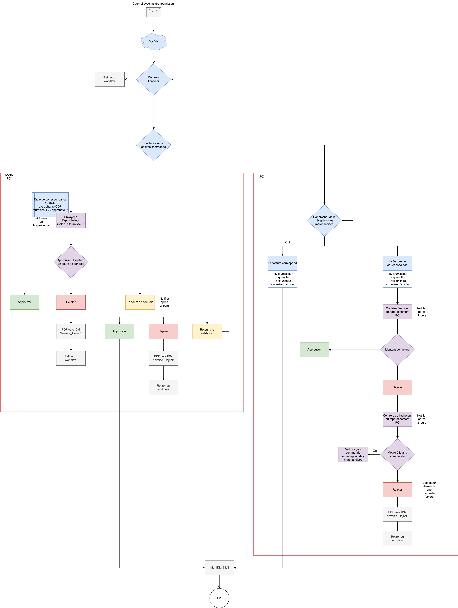

# Flux de travail standard

Ce schéma présente un exemple de traitement des factures avec et sans commande. Il décrit des rôles et des échanges à adapter à votre organisation ; il ne constitue pas une règle active ni une preuve d’exportation ou de paiement.

<figure><figcaption>
Exemple de workflow de factures avec et sans commande. Les circuits d’approbation, le délai de deux jours et la connexion ERP font partie de cet exemple et doivent correspondre à votre configuration.
</figcaption></figure>

## Réception et contrôle financier

La facture entre dans DocBits, puis la finance examine les informations et choisit le circuit avec commande ou sans commande. Les champs et les règles de validation doivent être configurés pour le processus retenu.

## Facture sans commande

Le circuit d’approbation utilise la correspondance entre le fournisseur et les approbateurs, notamment les informations transmises par BOD et les champs CDF de cet exemple. Une décision peut approuver, rejeter ou laisser la facture en cours d’examen. Les contrôles de validation peuvent renvoyer le document pour correction.

Le délai de **deux jours** et les notifications du schéma appartiennent à cet exemple ; ils ne définissent pas un délai universel du produit. Le chemin de rejet comporte le message `Invoice_Reject` vers IDM et le retrait du circuit illustré. Vérifiez les conditions et les destinataires avant de l’activer.

## Facture avec commande

Le rapprochement utilise la commande et les réceptions de marchandises, avec l’identifiant du fournisseur, la quantité, le prix unitaire et la référence d’article. En cas d’écart, la finance et l’acheteur examinent le document. Selon le cas, ils corrigent les données de commande ou de réception, demandent une nouvelle facture, ou rejettent la facture.

Après correction, les contrôles doivent être répétés. Une simple affectation à un acheteur ne vaut ni approbation ni résolution de l’écart.

## Validation et intégration

Le chemin final du schéma transmet les informations validées vers **Infor IDM** et **LN**. Les connexions, les messages et la gestion des erreurs doivent correspondre à votre installation. Contrôlez le résultat dans chaque système cible ; la présence d’une flèche dans ce schéma ne garantit pas l’exportation, l’écriture comptable ou le paiement.
