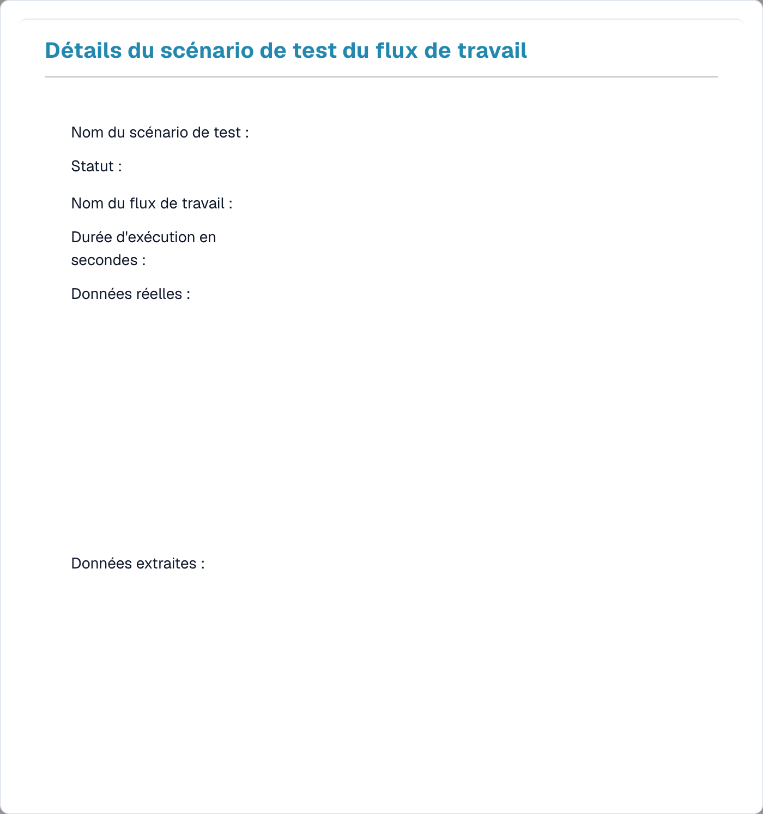

# Gestion des tests

Le **Gestion des tests** vous permet d'enregistrer des **scénarios de test** réutilisables pour vos workflows et de les exécuter ensemble — afin de confirmer qu'un workflow se comporte toujours correctement après une modification. Il fonctionne aussi bien pour les workflows Standard que Avancés.

Ouvrez-le depuis **Tableau de bord des flux → Liste des tests**.

<figure><figcaption>
La Test Manager List — chaque scénario enregistré affiche un résultat réussite/échec.
</figcaption></figure>

## Ce qu'est un scénario de test

Un scénario de test capture un workflow, une entrée d'exemple et le **résultat attendu**. Lorsque vous l'exécutez, le Test Manager rejoue le workflow avec cette entrée et compare le résultat à celui que vous attendiez — la ligne devient alors **verte** (réussite) ou **rouge** (échec).

## Travailler avec les scénarios

- **Ajouter un scénario de test** — créez un nouveau scénario à partir d'un workflow et d'un document d'exemple.
- **Exécuter tous les tests** — exécutez tous les scénarios d'un seul coup et voyez, en un coup d'œil, quels workflows réussissent toujours.
- **Voir les détails** — ouvrez un scénario pour en inspecter le résultat.

<figure><figcaption>
Détails d’un scénario du gestionnaire de tests ; les données sont masquées.
</figcaption></figure>

La vue des détails affiche le nom du scénario et son **statut**, le **nom du workflow**, la **durée d'exécution**, ainsi que les **données réelles** et **données extraites** produites par l'exécution — pour que vous puissiez voir précisément pourquoi un scénario a réussi ou échoué.

## Test Manager comparé aux tests dans le générateur

Ce sont deux choses différentes :

- **Gestion des tests** (cette page) — des scénarios *enregistrés et reproductibles* avec des résultats attendus, exécutés ensemble grâce à **Exécuter tous les tests**. Utilisez-le pour les tests de régression après des modifications.
- **Les tests dans le générateur** — les contrôles intégrés **Valider** et **Test** à l'intérieur du générateur Advanced Workflow, pour des vérifications rapides pendant que vous construisez. Voir [Validation et tests](advanced-workflow/validation-and-testing.md).
