# Alors

Une carte **Alors** indique à un flux de travail quoi faire après son déclencheur **Quand** et toutes les conditions **Et**. Dans **Générateur de flux de travail**, sélectionnez **Ajouter une carte** sous **Puis...**. Choisissez une catégorie sur la gauche ou tapez un nom dans **Carte de recherche**. Sélectionnez un aperçu de la carte pour l'ajouter, remplissez les champs affichés sur la carte et enregistrez le flux de travail. Faites défiler le sélecteur pour voir plus de cartes. Sélectionnez **×** pour le fermer sans ajouter de carte. Voir [Workflow](..) pour la séquence complète.

Les aperçus ci-dessous montrent les actions disponibles, et non les paramètres terminés. Choisissez l'action qui correspond au résultat souhaité.

## Champ de document

Cochez ou inversez une case à cocher, placez du texte dans un champ ou copiez un champ dans un autre. Choisissez les noms de champs et la valeur demandés par la carte. Voir [Champ du document](document-field).

<figure>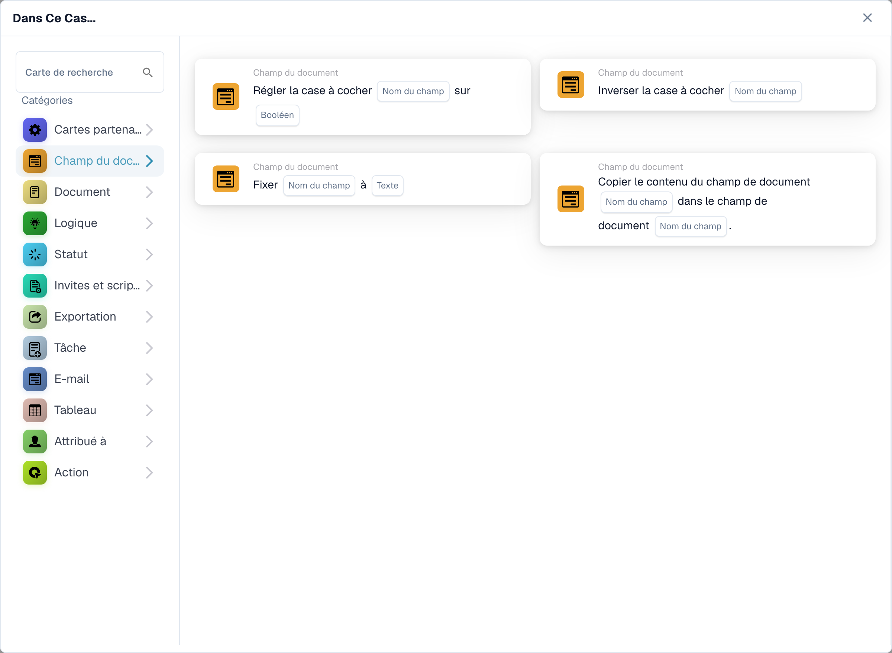<figcaption>
Cartes disponibles dans la catégorie sélectionnée. Renseignez les champs avant utilisation. Certains libellés de cette version de la carte ont encore une traduction incomplète ou incorrecte dans l’interface. Les explications de cette page emploient les termes corrects.
</figcaption></figure>

## Documenter

Choisissez **Approuver le document** ou **Rejeter le document** lorsque le flux de travail doit prendre cette décision. Utilisez d'abord une condition **Et** si l'approbation doit dépendre d'un contrôle. Voir [Document](document).

<figure>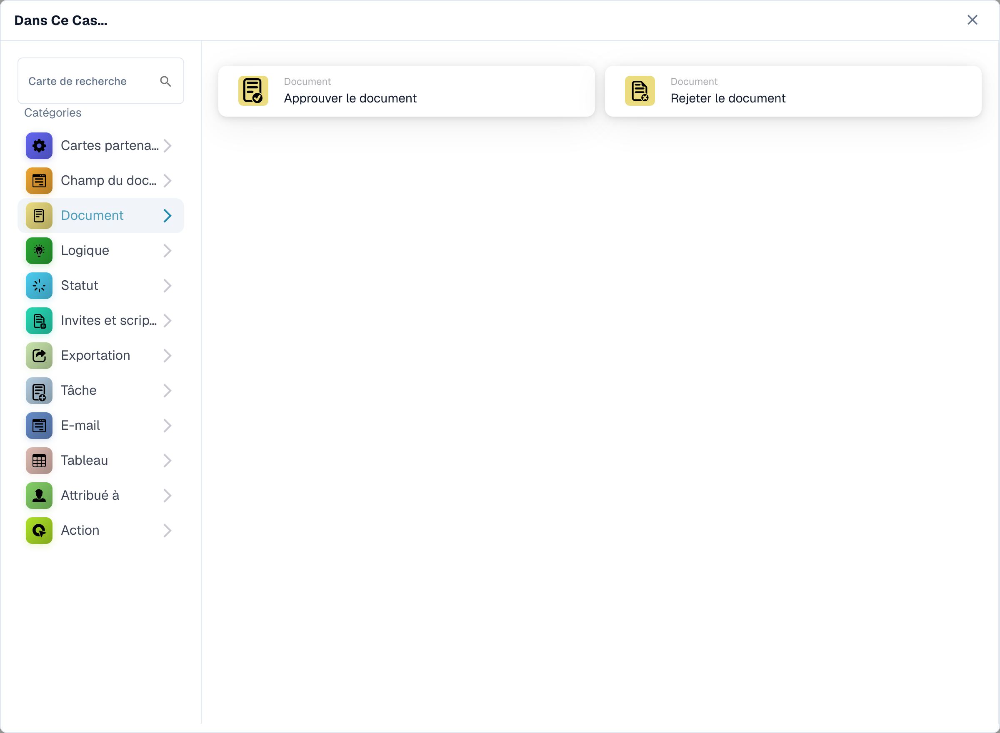<figcaption>
Cartes disponibles dans la catégorie sélectionnée. Renseignez les champs avant utilisation. Certains libellés de cette version de la carte ont encore une traduction incomplète ou incorrecte dans l’interface. Les explications de cette page emploient les termes corrects.
</figcaption></figure>

## Logique

Utilisez ces cartes pour convertir des valeurs entre les formats numérique, texte et booléen, ou lire une valeur à partir de JSON. Choisissez les champs de saisie et de sortie sur la carte sélectionnée.

<figure>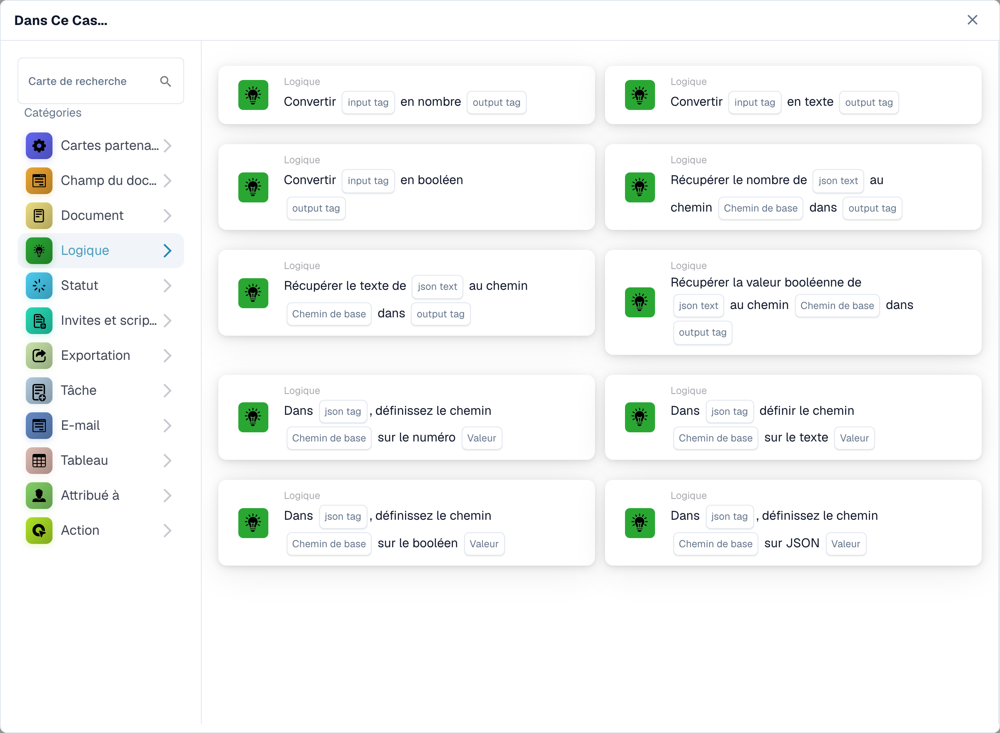<figcaption>
Cartes disponibles dans la catégorie sélectionnée. Renseignez les champs avant utilisation. Certains libellés de cette version de la carte ont encore une traduction incomplète ou incorrecte dans l’interface. Les explications de cette page emploient les termes corrects.
</figcaption></figure>

## Statut

Choisissez **Change Status** pour déplacer le document vers un statut sélectionné. La carte peut également déclencher un autre flux de travail. Voir [Statut](status).

<figure>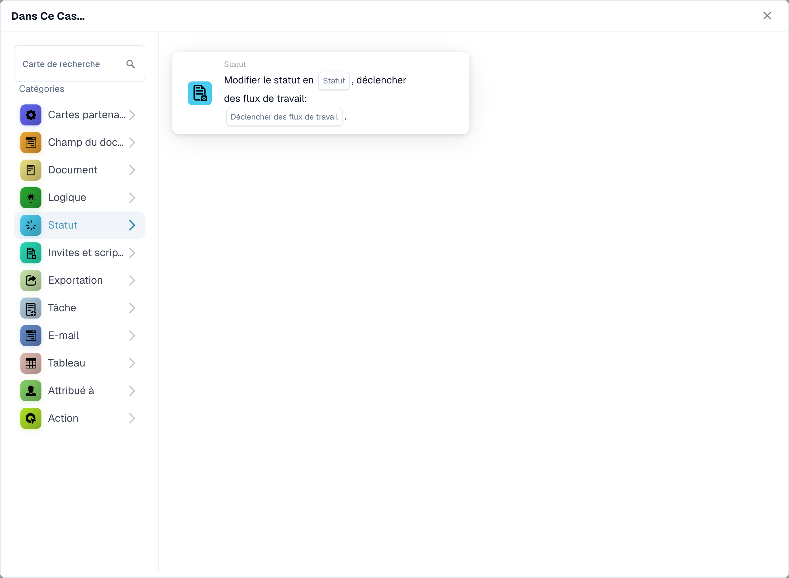<figcaption>
Cartes disponibles dans la catégorie sélectionnée. Renseignez les champs avant utilisation. Certains libellés de cette version de la carte ont encore une traduction incomplète ou incorrecte dans l’interface. Les explications de cette page emploient les termes corrects.
</figcaption></figure>

## Invites et scripts

Choisissez cette catégorie pour exécuter un script d'invite DocOperator. Sélectionnez le script et les variables demandées par la carte. La carte propose également des paramètres d'exécution tels que les tentatives.

<figure>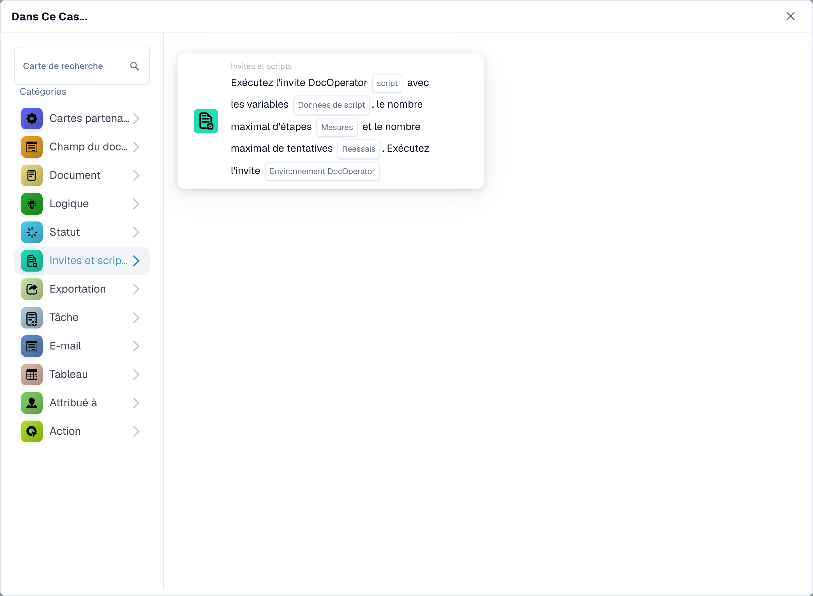<figcaption>
Cartes disponibles dans la catégorie sélectionnée. Renseignez les champs avant utilisation. Certains libellés de cette version de la carte ont encore une traduction incomplète ou incorrecte dans l’interface. Les explications de cette page emploient les termes corrects.
</figcaption></figure>

## Exporter

Démarrez une exportation, exportez avec une configuration choisie ou mettez en file d'attente une exportation finale. Choisissez la configuration d’exportation et l’option de tâche en attente affichées sur votre carte. Voir [Exporter](export).

<figure>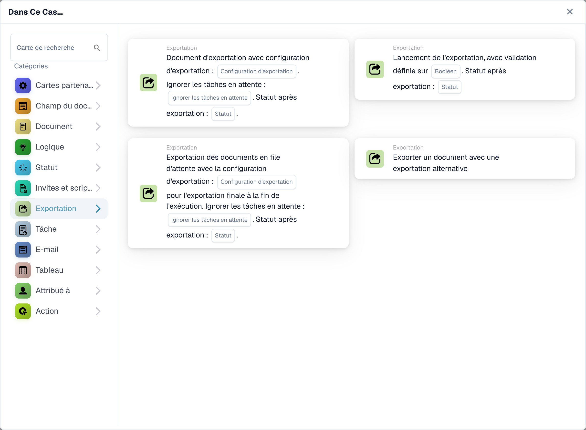<figcaption>
Cartes disponibles dans la catégorie sélectionnée. Renseignez les champs avant utilisation. Certains libellés de cette version de la carte ont encore une traduction incomplète ou incorrecte dans l’interface. Les explications de cette page emploient les termes corrects.
</figcaption></figure>

## Tâche

Créez une tâche ou une notification et attribuez-la à un utilisateur ou un groupe. Saisissez les paramètres de titre, de description, de priorité et de notification demandés par la carte. Certaines cartes sont attribuées de manière séquentielle. Voir [Tâche](task).

<figure>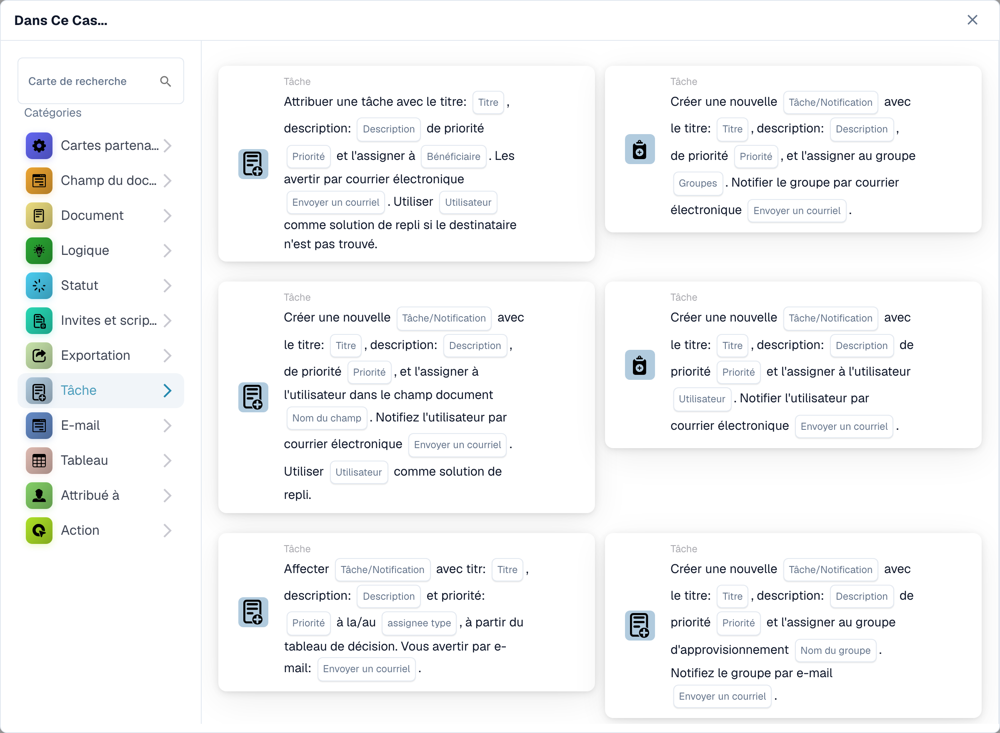<figcaption>
Cartes disponibles dans la catégorie sélectionnée. Renseignez les champs avant utilisation. Certains libellés de cette version de la carte ont encore une traduction incomplète ou incorrecte dans l’interface. Les explications de cette page emploient les termes corrects.
</figcaption></figure>

## Courriel

Envoyez un e-mail en utilisant un modèle sélectionné, soit aux destinataires, soit aux groupes. Choisissez le modèle et la destination sur la carte.

<figure>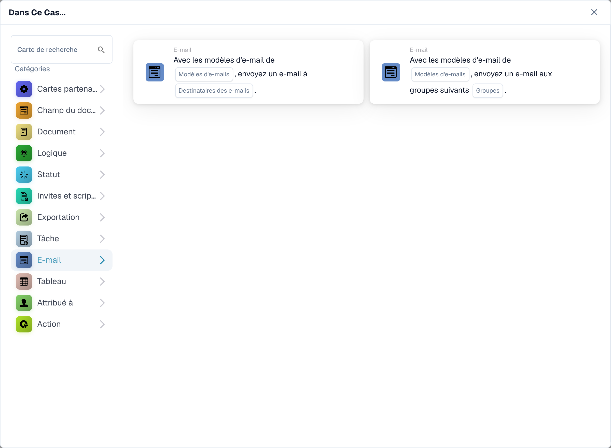<figcaption>
Cartes disponibles dans la catégorie sélectionnée. Renseignez les champs avant utilisation. Certains libellés de cette version de la carte ont encore une traduction incomplète ou incorrecte dans l’interface. Les explications de cette page emploient les termes corrects.
</figcaption></figure>

## Tableau

Modifiez les entrées ou calculez les valeurs dans un tableau de document. Sélectionnez la table, les colonnes, l'opérateur et la colonne de résultat demandés par la carte. Voir [Tableau](table).

<figure>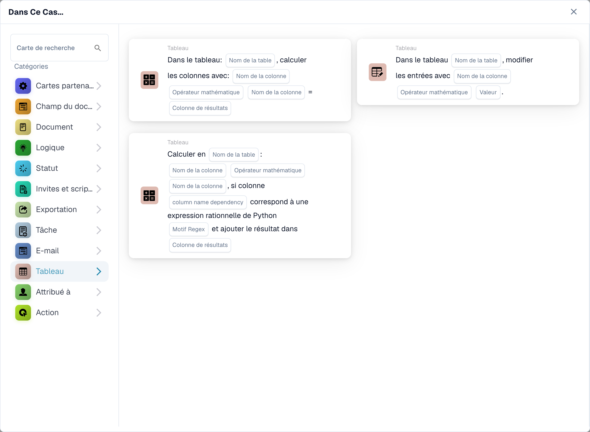<figcaption>
Cartes disponibles dans la catégorie sélectionnée. Renseignez les champs avant utilisation. Certains libellés de cette version de la carte ont encore une traduction incomplète ou incorrecte dans l’interface. Les explications de cette page emploient les termes corrects.
</figcaption></figure>

## Responsable

Attribuez le document à un utilisateur, un groupe, un destinataire ou une sous-organisation. Certaines cartes utilisent un champ ou une table de décision et proposent une solution de repli. Choisissez la bonne destination et repliez-vous sur la carte sélectionnée. Voir [Cessionnaire](assignee).

<figure>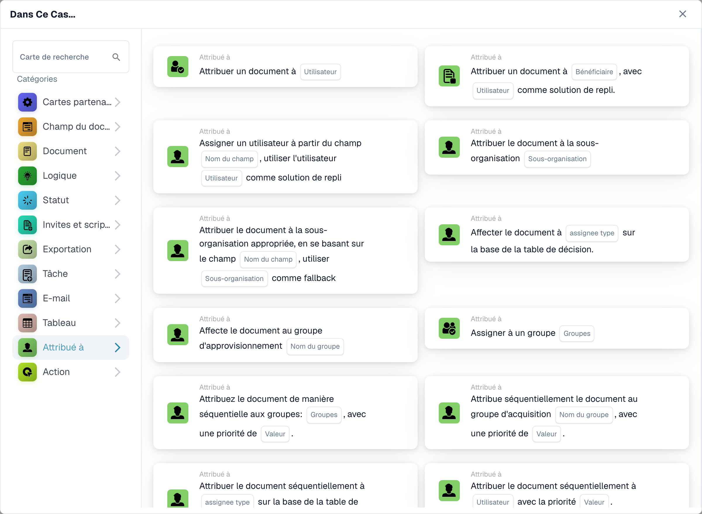<figcaption>
Cartes disponibles dans la catégorie sélectionnée. Renseignez les champs avant utilisation. Certains libellés de cette version de la carte ont encore une traduction incomplète ou incorrecte dans l’interface. Les explications de cette page emploient les termes corrects.
</figcaption></figure>

## Action

Exécutez un autre workflow, envoyez une requête HTTPS, appelez une API ou utilisez la carte de calcul de l'augmentation des coûts. Ces actions peuvent affecter d'autres systèmes ; demandez à votre administrateur quel point de terminaison et quels paramètres utiliser. Voir [Action](action).

<figure>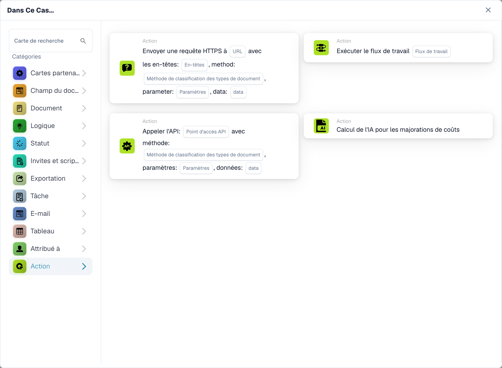<figcaption>
Cartes disponibles dans la catégorie sélectionnée. Renseignez les champs avant utilisation. Certains libellés de cette version de la carte ont encore une traduction incomplète ou incorrecte dans l’interface. Les explications de cette page emploient les termes corrects.
</figcaption></figure>

[Champs détaillés de la carte logique, chemins JSON, déclencheurs et tests](../cards-overview/logic-cards-guide.md).
