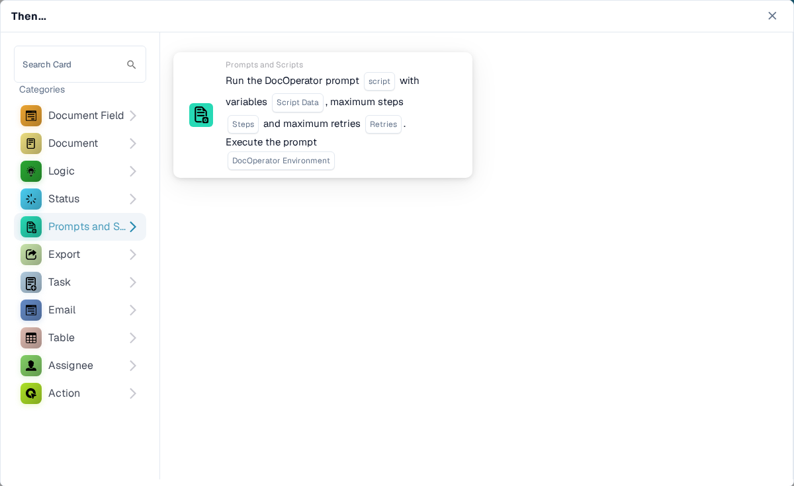
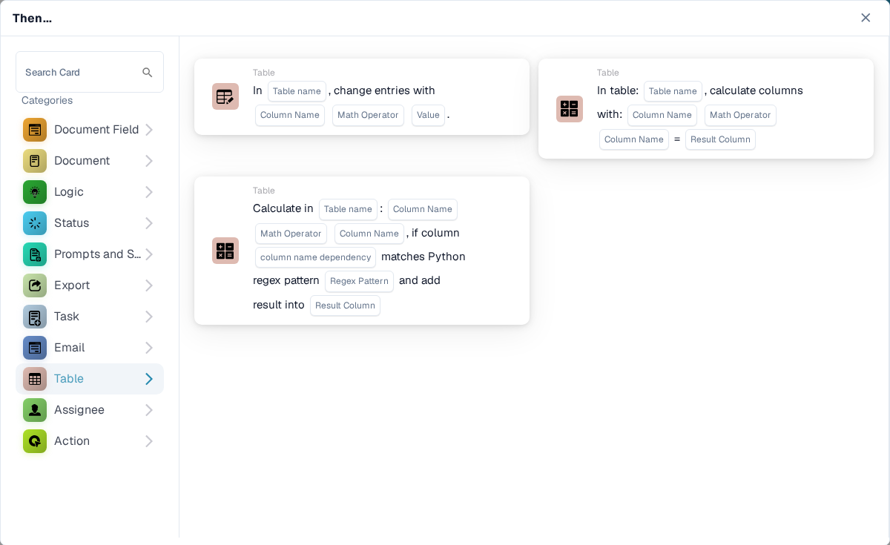
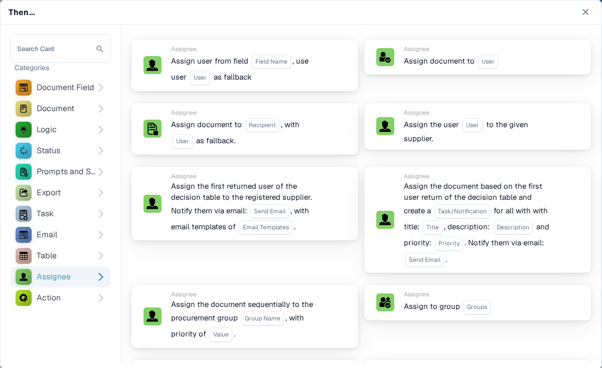

# Then : choisir une carte d'action

Une carte **Then** indique au workflow ce qu'il doit faire après son déclencheur **When** et toutes les conditions **And**. Dans le **Workflow Builder**, sélectionnez **Add Card** sous **Then...**. Choisissez une catégorie à gauche ou saisissez un nom dans **Search Card**. Sélectionnez l'aperçu d'une carte pour l'ajouter, renseignez les champs affichés sur la carte, puis enregistrez le workflow. Faites défiler le sélecteur pour voir d'autres cartes. Sélectionnez **×** pour le fermer sans ajouter de carte. Consultez [Workflow](../README.md) pour la séquence complète.

Les aperçus ci-dessous montrent les actions disponibles, et non des paramètres terminés. Choisissez l'action qui correspond au résultat souhaité.

## Document Field

Définissez ou inversez une case à cocher, saisissez du texte dans un champ, ou copiez un champ dans un autre. Choisissez les noms de champs et la valeur demandés par la carte. Consultez [Document Field](document-field/README.md).

<figure><figcaption>Modifiez un champ ou copiez son contenu.</figcaption></figure>

## Document

Choisissez **Approve the Document** ou **Reject the Document** lorsque le workflow doit prendre cette décision. Utilisez d'abord une condition **And** si l'approbation doit dépendre d'un contrôle. Consultez [Document](document/README.md).

<figure><figcaption>Approuvez ou rejetez le document en cours.</figcaption></figure>

## Logic

Utilisez ces cartes pour convertir des valeurs entre les formats nombre, texte et booléen, ou pour lire une valeur dans du JSON. Choisissez les champs d'entrée et de sortie sur la carte sélectionnée.

<figure><figcaption>Transformez des valeurs pour une étape ultérieure du workflow.</figcaption></figure>

## Status

Choisissez **Change Status** pour faire passer le document à un statut sélectionné. La carte peut également déclencher un autre workflow. Consultez [Status](status/README.md).

<figure><figcaption>Faites passer le document à un autre statut.</figcaption></figure>

## Prompts and Scripts

Choisissez cette catégorie pour exécuter un script de prompt DocOperator. Sélectionnez le script et les variables demandées par la carte. La carte propose également des paramètres d'exécution, tels que les nouvelles tentatives.

<figure><figcaption>Exécutez un script de prompt DocOperator configuré.</figcaption></figure>

## Export

Lancez un export, exportez avec une configuration choisie, ou placez un export final en file d'attente. Choisissez la configuration d'export et l'option de tâche en attente affichées sur votre carte. Consultez [Export](export/README.md).

<figure><figcaption>Sélectionnez quand et comment le document est exporté.</figcaption></figure>

## Task

Créez une tâche ou une notification et assignez-la à un utilisateur ou à un groupe. Saisissez le titre, la description, la priorité et les paramètres de notification demandés par la carte. Certaines cartes assignent de manière séquentielle. Consultez [Task](task/README.md).

<figure><figcaption>Créez un travail de suivi pour une personne ou un groupe.</figcaption></figure>

## Email

Envoyez un e-mail à partir d'un modèle sélectionné, soit à des destinataires, soit à des groupes. Choisissez le modèle et la destination sur la carte.

<figure><figcaption>Envoyez un e-mail basé sur un modèle.</figcaption></figure>

## Table

Modifiez des entrées ou calculez des valeurs dans un tableau du document. Sélectionnez le tableau, les colonnes, l'opérateur et la colonne de résultat demandés par la carte. Consultez [Table](table/README.md).

<figure><figcaption>Mettez à jour ou calculez des données de tableau.</figcaption></figure>

## Assignee

Assignez le document à un utilisateur, un groupe, un destinataire ou une sous-organisation. Certaines cartes utilisent un champ ou une table de décision et proposent une solution de repli. Choisissez la bonne destination et la bonne solution de repli sur la carte sélectionnée. Consultez [Assignee](assignee/README.md).

<figure><figcaption>Acheminez le document vers la prochaine personne ou le prochain groupe responsable.</figcaption></figure>

## Action

Exécutez un autre workflow, envoyez une requête HTTPS, appelez une API ou utilisez la carte de calcul d'augmentation des coûts. Ces actions peuvent affecter d'autres systèmes ; demandez à votre administrateur quel point de terminaison et quels paramètres utiliser. Consultez [Action](action/README.md).

<figure><figcaption>Démarrez un autre workflow ou une action d'intégration.</figcaption></figure>
