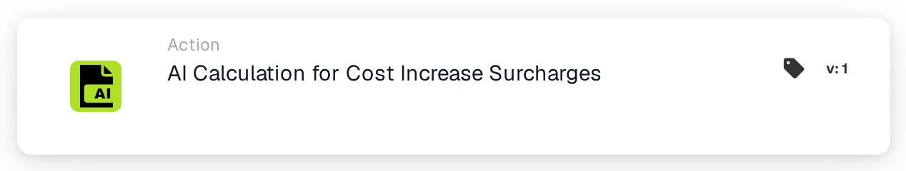
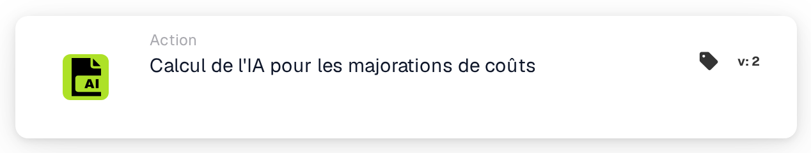

# Calcul IA pour les suppléments d’augmentation des coûts

<figure><figcaption>
Version 1
</figcaption></figure>

<figure><figcaption>
Version 2
</figcaption></figure>

## Quand utiliser cette carte

Utilisez cette action pour demander le calcul configuré du supplément matière et énergie MTZ/ETZ pour le document actuel. Préparez d’abord les données documentaires et la configuration du service de calcul requises par votre organisation.

## Configuration réelle

La carte affichée ne comporte aucune entrée de facteur d'augmentation des coûts, de champ de coût de base ou de champ de supplément. Il délègue le calcul au service configuré. Ne recherchez pas ces contrôles de carte inexistants et ne supposez pas une formule de pourcentage fixe à partir du nom de la carte.

## Résultat et vérification

Une réponse de service réussie marque la réussite de la carte. Un délai d'attente ou une réponse infructueuse produit une erreur de carte. Inspecter le journal de la carte et les données de supplément résultantes du document ; le succès de l’appel à lui seul ne justifie pas un montant particulier.

En mode test de carte, l'appel est ignoré et le succès est simulé. Ceci est utile pour tester la structure du flux de travail, mais cela ne prouve pas que le service a été exécuté ou qu'un supplément a été calculé.

<!-- workflow-card-practical-example-20261021 -->

## Exemple pratique

**Quand utiliser :** Demandez le calcul configuré du supplément matériel/énergie pour une facture préparée.

**Configuration :** Utilisez la facture synthétique `DEMO-001` avec les données requises par votre service MTZ/ETZ configuré. Ajoutez cette action après les conditions de validation du document.

**Résultat attendu et contre-exemple :** Une réponse de service réussie marque la carte comme réussie ; un délai d'attente ou une réponse infructueuse produit une erreur de carte. Inspectez les champs du document et le résultat du calcul séparément. Le mode de test de carte simule le succès et n'appelle pas le service, il ne peut donc pas prouver un réel résultat de supplément.

Il s’agit d’une configuration illustrative et du résultat attendu. Utilisez les champs, utilisateurs et groupes configurés dans votre organisation de test ; cela ne veut pas dire que cet exemple a été exécuté.
