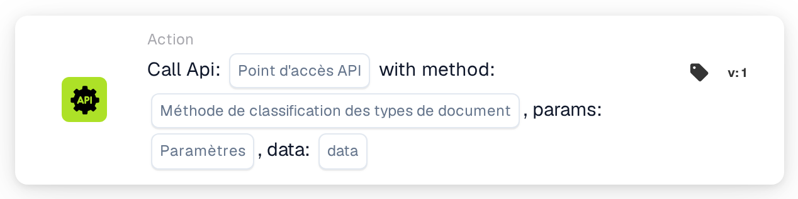
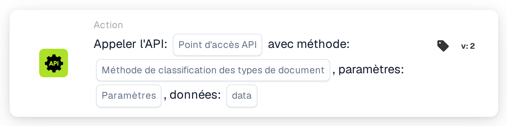

# Appeler l'API

<figure><figcaption>
Version 1
</figcaption></figure>

<figure><figcaption>
Version 2
</figcaption></figure>

<!-- workflow-card-call-api-contract-20261022 -->

## Objectif

Utilisez `call_api` pour appeler un point de terminaison de l’API DocBits configurée. Le chemin relatif est ajouté à son adresse de base. Une URL externe arbitraire ne configure pas une intégration avec une autre API.

## Configuration

Renseignez le chemin, la méthode HTTP, les paramètres de requête et les données acceptées par le point de terminaison. La requête utilise le contexte de l’utilisateur DocBits courant. Les valeurs absentes de `org_id` et `triggered_by_docflow` sont ajoutées automatiquement. Les objets de paramètres et de données, ou leur représentation textuelle prise en charge, doivent respecter le format de cette version. Elle ne propose pas de correspondance générale des champs d’une réponse JSON.

## Résultat et limites

Le texte de réponse est converti en booléen : `true`, `1`, `yes` ou `on` seuls donnent vrai ; une réponse non reconnue, y compris un objet JSON arbitraire, donne faux par défaut. Le statut HTTP ne détermine pas à lui seul ce booléen. Un délai dépassé ou une erreur de requête donne faux. Le test de carte simule l’appel et renvoie vrai sans envoyer la requête ; il ne démontre ni authentification, ni connectivité, ni comportement du point de terminaison.

<!-- workflow-card-practical-example-20261021 -->

## Exemple pratique

Utilisez cette carte après les conditions nécessaires pour obtenir un booléen d’un point de terminaison configuré de l’API DocBits. Pour un test isolé, choisissez un point existant, documenté et en lecture seule, avec le contrat de réponse booléen voulu et la méthode adaptée, par exemple `GET`. Utilisez uniquement ses paramètres de démonstration pris en charge.

Résultat attendu et contre-exemple : une réponse HTTP `200` hypothétique dont le texte intégral est `true` donne vrai ; `false` donne faux. Un objet tel que `{"approved": true}` n’est pas automatiquement converti en vrai. Vérifiez séparément la réponse réelle et les journaux. Exemple vérifié dans le code d’exécution ; aucun appel ni workflow n’a été exécuté.
