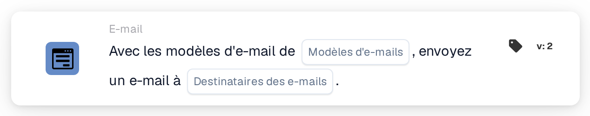

# Envoyer un e-mail

<figure><figcaption>
Version 2
</figcaption></figure>

## Objectif :

Cette carte de workflow envoie un e-mail à partir d'un ou de plusieurs modèles d'e-mail. Les destinataires ne sont pas saisis sous forme d'adresses fixes : ils sont choisis selon leur rôle dans le workflow, par exemple l'utilisateur ou le groupe auquel le document est attribué, ou les utilisateurs et groupes renvoyés par une table de décision. Le workflow reste ainsi valable lorsque les personnes qui occupent ces rôles changent.

Pour envoyer plutôt un e-mail à des groupes d'utilisateurs sélectionnés, la carte **Send Email to Groups** peut être utilisée, voir [Send Email to Groups](send-email-groups-guide.md).

## Composants de la carte :

1. **Modèles d'e-mails**
   * **Description :** les modèles d'e-mail utilisés pour l'e-mail.
   * **Détail :** un ou plusieurs modèles d'e-mail de l'organisation peuvent être sélectionnés. Chaque modèle sélectionné est envoyé à chaque destinataire. Lorsque le workflow s'exécute pour un document, un modèle configuré pour un type de document spécifique n'est envoyé que si le document est de ce type.
2. **Destinataires des e-mails**
   * **Description :** les personnes qui reçoivent l'e-mail.
   * **Options :** une ou plusieurs des options suivantes peuvent être sélectionnées :
     * **Utilisateur/groupe de document attribué :** l'utilisateur ou le groupe auquel le document est actuellement attribué.
     * **Utilisateur/groupe renvoyé de la table de décision :** les utilisateurs et groupes renvoyés par une table de décision évaluée plus tôt dans le même workflow, par exemple avec la carte **Decision Table has Returns**.
     * **Utilisateur affecté au fournisseur :** l'utilisateur affecté au fournisseur, dans les workflows démarrés par un changement de statut d'un fournisseur.
     * **Référent du fournisseur :** le référent du fournisseur, dans les workflows démarrés par un changement de statut d'un fournisseur.

## Fonctionnalité :

* **Collecte des destinataires :** la carte rassemble les destinataires de toutes les options sélectionnées. Un destinataire issu de plusieurs options ne reçoit l'e-mail qu'une seule fois.
* **Exécution de l'action :** l'e-mail est envoyé avec les modèles sélectionnés. Lorsque le workflow s'exécute pour un document, les modèles peuvent utiliser les valeurs des champs du document. Le résultat est consigné dans le journal du workflow avec les noms des destinataires.
* **Sans document :** la carte peut également s'exécuter dans des workflows qui ne sont pas démarrés pour un document, par exemple des workflows démarrés par un changement de statut d'un fournisseur. Dans un tel workflow, l'option **Utilisateur/groupe de document attribué** n'ajoute aucun destinataire.
* **Données manquantes :**
  * Si aucun modèle d'e-mail ou aucune option de destinataire n'est sélectionné sur la carte, la carte ne s'exécute pas et signale les données manquantes dans le journal du workflow.
  * Si une option sélectionnée ne mène à personne, par exemple parce que le document n'est attribué à personne ou que la table de décision n'a renvoyé personne, cette option n'ajoute aucun destinataire.
* **Erreurs :** si le service d'e-mail rejette la requête ou ne répond pas à temps, la carte se termine par une erreur.

## Mise en place et configuration :

* Les modèles d'e-mail devraient être configurés dans l'organisation avant de pouvoir être sélectionnés sur la carte.
* La carte peut être ajoutée depuis la catégorie **E-mail**. Ensuite, un ou plusieurs modèles sont sélectionnés dans **Modèles d'e-mails** et une ou plusieurs options dans **Destinataires des e-mails**.
* Pour l'option **Utilisateur/groupe renvoyé de la table de décision**, une table de décision devrait être évaluée plus tôt dans le même workflow.

## Conclusion :

La carte de workflow « Send Email » informe automatiquement les personnes impliquées dans un processus lié à un document ou à un fournisseur, à l'aide de modèles préparés. Comme les destinataires sont choisis selon leur rôle, le même workflow continue d'atteindre les bonnes personnes lorsque les attributions changent.
