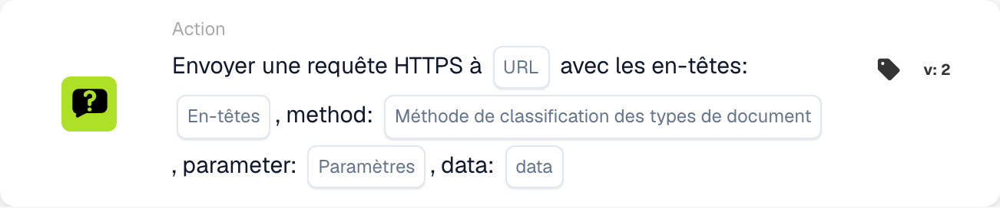

# Envoyer une requête HTTPS à

<figure><figcaption>
Champs de la carte dans la version affichée. Les champs ne sont pas encore renseignés. Certains libellés de cette version de la carte ont encore une traduction incomplète ou incorrecte dans l’interface. Les explications de cette page emploient les termes corrects.
</figcaption></figure>

## Objectif :

La carte de workflow **« Send HTTPS Request »** permet aux utilisateurs d'envoyer des requêtes HTTPS vers une URL spécifiée avec des en-têtes, des paramètres et une charge utile de données personnalisables. Cette carte est idéale pour intégrer des API externes ou des services web directement dans le workflow.

## Composants de la carte :

1. **URL**
   * **Descriptif :** spécifie le point de terminaison où la requête HTTPS sera envoyée.
   * **Détail :** saisissez l'URL complète de l'API ou du service web auquel se connecter.
2. **En-têtes**
   * **Descriptif :** définit les en-têtes à inclure dans la requête HTTPS.
   * **Détail :** fournissez des **paires clé-valeur** au **format JSON valide** pour spécifier des en-têtes tels que des jetons d'authentification ou des types de contenu. Exemple : {"Authorization": "Bearer example\_value"}
3. **Méthode**
   * **Descriptif :** spécifie la méthode HTTP à utiliser pour la requête.
   * **Possibilités :**
     * **GET :** récupère des données depuis le point de terminaison.
     * **POST :** envoie des données au point de terminaison pour créer ou mettre à jour des ressources.
     * **PUT :** met à jour des ressources existantes au point de terminaison.
     * **DELETE :** supprime les ressources du point de terminaison.
4. **Paramètres**
   * **Descriptif :** paires clé-valeur à inclure dans l'URL en tant que paramètres de requête.
   * **Détail :** utilisez-les pour envoyer des filtres ou des données supplémentaires requis par le point de terminaison, au format JSON valide. Voir l'exemple pour Headers.
5. **Données**
   * **Descriptif :** le corps de la requête HTTPS.
   * **Détail :** fournissez la charge utile au format JSON valide. Voir l'exemple pour Headers.

## Fonctionnalité :

* **Évaluation de la condition :** la carte n'envoie la requête HTTPS que si les sections **« Quand »** et **« Et »** sont évaluées comme vraies.
  * Si l'une des conditions est fausse, la requête n'est pas envoyée.
* **Exécution de la requête :**
  * Lorsque les conditions sont satisfaites, le système envoie la requête HTTPS avec les configurations spécifiées.

## Mise en place et configuration :

1. **Définir l'URL :** saisissez le point de terminaison où la requête HTTPS doit être envoyée.
2. **Définir les en-têtes :** fournissez les en-têtes requis sous forme de paires clé-valeur.
3. **Sélectionner la méthode HTTP :** choisissez la méthode appropriée (**GET**, **POST**, **PUT** ou **DELETE**) selon l'action à effectuer.
4. **Ajouter les paramètres :** spécifiez tous les paramètres de requête requis par le point de terminaison.
5. **Fournir la charge utile de données :** saisissez le corps de la requête au format requis (par ex. JSON) si nécessaire.
6. **Configurer les conditions :** définissez les sections **« Quand »** et **« Et »** pour garantir que la requête n'est envoyée que lorsque des conditions spécifiques sont satisfaites.

## Exemple de carte :

<figure><figcaption>
Champs de la carte dans la version affichée. Les champs ne sont pas encore renseignés. Certains libellés de cette version de la carte ont encore une traduction incomplète ou incorrecte dans l’interface. Les explications de cette page emploient les termes corrects.
</figcaption></figure>

## Conclusion :

La carte de workflow **« Send HTTPS Request »** simplifie l'intégration d'API en permettant aux utilisateurs d'effectuer des requêtes personnalisées vers des services externes directement depuis leurs workflows. En automatisant le processus d'envoi de requêtes HTTPS et la gestion des réponses, cette carte améliore la flexibilité et la fonctionnalité du workflow.
