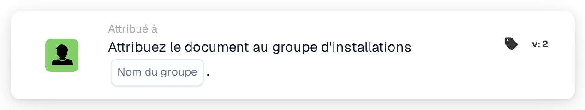

# Attribuer le document au groupe d'établissement

<figure><figcaption>
Version 2
</figcaption></figure>

## Objectif :

Cette carte de workflow attribue un document au groupe responsable de l'établissement de son bon de commande. L'établissement n'est pas sélectionné sur la carte : il est repris des bons de commande auxquels le document est rapproché. La carte recherche ensuite un groupe d'utilisateurs dont le nom contient à la fois le nom de groupe saisi sur la carte et le code d'établissement, puis attribue le document à ce groupe.

Elle est utile lorsque le même type d'équipe existe une fois par établissement, par exemple un groupe d'approbation par usine ou par entrepôt, et que chaque document devrait être transmis à l'équipe de l'établissement pour lequel il a été commandé.

Pour une attribution ajoutée à une séquence d'approbateurs au lieu d'être effectuée directement, la carte **Assign Sequentially to Facility Group** peut être utilisée.

## Composants de la carte :

1. **Nom du groupe**
   * **Description :** la partie du nom que les groupes d'établissement ont en commun.
   * **Détail :** un texte comparé aux noms des groupes d'utilisateurs de l'organisation. Un groupe correspond si son nom contient ce texte et le code d'établissement du bon de commande. La comparaison ne tient pas compte des majuscules et des minuscules. Par exemple, avec le nom de groupe **Approver** et un bon de commande pour l'établissement **1000**, un groupe nommé **Approver 1000** correspondrait.

## Fonctionnalité :

* **Détermination de l'établissement :** la carte lit les bons de commande auxquels le document est rapproché et relève le code d'établissement (le site du bon de commande) de chacun d'eux.
* **Détermination du groupe :** pour chaque code d'établissement, la carte recherche les groupes d'utilisateurs dont le nom contient à la fois le **Nom du groupe** indiqué sur la carte et le code d'établissement. Les codes d'établissement pour lesquels aucun groupe n'est trouvé sont listés dans le journal du workflow.
* **Exécution de l'action :** le document est attribué au groupe correspondant. Si plusieurs groupes correspondent, par exemple parce que le document est rapproché de bons de commande de différents établissements, le document n'est attribué qu'à l'un d'eux ; la carte ne détermine pas lequel.
* **Données manquantes :**
  * Si aucun nom de groupe n'est saisi sur la carte, la carte ne s'exécute pas et signale les données manquantes dans le journal du workflow.
  * Si le document n'est rapproché d'aucun bon de commande, la carte signale les données manquantes au lieu d'attribuer le document.
  * Si aucun groupe ne correspond à l'un des codes d'établissement, le document n'est pas attribué et le journal du workflow indique qu'aucun groupe correspondant n'a été trouvé.

## Mise en place et configuration :

* Les groupes d'utilisateurs devraient être nommés de sorte que chaque nom contienne la partie commune du nom et le code d'établissement, par exemple **Approver 1000**, **Approver 2000**.
* La carte peut être ajoutée depuis la catégorie **Attribué à**. Ensuite, la partie commune du nom des groupes est saisie dans le champ **Nom du groupe**.
* Comme l'établissement provient des bons de commande rapprochés, la carte s'utilise de préférence dans des workflows pour des documents déjà rapprochés d'un bon de commande.

## Conclusion :

La carte de workflow « Assign Document to Facility Group » achemine les documents vers l'équipe de l'établissement pour lequel ils ont été commandés. Une seule carte couvre tous les établissements, à condition que les groupes d'utilisateurs suivent un schéma de nommage cohérent comprenant le code d'établissement.
