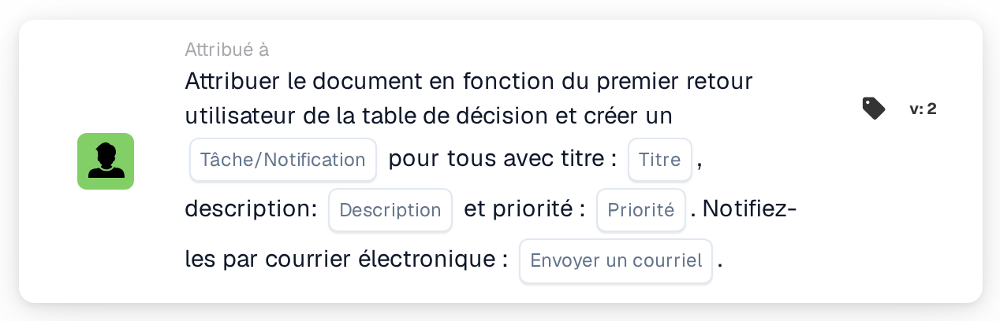

# Attribuer le document au premier utilisateur de la table de décision et créer des tâches

<figure><figcaption>
Version 2
</figcaption></figure>

## Objectif :

Cette carte de workflow utilise de deux manières les utilisateurs renvoyés par une table de décision : le document est attribué au premier utilisateur renvoyé, et chaque utilisateur renvoyé, y compris le premier, reçoit une tâche ou une notification concernant le document. Une personne devient ainsi responsable du document, tandis que les autres sont informées ou invitées à agir elles aussi.

Les utilisateurs proviennent d'une table de décision évaluée plus tôt dans le même workflow, par exemple avec la carte **Decision Table has Returns**, configurée pour utiliser les données renvoyées dans les cartes suivantes.

## Composants de la carte :

1. **Tâche/Notification**
   * **Description :** définit si une tâche ou une notification est créée pour les utilisateurs renvoyés.
   * **Options :**
     * **Tâche :** une tâche est créée pour chaque utilisateur.
     * **Notification :** une notification est créée pour chaque utilisateur.
2. **Titre**
   * **Description :** le titre de la tâche ou de la notification.
   * **Détail :** un texte court qui identifie la tâche ou la notification.
3. **Description**
   * **Description :** des précisions supplémentaires sur la tâche ou la notification.
   * **Détail :** un texte qui décrit ce qui devrait être fait ou pourquoi les utilisateurs sont informés.
4. **Priorité**
   * **Description :** l'urgence de la tâche ou de la notification.
   * **Options :**
     * **poids élevé :** la tâche ou la notification est créée avec une priorité élevée.
     * **poids moyen :** la tâche ou la notification est créée avec une priorité moyenne.
     * **poids léger :** la tâche ou la notification est créée avec une priorité faible.
5. **Envoyer un courriel**
   * **Description :** définit si les utilisateurs sont également informés de la tâche ou de la notification par e-mail.
   * **Options :**
     * **Vrai :** une notification par e-mail est envoyée.
     * **Faux :** aucune notification par e-mail n'est envoyée.

## Fonctionnalité :

* **Lecture de la table de décision :** la carte lit les utilisateurs renvoyés par la table de décision plus tôt dans le workflow. Seuls les utilisateurs renvoyés sont pris en compte, pas les groupes.
* **Attribution du document :** le document est attribué au premier utilisateur renvoyé.
* **Création des tâches :** pour chaque utilisateur renvoyé, une tâche ou une notification est créée avec le titre, la description et la priorité indiqués sur la carte. Chaque utilisateur reçoit sa propre tâche. Les tâches sont créées même si l'attribution du document a échoué ; le journal du workflow affiche le résultat de l'attribution et de chaque tâche.
* **Valeurs par défaut :** si aucune priorité n'est définie, **poids moyen** est utilisé. Si **Envoyer un courriel** n'est pas défini, aucun e-mail n'est envoyé. Si **Tâche/Notification** n'est pas défini, une tâche est créée et le journal du workflow signale le paramètre manquant.
* **Données manquantes :**
  * Si la table de décision n'a renvoyé aucun utilisateur, rien n'est attribué et la carte signale les données manquantes dans le journal du workflow.
  * Si le titre ou la description est vide, le document n'est pas attribué, aucune tâche n'est créée et la carte signale les données manquantes.

## Mise en place et configuration :

* Une table de décision qui renvoie des utilisateurs devrait être évaluée plus tôt dans le workflow, par exemple avec la carte **Decision Table has Returns**. L'ordre des utilisateurs renvoyés est important, car le premier reçoit le document.
* La carte peut être ajoutée depuis la catégorie **Attribué à**. Ensuite, le type (**Tâche** ou **Notification**), le titre, la description, la priorité et le paramètre d'e-mail peuvent être configurés.

## Conclusion :

La carte de workflow « Assign Document to First Decision Table User and Create Tasks » associe une responsabilité claire pour le document à l'information de toutes les personnes désignées par la table de décision. Elle est utile lorsqu'une personne devrait prendre en charge le document tandis que d'autres doivent être impliquées ou tenues informées.
