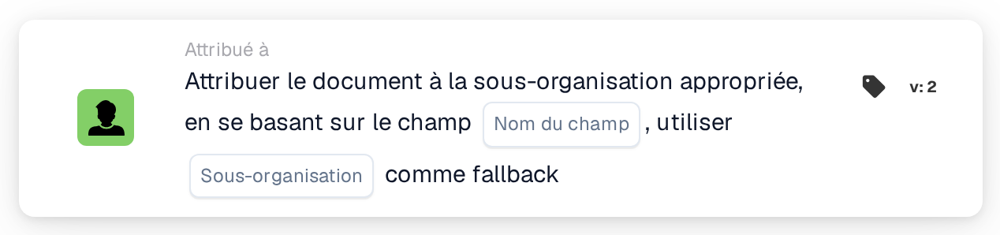

# Attribuer le document à la sous-organisation correspondante

<figure><figcaption>
Version 2
</figcaption></figure>

## **Objectif :**

La carte de workflow **« Attribuer le document à la sous-organisation correspondante en fonction du champ »** assigne dynamiquement un document à une sous-organisation, en fonction d'un champ spécifié dans le document. Si aucune sous-organisation correspondante n'est trouvée, la carte utilise une sous-organisation de repli prédéfinie.

## **Composants de la carte :**

1. **Nom du champ**
   * **Descriptif :** spécifie le champ de document à utiliser pour déterminer la sous-organisation correspondante.
   * **Détail :** la carte recherche une valeur dans le champ spécifié pour la faire correspondre à une sous-organisation disponible.
2. **Sous-organisation (repli)**
   * **Descriptif :** définit la sous-organisation de repli à utiliser si aucune correspondance n'est trouvée dans le champ spécifié.
   * **Détail :** si la valeur du champ ne correspond à aucune sous-organisation, le document sera assigné à la sous-organisation de repli sélectionnée.

## **Fonctionnalité :**

* **Évaluation de la condition :**\
  La carte n'exécute son action que si les sections **« Quand »** et **« Et »** sont toutes deux évaluées comme vraies.
* **Attribution dynamique :**\
  La carte vérifie la valeur du champ spécifié et assigne le document à la sous-organisation qui correspond à cette valeur.
* **Mécanisme de repli :**\
  Si aucune sous-organisation correspondante n'est trouvée, le document est assigné à la sous-organisation de repli.

## **Mise en place et configuration :**

* **Sélectionnez le Nom du champ :**\
  Choisissez le champ du document qui contient la valeur à faire correspondre à une sous-organisation.
* **Sélectionner la sous-organisation de repli :**\
  Choisissez la sous-organisation qui sera utilisée si aucune correspondance n'est trouvée dans le champ du document.

## **Conclusion :**

La carte de workflow **« Attribuer le document à la sous-organisation correspondante en fonction du champ »** offre de la flexibilité en acheminant dynamiquement les documents vers la sous-organisation appropriée, avec une option de repli supplémentaire pour garantir qu'aucun document ne reste non assigné.

<!-- workflow-card-practical-example-20261021 -->

## Exemple pratique

**Quand utiliser :** Choisissez une unité commerciale à partir d'un champ de routage extrait.

**Configuration :** Définissez le champ de routage `business_unit` sur le nom de sous-organisation configuré `Demo North` et choisissez `Demo Default` comme solution de secours.

**Résultat attendu et contre-exemple :** Une valeur de champ correspondante sélectionne `Demo North`. Un nom inconnu utilise `Demo Default` ; testez la solution de secours avant d’activer le workflow.

Il s’agit d’une configuration illustrative et du résultat attendu. Utilisez les champs, utilisateurs et groupes configurés dans votre organisation de test ; cela ne veut pas dire que cet exemple a été exécuté.
