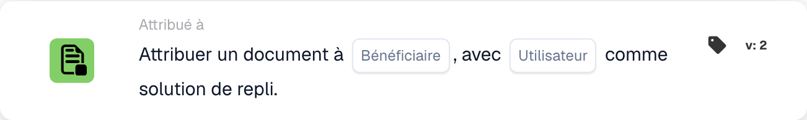

# Attribuer un document au destinataire

Cette carte affecte le **document** à un destinataire résolu à partir de la source configurée. Dans la version 2 illustrée, les champs sont **Bénéficiaire** et **Utilisateur**. Le second champ définit le repli à utiliser si le destinataire principal ne peut pas être résolu.

<figure><figcaption>
Carte d’affectation, version 2 : Bénéficiaire désigne la source du destinataire et Utilisateur le repli à configurer. Aucun utilisateur n’a été sélectionné dans cette illustration.
</figcaption></figure>

## Configuration

1. Définissez les conditions **Quand** et **Et** du workflow.
2. Dans **Bénéficiaire**, choisissez la source du destinataire proposée par votre configuration.
3. Dans **Utilisateur**, sélectionnez explicitement un utilisateur de repli valide et autorisé.

Les anciennes désignations Disponent et Purchaser ne décrivent pas les champs de cette version. La carte ne sélectionne pas automatiquement un administrateur universel ; une valeur vide, un utilisateur inexistant ou des droits insuffisants doivent être traités et testés.

<!-- workflow-card-practical-example-20261021 -->

## Exemple pratique

Configurez une source de destinataire et un utilisateur de test autorisé comme repli. Avec un destinataire résoluble, vérifiez l’affectation du document à celui-ci. Dans un second cas, rendez la source non résoluble et vérifiez l’affectation au repli configuré. Contrôlez aussi le comportement lorsque le repli est absent ou invalide.

Il s’agit d’un exemple de configuration et de résultats attendus. Aucun de ces cas n’a été exécuté pour cette illustration. L’action affecte un document ; elle ne prouve ni la création d’une tâche ni l’envoi d’une notification.
