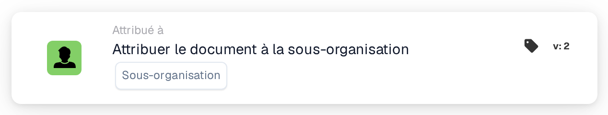

# Attribuer un document à la sous-organisation

<figure><figcaption>
Version 2
</figcaption></figure>

## **Objectif :**

La carte de workflow **« Attribuer un document à une sous-organisation »** assigne un document à une sous-organisation spécifique au sein du système, garantissant qu'il est acheminé vers l'unité organisationnelle appropriée pour traitement.

## **Composants de la carte :**

1. **Sous-organisation**
   * **Descriptif :** spécifie la sous-organisation à laquelle le document sera assigné.
   * **Détail :** une liste déroulante des sous-organisations disponibles est proposée pour sélectionner la sous-organisation cible.

## **Fonctionnalité :**

* **Évaluation de la condition :**\
  La carte n'exécute son action que si les sections **« Quand »** et **« Et »** sont toutes deux évaluées comme vraies.
* **Attribution du document :**\
  La carte assigne le document à la sous-organisation sélectionnée dans la liste déroulante.

## **Mise en place et configuration :**

* **Sélectionner la sous-organisation :**\
  Choisissez la sous-organisation appropriée dans la liste déroulante à laquelle le document doit être assigné.

## **Conclusion :**

La carte de workflow **« Attribuer un document à une sous-organisation »** garantit que les documents sont acheminés vers la bonne sous-organisation, rationalisant le processus de gestion des documents en attribuant la responsabilité en fonction de la structure organisationnelle.

<!-- workflow-card-practical-example-20261021 -->

## Exemple pratique

**Quand utiliser :** Acheminer un document vers une unité commerciale connue.

**Configuration :** Sélectionnez la sous-organisation configurée `Demo North`.

**Résultat attendu et contre-exemple :** Le document appartient à la sous-organisation sélectionnée après l'action. Confirmez la cible avant d'activer le workflow, car les règles d'accès aux sous-organisations peuvent différer.

Il s’agit d’une configuration illustrative et du résultat attendu. Utilisez les champs, utilisateurs et groupes configurés dans votre organisation de test ; cela ne veut pas dire que cet exemple a été exécuté.
