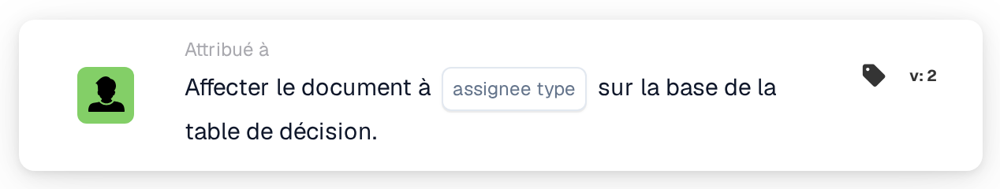

# Attribuer un document à

<figure><figcaption>
Version 2
</figcaption></figure>

## Objectif :

La carte de workflow **« Attribuer un document à \[Utilisateur/groupe] en fonction de la table de décision »** assigne dynamiquement des documents à des utilisateurs ou à des groupes en fonction du résultat d'une **table de décision**. Cette fonctionnalité garantit que l'attribution des documents est gérée de manière efficace et cohérente sur la base de conditions prédéfinies.

## Composants de la carte :

1. **Utilisateur/Groupe**
   * **Descriptif :** spécifie l'**utilisateur** ou le **groupe** auquel le document sera assigné.
   * **Détail :** sélectionné en fonction du résultat de la **table de décision**.
2. **Table de décision**
   * **Descriptif :** une **table de décision** est utilisée pour déterminer l'**utilisateur** ou le **groupe** approprié pour l'attribution du document.
   * **Détail :** utilise la table de décision définie dans la section **« et »**.

## Fonctionnalité :

* **Évaluation de la condition :** la carte n'exécute son action que si les sections **« Quand »** et **« Et »** sont toutes deux évaluées comme vraies.
* **Attribution dynamique du document :** le document est assigné à l'**utilisateur** ou au **groupe** déterminé par la **table de décision**.

## Mise en place et configuration :

* **Définir la table de décision :** configurez la **table de décision** pour inclure les conditions de détermination de l'**utilisateur** ou du **groupe** cible.
* **Assigner le document à l'utilisateur/groupe :** le document sera assigné dynamiquement en fonction du résultat de la table de décision.

## Conclusion :

La carte de workflow **« Attribuer un document à \[Utilisateur/groupe] en fonction de la table de décision »** offre des capacités d'attribution dynamique des documents fondées sur une logique de décision. Cela garantit un traitement précis et efficace en dirigeant automatiquement les documents vers l'**utilisateur** ou le **groupe** approprié, renforçant l'automatisation du workflow.

<!-- workflow-card-practical-example-20261021 -->

## Exemple pratique

**Quand utiliser :** Choisissez un responsable de document dans une table de décision.

**Configuration :** Sélectionnez une table de décision de démonstration dont la règle de correspondance renvoie le réviseur configuré, et choisissez le type de responsable proposé par cette version de carte.

**Résultat attendu et contre-exemple :** L'utilisateur ou le groupe renvoyé devient le destinataire du document. Un résultat de table de décision vide doit être diagnostiqué séparément.

Il s’agit d’une configuration illustrative et du résultat attendu. Utilisez les champs, utilisateurs et groupes configurés dans votre organisation de test ; cela ne veut pas dire que cet exemple a été exécuté.
