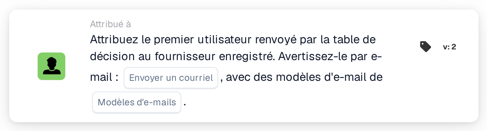

# Affecter le premier utilisateur de la table de décision au fournisseur

<figure><figcaption>
Version 2
</figcaption></figure>

## Objectif :

Cette carte de workflow définit l'utilisateur affecté à un fournisseur enregistré à partir d'une table de décision. Le premier utilisateur renvoyé par la table de décision devient l'utilisateur affecté au fournisseur, c'est-à-dire l'interlocuteur interne responsable de ce fournisseur. Les utilisateurs renvoyés peuvent également être informés par e-mail.

Comme **Assign User to Supplier**, la carte ne travaille pas sur un document : elle est destinée aux workflows démarrés par un changement de statut d'un fournisseur, par exemple avec la carte When **Supplier status changed**. L'utilisateur est déterminé par une table de décision évaluée plus tôt dans le même workflow, par exemple avec la carte **Decision Table has Returns**, au lieu d'être sélectionné sur la carte.

## Composants de la carte :

1. **Envoyer un courriel**
   * **Description :** le paramètre d'e-mail de la carte.
   * **Options :** **Vrai** ou **Faux**.
   * **Détail :** avec **Vrai**, les e-mails sont envoyés avec les modèles d'e-mail sélectionnés. Avec **Faux**, aucun e-mail n'est envoyé. Si **Envoyer un courriel** n'est pas défini, aucun e-mail n'est envoyé non plus.
2. **Modèles d'e-mails**
   * **Description :** les modèles d'e-mail utilisés pour l'e-mail.
   * **Détail :** un ou plusieurs modèles d'e-mail de l'organisation peuvent être sélectionnés. Les modèles sont utilisés lorsque **Envoyer un courriel** est sur **Vrai**.

## Fonctionnalité :

* **Lecture de la table de décision :** la carte lit les utilisateurs renvoyés par la table de décision plus tôt dans le workflow. Seuls les utilisateurs renvoyés sont pris en compte, pas les groupes.
* **Notification par e-mail :** lorsque des e-mails sont envoyés, ils sont adressés à tous les utilisateurs renvoyés par la table de décision, et pas seulement au premier. Les e-mails sont envoyés avant que l'utilisateur ne soit affecté au fournisseur.
* **Exécution de l'action :** le premier utilisateur renvoyé est enregistré comme utilisateur affecté au fournisseur dont le statut a changé. Si un utilisateur est déjà affecté au fournisseur, il est remplacé. Le résultat est consigné dans le journal du workflow.
* **Données manquantes :**
  * Si la table de décision n'a renvoyé aucun utilisateur, rien n'est affecté et la carte signale les données manquantes dans le journal du workflow.
  * Si **Envoyer un courriel** est sur **Vrai** mais qu'aucun modèle d'e-mail n'est sélectionné, la carte s'arrête sans affecter l'utilisateur et signale les données manquantes.
  * Si **Envoyer un courriel** n'est pas défini, le journal du workflow signale le paramètre manquant et l'utilisateur est affecté sans e-mail.
* **Erreurs :** si le service d'e-mail ou le service fournisseurs rejette la requête ou ne répond pas à temps, la carte se termine par une erreur. Si l'envoi des e-mails échoue, l'utilisateur n'est pas affecté au fournisseur.

## Mise en place et configuration :

* La carte peut être utilisée dans un workflow démarré par un changement de statut d'un fournisseur. Une table de décision qui renvoie des utilisateurs devrait être évaluée plus tôt dans le même workflow.
* La carte peut être ajoutée depuis la catégorie **Attribué à**. Ensuite, **Envoyer un courriel** peut être défini et un ou plusieurs modèles d'e-mail peuvent être sélectionnés.

## Conclusion :

La carte de workflow « Assign First Decision Table User to Supplier » affecte un interlocuteur responsable à un fournisseur selon des règles gérées dans une table de décision. L'e-mail facultatif permet d'informer immédiatement les utilisateurs renvoyés au sujet du fournisseur.
