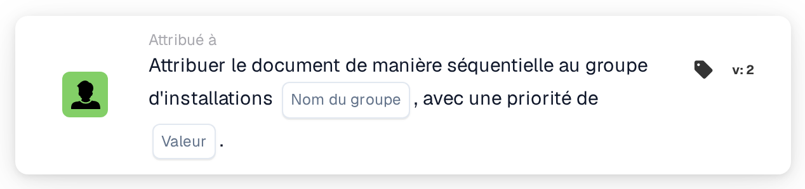

# Attribuer séquentiellement au groupe d'établissement

<figure><figcaption>
Version 2
</figcaption></figure>

## Objectif :

Cette carte de workflow ajoute le groupe responsable de l'établissement du bon de commande du document à l'attribution séquentielle de ce document. Comme **Assign Document to Facility Group**, elle trouve le groupe grâce au code d'établissement des bons de commande rapprochés. Au lieu d'attribuer immédiatement le document, elle ajoute le groupe à l'ordre des approbateurs avec une priorité, de sorte que plusieurs cartes séquentielles d'un workflow puissent former une chaîne d'attributions.

## Composants de la carte :

1. **Nom du groupe**
   * **Description :** la partie du nom que les groupes d'établissement ont en commun.
   * **Détail :** un texte comparé aux noms des groupes d'utilisateurs de l'organisation. Un groupe correspond si son nom contient ce texte et le code d'établissement du bon de commande. La comparaison ne tient pas compte des majuscules et des minuscules. Par exemple, avec le nom de groupe **Approver** et un bon de commande pour l'établissement **1000**, un groupe nommé **Approver 1000** correspondrait.
2. **Valeur**
   * **Description :** la priorité du groupe au sein de l'attribution séquentielle.
   * **Détail :** un nombre entier. Les nombres les plus faibles passent en premier, 0 étant la priorité la plus élevée. Si aucune valeur n'est saisie, ou si une valeur négative est saisie, la priorité 1 est utilisée.

## Fonctionnalité :

* **Détermination de l'établissement :** la carte lit les bons de commande auxquels le document est rapproché et relève le code d'établissement (le site du bon de commande) de chacun d'eux.
* **Détermination du groupe :** pour chaque code d'établissement, la carte recherche les groupes d'utilisateurs dont le nom contient à la fois le **Nom du groupe** indiqué sur la carte et le code d'établissement. Les codes d'établissement pour lesquels aucun groupe n'est trouvé sont listés dans le journal du workflow.
* **Exécution de l'action :** chaque groupe correspondant est ajouté à l'attribution séquentielle avec la priorité du champ **Valeur**. L'attribution elle-même a lieu à la fin de l'exécution du workflow : l'entrée dont le numéro de priorité est le plus faible est attribuée en premier, et toutes les entrées, y compris la première, sont enregistrées sur le document comme ses demandes d'approbation. Les étapes suivantes de la séquence en sont tirées par ordre croissant de priorité. Si une autre carte a déjà attribué directement le document au cours de la même exécution, cette première attribution séquentielle est ignorée.
* **Données manquantes :**
  * Si aucun nom de groupe n'est saisi sur la carte, la carte ne s'exécute pas et signale les données manquantes dans le journal du workflow.
  * Si le document n'est rapproché d'aucun bon de commande, la carte signale les données manquantes au lieu d'ajouter un groupe.
  * Si aucun groupe ne correspond à l'un des codes d'établissement, aucun groupe n'est ajouté et le journal du workflow indique qu'aucun groupe correspondant n'a été trouvé.

## Mise en place et configuration :

* Les groupes d'utilisateurs devraient être nommés de sorte que chaque nom contienne la partie commune du nom et le code d'établissement, par exemple **Approver 1000**, **Approver 2000**.
* La carte peut être ajoutée depuis la catégorie **Attribué à**. Ensuite, la partie commune du nom des groupes est saisie dans le champ **Nom du groupe** et la priorité dans le champ **Valeur**.
* Pour former une chaîne d'approbateurs, plusieurs cartes séquentielles peuvent être combinées dans le workflow, chacune avec sa propre priorité, par exemple le groupe d'établissement avec la priorité 1 et un groupe central avec la priorité 2.

## Conclusion :

La carte de workflow « Assign Sequentially to Facility Group » place l'équipe d'établissement responsable à une position définie dans une approbation séquentielle. Combinée à d'autres cartes séquentielles, elle permet des chaînes d'approbation dans lesquelles l'équipe d'établissement constitue l'une des étapes.
