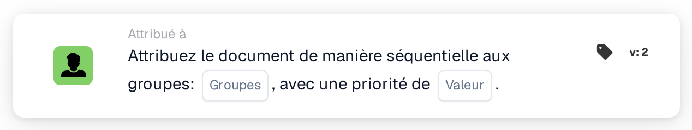

# Attribuer séquentiellement aux groupes

<figure><figcaption>
Version 2
</figcaption></figure>

## **Objectif**

La carte de workflow « **Attribuer le document de manière séquentielle aux groupes** » permet l'attribution séquentielle de documents à un ou plusieurs groupes sélectionnés. La valeur de priorité détermine l'ordre d'attribution, les nombres les plus faibles représentant la priorité la plus élevée.

## **Composants de la carte**

1. **Groupe**
   * **Descriptif** : spécifie les groupes qui recevront l'attribution du document.
   * **Détail** : un menu déroulant où un ou plusieurs groupes peuvent être sélectionnés pour l'attribution du document.
2. **Priorité (Valeur)**
   * **Descriptif** : un champ de saisie numérique où le niveau de priorité des groupes peut être défini.
   * **Détail** : les nombres les plus faibles indiquent une priorité plus élevée, garantissant que les documents sont attribués aux groupes par ordre croissant de priorité.

## **Fonctionnalité**

* **Attribution du document** :\
  La carte attribue les documents de manière séquentielle aux groupes sélectionnés en fonction de leurs valeurs de priorité.\
  Si plusieurs groupes partagent la même priorité, les documents sont attribués dans l'ordre de sélection des groupes.

## **Mise en place et configuration**

1. Ajoutez la carte **Attribuer le document de manière séquentielle** à votre workflow.
2. Configurez le champ **Groupe** :
   * Sélectionnez un ou plusieurs groupes dans le menu déroulant.
3. Configurez le champ **Priorité (Valeur)** :
   * Saisissez une valeur numérique pour définir la priorité d'attribution.
4. Enregistrez et activez le workflow pour appliquer la configuration.

## **Conclusion**

La carte de workflow « Assign the Document Sequentially to Groups » garantit une attribution efficace des documents à un ou plusieurs groupes en fonction de la priorité. Cette fonctionnalité facilite un traitement des documents flexible et organisé entre plusieurs équipes ou services.

<!-- workflow-card-practical-example-20261021 -->

## Exemple pratique

**Quand utiliser :** Priorisez l'attribution des documents aux équipes de révision.

**Configuration :** Sélectionnez les groupes de démonstration configurés et définissez la priorité requise, par exemple `10`.

**Résultat attendu et contre-exemple :** Le document reçoit les affectations de groupe sélectionnées avec cette priorité. Testez une deuxième priorité séparément lorsque les groupes doivent occuper des étapes différentes.

Il s’agit d’une configuration illustrative et du résultat attendu. Utilisez les champs, utilisateurs et groupes configurés dans votre organisation de test ; cela ne veut pas dire que cet exemple a été exécuté.
