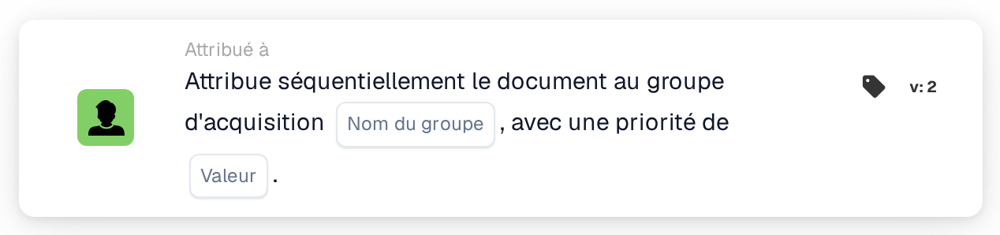

# Attribuer séquentiellement au groupe d'approvisionnement

<figure><figcaption>
Version 2
</figcaption></figure>

## **Objectif**

La carte de workflow « **Attribuer le document de manière séquentielle au groupe d'approvisionnement** » permet l'attribution séquentielle de documents à un groupe d'approvisionnement spécifié. La valeur de priorité détermine l'ordre d'attribution, les nombres les plus faibles représentant la priorité la plus élevée.

## **Composants de la carte**

1. **Groupe**
   * **Descriptif** : un champ de saisie de texte où le nom du groupe d'approvisionnement peut être saisi.
   * **Détail** : spécifie le groupe d'approvisionnement auquel le document sera assigné.
2. **Priorité (Valeur)**
   * **Descriptif** : un champ de saisie numérique où le niveau de priorité du groupe peut être défini.
   * **Détail** : les nombres les plus faibles indiquent une priorité plus élevée, garantissant que les documents sont attribués aux groupes par ordre croissant de priorité.

## **Fonctionnalité**

* **Attribution du document** :\
  La carte attribue les documents au groupe d'approvisionnement spécifié de manière séquentielle.\
  Les valeurs de priorité dictent l'ordre d'attribution, les nombres les plus faibles étant traités en premier.

## **Mise en place et configuration**

1. Ajoutez la carte **Attribuer le document de manière séquentielle** à votre workflow.
2. Configurez le champ **Groupe** :
   * Saisissez le nom du groupe d'approvisionnement dans le champ de texte.
3. Configurez le champ **Priorité (Valeur)** :
   * Saisissez une valeur numérique pour définir la priorité d'attribution.
4. Enregistrez et activez le workflow pour appliquer la configuration.

## **Conclusion**

La carte de workflow « Assign the Document Sequentially to the Procurement Group » garantit une attribution efficace des documents aux groupes d'approvisionnement en fonction de la priorité. Cela améliore l'efficacité organisationnelle et la gestion des tâches.

<!-- workflow-card-practical-example-20261021 -->

## Exemple pratique

**Quand utiliser :** Donner la priorité à un groupe d'approvisionnement dans le cadre de l'examen des documents.

**Configuration :** Sélectionnez `Demo Procurement` et la priorité `10`.

**Résultat attendu et contre-exemple :** Le document reçoit l'affectation du groupe d'approvisionnement en priorité `10`. Vérifiez que les affectations ultérieures utilisent les priorités numériques supérieures prévues.

Il s’agit d’une configuration illustrative et du résultat attendu. Utilisez les champs, utilisateurs et groupes configurés dans votre organisation de test ; cela ne veut pas dire que cet exemple a été exécuté.
