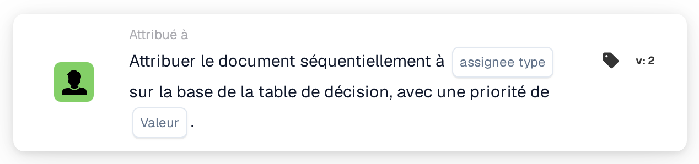
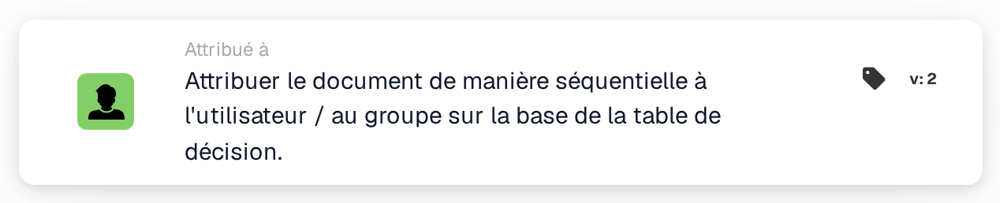

# Attribuer séquentiellement à l'utilisateur/au groupe

<figure><figcaption>
Version 2
</figcaption></figure>

<figure><figcaption>
Attribuer le document de manière séquentielle à l'utilisateur / au groupe sur la base de la table de décision. — Version 2
</figcaption></figure>

## **Objectif**

La carte de workflow « **Attribuer le document de manière séquentielle à l'utilisateur/au groupe en fonction de la table de décision** » assigne dynamiquement des documents soit à un utilisateur, soit à un groupe, selon l'évaluation de la table de décision. Cela garantit que les documents sont acheminés de manière appropriée en fonction de règles prédéfinies.

## **Composants de la carte**

1. **Priorité (Valeur)**
   * **Descriptif** : spécifie le niveau de priorité des attributions, où les nombres les plus faibles représentent la priorité la plus élevée.
   * **Détail** : un champ de saisie numérique où la valeur de priorité peut être définie pour contrôler la séquence d'attribution.

## **Fonctionnalité**

* **Évaluation de la table de décision** :\
  La table de décision évalue des conditions prédéfinies pour décider si le document est assigné à un utilisateur ou à un groupe.
* **Attribution du document** :
  * Si la table de décision renvoie un utilisateur, le document est assigné directement à cet utilisateur.
  * Si la table de décision renvoie un groupe, le document est assigné au groupe de manière séquentielle, en respectant la valeur de priorité spécifiée.

## **Mise en place et configuration**

1. Ajoutez la carte **Attribuer le document de manière séquentielle** à votre workflow.
2. Configurez le champ **Priorité (Valeur)** :
   * Saisissez une valeur numérique pour définir la priorité d'attribution.
3. Enregistrez et activez le workflow pour appliquer la configuration.

## **Conclusion**

La carte de workflow « **Attribuer le document de manière séquentielle à l'utilisateur/au groupe en fonction de la table de décision** » garantit un acheminement efficace et dynamique des documents. En s'appuyant sur la logique de la table de décision et les valeurs de priorité, la carte facilite une attribution précise soit à un utilisateur, soit à un groupe, rationalisant les workflows documentaires.

<!-- workflow-card-practical-example-20261021 -->

## Exemple pratique

**Quand utiliser :** Utilisez une table de décision pour sélectionner un responsable de document prioritaire.

**Configuration :** Configurez une règle de table de décision de démonstration correspondante renvoyant l'utilisateur ou le groupe prévu, puis sélectionnez cette table sur la carte.

**Résultat attendu et contre-exemple :** Le destinataire renvoyé est utilisé pour l'affectation séquentielle des documents. En l’absence de retour correspondant, ne supposez pas un responsable par défaut ; inspectez le résultat et le comportement de repli configuré de cette version.

Il s’agit d’une configuration illustrative et du résultat attendu. Utilisez les champs, utilisateurs et groupes configurés dans votre organisation de test ; cela ne veut pas dire que cet exemple a été exécuté.
