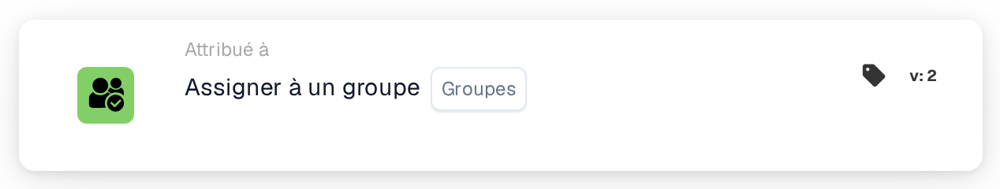
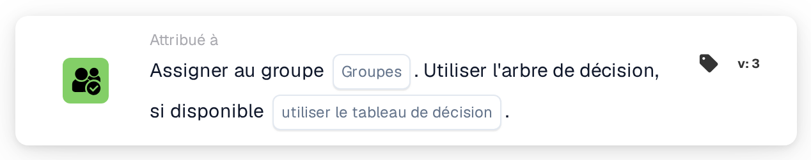

# Attribuer au groupe

<figure><figcaption>
Version 2
</figcaption></figure>

<figure><figcaption>
Version 3
</figcaption></figure>

## Objectif :

La carte de workflow **« Assign to Group »** facilite l'attribution de documents à un **groupe** spécifique au sein du système. Cela garantit que le document est traité par l'équipe appropriée, rationalisant le workflow. Améliorée dans les versions ultérieures, elle introduit une fonctionnalité d'arbre de décision pour l'attribution dynamique de groupe.

## Composants de la carte :

1. **Groupes**
   * **Descriptif :** spécifie le **groupe** auquel le document sera assigné.
   * **Détail :** sélectionné dans une liste déroulante de **groupes** disponibles.

## **Composants supplémentaires dans la Version 3**

1. **Arbre de décision (Version 3 uniquement)**
   * **Descriptif :** permet d'utiliser un arbre de décision pour déterminer dynamiquement le **groupe** auquel le document doit être assigné.
   * **Possibilités :**
     * **True :** active le traitement par arbre de décision.
     * **False :** désactive le traitement par arbre de décision.

## Fonctionnalité :

* **Évaluation de la condition :** la carte n'exécute son action que si les sections **« Quand »** et **« Et »** sont toutes deux évaluées comme vraies.
* **Attribution du document :** assigne le document au **groupe** sélectionné. Dans la **Version 3**, l'**arbre de décision** détermine dynamiquement le groupe cible s'il est activé.

## Mise en place et configuration :

* **Sélectionner le groupe :** choisissez le **groupe** dans la liste déroulante pour assigner le document.
* **Utiliser l'Arbre de Décision (Version 3 uniquement) :** activez cette option si l'**arbre de décision** doit être utilisé pour l'attribution dynamique.

## Conclusion :

La carte de workflow **« Assign to Group »** automatise l'attribution des documents à des **groupes** prédéfinis, renforçant la coordination des équipes. La **Version 3** introduit la possibilité d'attribuer dynamiquement des groupes sur la base de la logique d'un arbre de décision.

<!-- workflow-card-practical-example-20261021 -->

## Exemple pratique

**Quand utiliser :** Placez un document dans une file d'attente de révision partagée.

**Configuration :** Sélectionnez le groupe configuré `Demo Finance`.

**Résultat attendu et contre-exemple :** Le document est affecté au groupe sélectionné. Il s'agit d'une attribution de document et non d'une promesse de création d'une tâche ou d'un e-mail supplémentaire.

Il s’agit d’une configuration illustrative et du résultat attendu. Utilisez les champs, utilisateurs et groupes configurés dans votre organisation de test ; cela ne veut pas dire que cet exemple a été exécuté.
