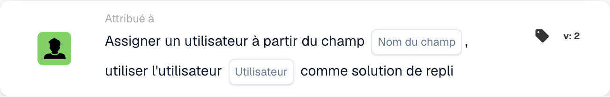

# Attribuer un utilisateur à partir du champ

<figure><figcaption>
Champs de la carte dans la version affichée. Les champs ne sont pas encore renseignés.
</figcaption></figure>

## **Objectif :**

La carte de workflow **« Attribuer un utilisateur à partir du champ avec repli »** assigne dynamiquement un utilisateur en fonction de la valeur trouvée dans un champ de document spécifié. Si le champ ne contient pas d'utilisateur valide, un utilisateur de repli est sélectionné dans une liste prédéfinie d'utilisateurs disponibles pour garantir que la tâche ou l'action est correctement assignée.

## **Composants de la carte :**

1. **Nom du champ**
   * **Descriptif :** spécifie le **champ de document** qui contient les informations de l'utilisateur à assigner.
   * **Détail :** ce champ est évalué pour déterminer quel utilisateur doit être assigné. Si le champ contient un utilisateur valide, cet utilisateur se verra attribuer la tâche. Si le champ est vide ou invalide, l'utilisateur de repli sera assigné.
2. **Utilisateur (repli)**
   * **Descriptif :** spécifie l'**utilisateur de repli** à assigner si le champ de document ne contient pas d'utilisateur valide.
   * **Détail :** une liste déroulante de tous les utilisateurs disponibles est proposée pour la sélection. Cet utilisateur sera assigné si le champ de document est vide ou ne contient pas d'utilisateur valide.

## **Fonctionnalité :**

* **Évaluation de la condition :**\
  La carte n'exécute son action que si les sections **« Quand »** et **« Et »** sont toutes deux évaluées comme vraies.
* **Attribution d'utilisateur basée sur un champ :**\
  La carte tente d'abord d'assigner la tâche ou l'action à l'utilisateur identifié dans le **Nom du champ**.
* **Attribution d'utilisateur de repli :**\
  Si le champ ne contient pas d'utilisateur valide (ou est vide), la carte assigne la tâche à l'utilisateur de repli sélectionné dans la liste déroulante **Utilisateur (remplacement)**.

## **Mise en place et configuration :**

* **Sélectionnez le Nom du champ :**\
  Choisissez le **champ de document** qui spécifie l'utilisateur de l'attribution.
* **Sélectionner l'utilisateur de repli :**\
  Choisissez l'**utilisateur de repli** dans la liste déroulante. Cet utilisateur se verra attribuer la tâche si le champ de document ne contient pas d'utilisateur valide.

## **Conclusion :**

La carte de workflow **« Attribuer un utilisateur à partir du champ avec repli »** garantit qu'une tâche ou une action est toujours assignée à un utilisateur valide. Si l'utilisateur du champ de document n'est pas disponible, l'utilisateur de repli est automatiquement assigné, offrant de la flexibilité et garantissant l'achèvement de la tâche.

<!-- workflow-card-practical-example-20261021 -->

## Exemple pratique

**Quand utiliser :** Attribuez le réviseur nommé par les données du document.

**Configuration :** Sélectionnez le champ `reviewer_name` et l'utilisateur de secours `Demo Reviewer A`. Fournissez un nom d’utilisateur de démonstration résoluble lors du premier test.

**Résultat attendu et contre-exemple :** Une valeur de champ valide sélectionne cet utilisateur. Une valeur vide ou insoluble utilise la solution de repli configurée ; vérifier les deux cas.

Il s’agit d’une configuration illustrative et du résultat attendu. Utilisez les champs, utilisateurs et groupes configurés dans votre organisation de test ; cela ne veut pas dire que cet exemple a été exécuté.
