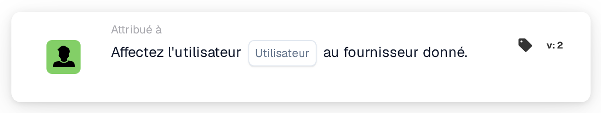

# Affecter un utilisateur au fournisseur

<figure><figcaption>
Version 2
</figcaption></figure>

## Objectif :

Cette carte de workflow définit l'utilisateur affecté à un fournisseur enregistré. L'utilisateur affecté est l'interlocuteur interne responsable du fournisseur. La carte ne travaille pas sur un document : elle est destinée aux workflows démarrés par un changement de statut d'un fournisseur, par exemple avec la carte When **Supplier status changed**. Le fournisseur dont le statut a changé est celui auquel l'utilisateur est affecté.

## Composants de la carte :

1. **Utilisateur**
   * **Description :** l'utilisateur qui devient l'utilisateur affecté au fournisseur.
   * **Détail :** un utilisateur de l'organisation peut être sélectionné. Si un utilisateur est déjà affecté au fournisseur, il est remplacé.

## Fonctionnalité :

* **Exécution de l'action :** la carte reprend le fournisseur de l'exécution du workflow et enregistre l'utilisateur sélectionné comme utilisateur affecté au fournisseur. Le résultat est consigné dans le journal du workflow.
* **Utilisation avec les e-mails :** une fois un utilisateur affecté, des e-mails peuvent lui être adressés avec l'option **Utilisateur affecté au fournisseur**, par exemple dans la carte **Send Email**.
* **Données manquantes :** si aucun utilisateur n'est sélectionné sur la carte, la carte ne s'exécute pas et signale les données manquantes dans le journal du workflow.
* **Erreurs :** si le service fournisseurs rejette la requête ou ne répond pas à temps, la carte se termine par une erreur.

## Mise en place et configuration :

* La carte peut être utilisée dans un workflow démarré par un changement de statut d'un fournisseur.
* La carte peut être ajoutée depuis la catégorie **Attribué à**. Ensuite, l'utilisateur qui devrait être responsable du fournisseur est sélectionné dans le champ **Utilisateur**.

## Conclusion :

La carte de workflow « Assign User to Supplier » attribue automatiquement un interlocuteur responsable à chaque fournisseur lorsque son statut change, par exemple après l'inscription. Les étapes ultérieures, comme les e-mails à l'utilisateur affecté, peuvent s'appuyer sur cette affectation.
