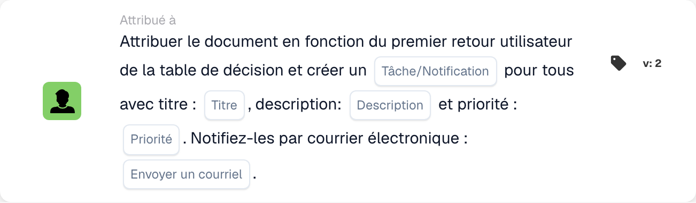
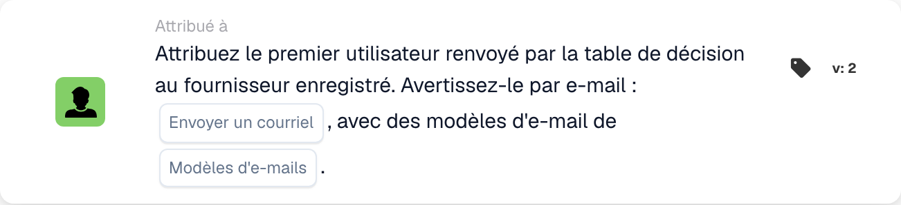

# Affectation de documents et cartes d'utilisateur

## Affectation de documents et cartes utilisateur - Guide complet

**Couvertures :** 13 cartes d'affectation et liées à l'utilisateur

***

Les cartes de cette page vont dans le groupe **Alors** du Workflow Builder — les actions qui s'exécutent une fois que les conditions Quand/Et correspondent :

<figure><figcaption><p>Exemple non enregistré avec les cartes Quand, Et et Alors. Renseignez tous les champs avant exécution.</p></figcaption></figure>

***

### 📌 Informations sur la version

**Cartes multi-versions :** DOC\_USER\_ASSIGN (v2 dernière, v3 obsolète), DOC\_GROUP\_ASSIGN (v2 dernière, v3 obsolète), OC\_ASSIGN\_DOC (v2)

**Important :** Les versions v3 ont ajouté la prise en charge de l'arbre de décision mais sont désormais obsolètes **Recommandation :** Utilisez la v2 pour DOC\_USER\_ASSIGN et DOC\_GROUP\_ASSIGN

📖 [Historique complet des versions](../../release.md) | [Versions et comportement des cartes](../../cards-overview/card-versions-guide.md)

***

## Affectation de documents de base

### Carte : DOC\_USER\_ASSIGN / Attribuer un document à l'utilisateur

#### Objectif

Attribue un document à une personne spécifique pour son action

#### Quand utiliser

* Le document nécessite l'examen d'une personne spécifique
* Transfert à un membre individuel de l'équipe
* Suivi de la responsabilité
* Attribuer le travail à une personne nommée

#### Comment ça marche

```
Document is "assigned to" = John Smith
Only John can see it as assigned to him
John is responsible for this document
```

#### Exemple

```
Invoice arrives
    ↓
Assign Document to: John Smith (Finance Manager)
    ↓
Only John sees "Assigned to Me"
John must take action on it
```

#### Paramètres

```
User: [Select which person]
```

#### Remarque

Attribuer signifie :

* Le document apparaît comme "attribué à moi" pour cette personne
* Cette personne est responsable
* Les autres peuvent toujours voir le document (mais pas tel qu'il leur est attribué)
* Une mission à la fois par document

***

### Carte : DOC\_GROUP\_ASSIGN / Attribuer un document au groupe

#### Objectif

Attribue un document à un groupe (tous les membres le voient comme qui leur est attribué)

#### Quand utiliser

* Document pour l'équipe, pas pour l'individu
* Plusieurs personnes peuvent gérer
* Responsabilité partagée
* Répartition de la charge de travail de l'équipe

#### Comment ça marche

```
Document is "assigned to" = Finance Team (10 people)
All 10 team members see "Assigned to My Group"
Any team member can take action
```

#### Exemple

```
New vendor invoice
    ↓
Assign Document to: Procurement Team
    ↓
All procurement team members see it
First available person handles it
```

#### Paramètres

```
Group: [Select which group]
```

#### Différence

```
Individual Assignment:
- One person responsible
- That person sees "Assigned to Me"
- Others don't see assignment

Group Assignment:
- Team responsible
- All members see "Assigned to My Group"
- Anyone can claim/process
```

***

### Carte : ACTION\_ASSIGN\_DOC\_BASED\_ON\_DECISION\_TABLE

#### Objectif

Attribue un document en fonction de la logique de la table de décision

#### Quand utiliser

* Différents fournisseurs ont besoin de différents gestionnaires
* Affectation en fonction du montant
* Logique de routage complexe
* Plusieurs conditions d'affectation

#### Comment ça marche

```
Decision Table Logic:
  If Supplier = "ABC Corp" → Assign to: Procurement Team
  If Supplier = "XYZ Inc" → Assign to: Direct Manager
  If Amount > €10000 → Assign to: Finance Director

Document arrives
    ↓
Check: Which condition matches?
    ↓
Assign accordingly
```

#### Exemple : affectation basée sur un montant

```
Invoice: €2000 from ABC Corp

Decision Table checks:
  Is amount > €10000? NO
  Is amount > €5000? NO
  Is amount > €1000? YES

Result: Assign to: Finance Manager
```

#### Exemple : affectation basée sur le fournisseur

```
Invoice from: Preferred Supplier

Decision Table:
  If preferred supplier → Finance Team
  If new supplier → Procurement Manager
  If blacklisted → Director Review

Result: Assign to: Finance Team
```

#### Paramètres

```
Decision Table: [Select decision table]
(Decision table contains assignment logic)
```

***

### Carte : ACTION\_ASSIGN\_DOC\_DECISION\_TABLE\_SEQUENTIAL

#### Objectif

Attribue le document de manière séquentielle en fonction d'un tableau de décision avec des priorités

#### Quand utiliser

* Plusieurs approbations séquentielles
* Différentes personnes à différents niveaux
* Chaîne d'approbation basée sur le montant
* Chemin d'escalade

#### Comment ça marche

```
First Decision: Who approves first?
    ↓
Assign to: Person 1
    ↓
Person 1 approves
    ↓
Second Decision: Who approves next?
    ↓
Assign to: Person 2
    ↓
Person 2 approves (final)
    ↓
Document Complete
```

#### Système de priorité

```
Priority 1: First assignment
Priority 2: Second assignment
Priority 3: Third assignment
(etc.)

Each must complete before next begins
```

#### Exemple : approbation à plusieurs niveaux

```
Invoice: €50,000

Decision Table:
  €1k-€5k → Assign to: Finance Manager (Priority 1)
  €5k-€20k → Then: Assign to: Finance Director (Priority 2)
  €20k+ → Then: Assign to: CFO (Priority 3)

Invoice Flow:
1. Finance Manager reviews → approves
2. Finance Director reviews → approves
3. CFO reviews → approves final

Each step depends on previous completion
```

#### Paramètres

```
Decision Table: [Select]
Priority Order: [Determined by decision table]
```

***

### Carte : ACTION\_ASSIGN\_DOC\_TO\_USER\_SEQUENTIAL

#### Objectif

Attribue le document à l'utilisateur avec une priorité séquentielle

#### Quand utiliser

* Le document nécessite une personne spécifique
* Traitement séquentiel clair
* Mission unique avec commande

#### Comment ça marche

```
Assign Document to: User A (Priority 1)
    ↓
User A processes
    ↓
Then: Assign to User B (Priority 2)
    ↓
User B processes
```

#### Exemple

```
Invoice processing:
1. Assign to: Accounts Payable Clerk
2. Then: Assign to: Finance Manager
3. Then: Assign to: Director

Each person has their turn
```

***

### Carte : ACTION\_ASSIGN\_DOC\_TO\_GROUP\_SEQUENTIAL

#### Objectif

Attribue le document de manière séquentielle aux groupes

#### Quand utiliser

* Approbations de groupes multiples
* Différents départements à chaque étape
* Traitement séquentiel en équipe

#### Comment ça marche

```
Step 1: Assign to Group A (Quality Team)
        Quality verifies
    ↓
Step 2: Assign to Group B (Finance Team)
        Finance reviews
    ↓
Step 3: Assign to Group C (Procurement)
        Procurement approves
```

#### Exemple

```
New Supplier Onboarding:

Step 1: Quality Team
  - Evaluate supplier capability
  - Check certifications

Step 2: Finance Team
  - Check payment terms
  - Verify pricing

Step 3: Procurement Team
  - Approve supplier
  - Set up in system

Document passes through all three
```

***

### Carte : ACTION\_ASSIGN\_DOC\_TO\_FACILITY\_GROUP

#### Objectif

Attribue le document à un groupe d'installations spécifique

#### Quand utiliser

* Document pour un entrepôt/installation spécifique
* Opérations basées sur les installations
* Traitement spécifique à l'emplacement

#### Exemple

```
Shipment notification

Assign to: Berlin Warehouse Team
    ↓
Berlin warehouse processes shipment
    ↓
Or

Assign to: Munich Warehouse Team
    ↓
Munich warehouse processes shipment
```

***

### Carte : ACTION\_ASSIGN\_DOC\_TO\_FACILITY\_GROUP\_SEQUENTIAL

#### Objectif

Attribué de manière séquentielle dans les installations

#### Quand utiliser

* Traitement multi-sites
* L'expédition passe par des installations
* Flux de travail basé sur la localisation

#### Exemple

```
Manufacturing Order:

Step 1: Factory A (Manufacturing) - Build product
Step 2: Quality Center (Testing) - Test product
Step 3: Distribution Center (Packing) - Package
Step 4: Warehouse (Storage) - Store

Document/shipment passes through each
```

***

### Carte : ACTION\_ASSIGN\_DOC\_TO\_PROCUREMENT\_GROUP

#### Objectif

Attribue le document au service des achats

#### Quand utiliser

* Gestion de l'équipe d'approvisionnement
* Travaux liés aux fournisseurs
* Lié au bon de commande

#### Exemple

```
Vendor evaluation document
    ↓
Assign to: Procurement Group
    ↓
Procurement team evaluates vendor
```

***

### Carte : ACTION\_ASSIGN\_DOC\_TO\_PROCUREMENT\_GROUP\_SEQUENTIAL

#### Objectif

Affectation séquentielle au sein des achats

#### Quand utiliser

* Processus d'approvisionnement en plusieurs étapes
* Chaîne d'approbation dans les achats

#### Exemple

```
Purchase Requisition:

Step 1: Buyer (Creates PO)
Step 2: Approver (Reviews)
Step 3: Director (Final sign-off)

Each step in sequence
```

***

### Fiche : ACTION\_CHANGE\_DOC\_SUBORG / Modifier la sous-organisation du document

#### Objectif

Attribue le document à différentes sous-organisations

#### Quand utiliser

* Mauvaise organisation sélectionnée
* Besoin de déménager dans le bon département
* Restructuration organisationnelle

#### Comment ça marche

```
Current Sub-Org: Finance Department
    ↓
Change to: Accounting Department
    ↓
Document now belongs to Accounting
```

#### Exemple

```
Document for: Berlin Office
    ↓
Realize should be: Munich Office
    ↓
Change Sub-Organization to: Munich Office
```

***

### Carte : ACTION\_CHANGE\_DOC\_SUBORG\_BY\_FIELD\_TEXT

#### Objectif

Modifie la sous-organisation en fonction de la valeur du champ du document

#### Quand utiliser

* Sous-organisation stockée dans le champ
* Faire correspondre l'emplacement du document avec le champ
* Affectation automatique de l'organisation

#### Comment ça marche

```
Document Field: "Delivery_Location" = "Berlin"
    ↓
Decision Table:
  If location = "Berlin" → Assign to: Berlin Sub-Org
  If location = "Munich" → Assign to: Munich Sub-Org

    ↓
Document assigned to: Berlin Sub-Org
```

#### Exemple

```
Invoice field: "Cost Center: CC-Berlin-001"
    ↓
System recognizes: Berlin location
    ↓
Change document to: Berlin Sub-Organization
```

***

### Carte : ACTION\_ASSIGN\_USER\_FROM\_FIELD\_WITH\_FALLBACK

#### Objectif

Attribue le document à l'utilisateur à partir du champ, avec solution de secours si l'utilisateur est introuvable

#### Quand utiliser

* Nom d'utilisateur stocké dans le champ du document
* Peut ne pas exister dans le système
* Besoin d'une sauvegarde si l'utilisateur n'est pas disponible

#### Comment ça marche

```
Document Field: "Approver: John Smith"
    ↓
Try to assign to: John Smith
    ↓
If John doesn't exist:
    ↓
Use Fallback: Sarah Johnson (Manager)
    ↓
Document assigned to: Sarah Johnson
```

#### Paramètres

```
Source Field: [Field containing user name]
Fallback User: [If source user not found]
```

#### Exemple

```
Invoice has field: "Contact Person: Mike Johnson"

Try to assign to: Mike Johnson
    ↓
If Mike not in system:
    ↓
Fallback to: Finance Manager (Robert)
```

***

### Carte : ACTION\_ASSIGN\_USER\_TO\_SUPPLIER

#### Objectif

Attribue le document à l'utilisateur qui gère ce fournisseur

#### Quand utiliser

* Utilisateur lié au fournisseur
* Responsable de comptes fournisseurs
* Responsable de la relation fournisseur

#### Comment ça marche

```
Document Supplier: ABC Corp
    ↓
System checks: Who manages ABC Corp?
    ↓
Assign to: John Smith (ABC Corp Account Manager)
```

***

## Arbres de décision d'affectation

### Tableau de décision, exemple 1 : basé sur le montant

```
Amount ≤ €1000
  → Assign to: Finance Team

Amount €1000-€5000
  → Assign to: Finance Manager

Amount €5000-€20000
  → Assign to: Finance Director

Amount > €20000
  → Assign to: CFO
```

### Exemple de tableau de décision 2 : basé sur le fournisseur

```
Supplier Type = "Preferred"
  → Assign to: Account Manager

Supplier Type = "New"
  → Assign to: Procurement Manager

Supplier Type = "Problem"
  → Assign to: Procurement Director
```

### Exemple de table de décision 3 : basé sur le type de document

```
Document Type = "Invoice"
  → Assign to: Accounts Payable Team

Document Type = "Credit Memo"
  → Assign to: Finance Manager

Document Type = "PO"
  → Assign to: Procurement Team
```

***

## Exemples de flux de travail d'affectation

### Exemple 1 : routage simple

```
Document Arrives
    ↓
Check: Supplier = "ABC Corp"? YES
    ↓
Assign to: John Smith
(John handles ABC Corp)
    ↓
John reviews and approves
```

### Exemple 2 : Approbation séquentielle

```
Document Arrives
    ↓
Assign to: Finance Manager (Step 1)
    ↓
Manager reviews
    ↓
Passes to: Finance Director (Step 2)
    ↓
Director reviews
    ↓
Passes to: CFO (Step 3)
    ↓
CFO approves final
```

### Exemple 3 : acheminement basé sur le montant

```
Invoice: €50,000
    ↓
Decision Table: Amount > €20k?
    ↓
YES → Assign to: CFO
    ↓
CFO approves directly
```

### Exemple 4 : Basé sur les installations

```
Shipment for: Berlin Office
    ↓
Assign to: Berlin Warehouse Team
    ↓
Then assign to: Berlin Distribution Team
    ↓
Both teams process in sequence
```

***

## Meilleures pratiques en matière d'affectation

✅ **Faire :**

* Gardez les tableaux de décision simples
* Tester la logique de routage avec des exemples
* Assurez-vous que tous les chemins mènent quelque part
* Avoir une solution de secours pour les utilisateurs manquants
* Décisions de routage des documents

❌ **À ne pas faire :**

* Créer des affectations circulaires (A → B → A)
* Attribuer à des utilisateurs inexistants (sans repli)
* Rendre le routage trop complexe
* Oubliez de tester le routage
* Attribuer à des personnes indisponibles

***

## Mission de dépannage

### "Document non attribué"

**Cause :** Condition non remplie ou l'utilisateur n'existe pas

**Solution :**

* Vérifier que la condition est vraie
* Vérifier que l'utilisateur existe dans le système
* Vérifier les paramètres de secours
* Examiner la logique de la table de décision

### "Mauvaise personne assignée"

**Cause :** Table de décision ou logique de routage incorrecte

**Solution :**

* Table de décision de test
* Vérifier les conditions
* Vérifier le mappage des utilisateurs
* Vérifier les valeurs des champs

### "Le devoir semble ignorer quelqu'un"

**Cause :** Ordre séquentiel incorrect

**Solution :**

* Vérifier les numéros prioritaires
* Vérifier que la séquence est correcte
* Test avec échantillon
* Examiner l'ordre des tables de décision

***

## Comparaison des cartes de mission

| Carte                                                    | Attribue à               | Type d'itinéraire  | Cas d'utilisation                   |
| ------------------------------------------------------- | ------------------------ | ----------- | -------------------------- |
| DOC\_USER\_ASSIGN                                       | Individuel               | Direct      | Mission simple          |
| DOC\_GROUP\_ASSIGN                                      | Groupe                    | Direct      | Affectation de l'équipe            |
| ACTION\_ASSIGN\_DOC\_BASED\_ON\_DECISION\_TABLE         | Résultat de la décision          | Conditionnel | Routage complexe            |
| ACTION\_ASSIGN\_DOC\_DECISION\_TABLE\_SEQUENTIAL        | Multiple (séquentiel)    | Conditionnel | Chaîne d'approbation             |
| ACTION\_ASSIGN\_DOC\_TO\_USER\_SEQUENTIAL               | Utilisateur (séquentiel)        | Commandé     | Étapes utilisateur séquentielles      |
| ACTION\_ASSIGN\_DOC\_TO\_GROUP\_SEQUENTIAL              | Groupes (séquentiels)      | Commandé     | Étapes de groupe séquentielles     |
| ACTION\_ASSIGN\_DOC\_TO\_FACILITY\_GROUP                | Groupe d'installations           | Direct      | Spécifique à l'installation          |
| ACTION\_ASSIGN\_DOC\_TO\_FACILITY\_GROUP\_SEQUENTIAL    | Installations (séquentielles)  | Commandé     | Multi-installations             |
| ACTION\_ASSIGN\_DOC\_TO\_PROCUREMENT\_GROUP             | Approvisionnement              | Direct      | Flux de travail d'approvisionnement       |
| ACTION\_ASSIGN\_DOC\_TO\_PROCUREMENT\_GROUP\_SEQUENTIAL | Approvisionnement (séquentiel) | Commandé     | Chaîne d'approbation des achats |
| ACTION\_CHANGE\_DOC\_SUBORG                             | Sous-organisation         | Direct      | Changement de département          |
| ACTION\_CHANGE\_DOC\_SUBORG\_BY\_FIELD\_TEXT            | Sous-organisation par domaine         | Conditionnel | Affectation sur le terrain     |
| ACTION\_ASSIGN\_USER\_FROM\_FIELD\_WITH\_FALLBACK       | Champ/Retour           | Conditionnel | Affectation d'utilisateur dynamique    |

***

## Cartes associées

* **ACTION\_CREATE\_TASK\_FOR\_USER** - Attribuer une tâche à la même personne
* **ACTION\_SEND\_EMAIL** - Notifier la personne désignée
* **CONDITION\_USER\_IS\_ISNOT** - Vérifiez si la bonne personne est assignée
* **CONDITION\_GROUP\_IS\_ISNOT** - Vérifiez si le bon groupe est attribué

<!-- workflow-card-example-action_assign_doc_to_first_user_and_tasks-20261021 -->

### Attribuez le document au premier utilisateur renvoyé et créez des tâches

<figure><figcaption><p>Champs de la carte dans la version affichée. Les champs ne sont pas encore renseignés.</p></figcaption></figure>

`ACTION_ASSIGN_DOC_TO_FIRST_USER_AND_TASKS` · version 2

Utilisez une règle de table de décision de démonstration renvoyant les utilisateurs configurés `Demo Reviewer A` et `Demo Reviewer B` dans cet ordre. Sélectionnez l'option de tâche/notification, le titre `Review invoice`, la description, la priorité et la préférence de courrier électronique. Le premier utilisateur renvoyé est la cible d'attribution de document et les tâches/notifications configurées ciblent les utilisateurs renvoyés. Vérifiez les deux sorties ; un retour vide ne doit pas être traité comme une cession.

<!-- workflow-card-example-action_assign_supplier_user_first_return_of_dt-20261021 -->

### Attribuer le premier utilisateur renvoyé au fournisseur

<figure><figcaption><p>Champs de la carte dans la version affichée. Les champs ne sont pas encore renseignés.</p></figcaption></figure>

`ACTION_ASSIGN_SUPPLIER_USER_FIRST_RETURN_OF_DT` · version 2

Utilisez un fournisseur de démonstration enregistré et une règle de table de décision dont le premier résultat utilisateur est `Demo Supplier Owner`. Sélectionnez la table de décision et, si nécessaire, les modèles d'e-mails. L'association fournisseur-utilisateur utilise le premier utilisateur renvoyé ; ce n'est pas la même opération que l'attribution du document. Vérifiez le résultat du fournisseur séparément et testez un retour de règle vide.
