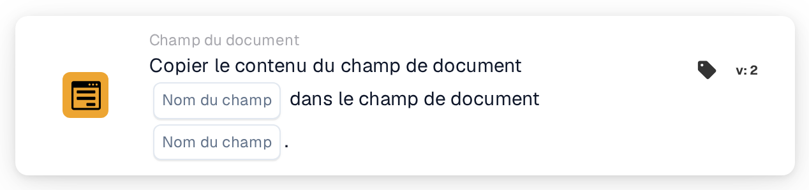

# Copier un champ de document dans un champ de document

<figure><figcaption>
Version 2
</figcaption></figure>

## Objectif :

Cette carte de workflow copie le contenu d'un champ de document dans un autre champ du même document. Elle peut servir, par exemple, à renseigner un champ nécessaire à un export ou à une carte ultérieure avec une valeur déjà extraite dans un autre champ.

## Composants de la carte :

1. **Nom du champ** (premier)
   * **Description :** le champ de document dont le contenu est copié.
   * **Détail :** le nom d'un champ de document. Le nom est comparé à l'identique, majuscules et minuscules comprises. Le champ lui-même n'est pas modifié.
2. **Nom du champ** (second)
   * **Description :** le champ de document dans lequel le contenu est copié.
   * **Détail :** le nom d'un champ de document. Son contenu actuel est remplacé par le contenu copié.

## Fonctionnalité :

* **Lecture de la valeur :** la carte recherche le premier champ parmi les champs du document et lit sa valeur. La valeur trouvée est consignée dans le journal du workflow.
* **Exécution de l'action :** la valeur est écrite dans le second champ et le document est enregistré. La valeur copiée est reprise telle quelle, sans conversion. Si le second champ n'existe pas encore sur le document, il est ajouté. Après une copie réussie, les cartes suivantes du workflow utilisent la nouvelle valeur.
* **Données manquantes :**
  * Si l'un des deux noms de champ n'est pas défini sur la carte, la carte ne s'exécute pas et signale les données manquantes dans le journal du workflow.
  * Si le document ne comporte aucun champ portant le premier nom, rien n'est copié et la carte signale que le champ est introuvable dans le document.
* **Erreurs :** si le document ne peut pas être enregistré, par exemple parce que son statut actuel n'autorise pas de modifications, la carte se termine par une erreur et le second champ conserve son contenu précédent.

## Mise en place et configuration :

* La carte peut être ajoutée depuis la catégorie **Champ du document**. Ensuite, le champ source est indiqué dans le premier emplacement **Nom du champ** et le champ cible dans le second.
* Comme la valeur est copiée sans conversion, les deux champs devraient contenir le même type de données, par exemple du texte vers du texte ou une date vers une date.

## Conclusion :

La carte de workflow « Copy Document Field into Document Field » transfère des valeurs entre champs sans intervention manuelle. Elle maintient la cohérence entre champs liés et permet aux étapes ultérieures d'un workflow d'utiliser une valeur sous le nom de champ qu'elles attendent.
