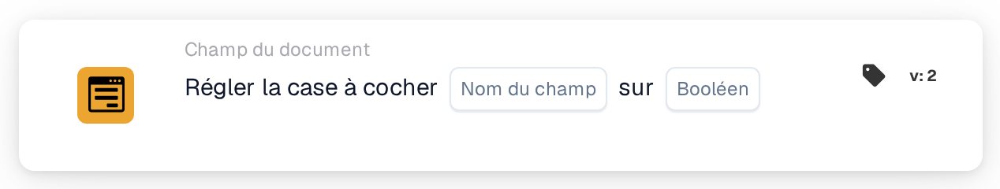

# Définissez la case à cocher sur

<figure><figcaption>
Version 2
</figcaption></figure>

## **Objectif :**

Cette carte de workflow est conçue pour définir un champ de type case à cocher sur une valeur spécifiée (true ou false) en fonction des conditions définies dans les sections **« Quand »** et **« Et »**. Elle offre un moyen simple mais efficace d'automatiser la mise à jour des cases à cocher lorsque certains critères sont satisfaits, garantissant un traitement rationalisé des documents.

## **Composants de la carte :**

1. **Nom du champ :**
   * **Descriptif** : spécifie le champ où la case à cocher sera définie.
   * **Détail** : le champ de case à cocher à mettre à jour est identifié par le nom du champ.
2. **Booléen**
   * **Descriptif** : définit la valeur sur laquelle le champ de case à cocher sera défini lorsque les conditions des sections **Où** et **Et** sont toutes deux vraies.
   * **Possibilités** :
     * **True** : la case sera définie sur **true** si les conditions sont satisfaites.
     * **False** : la case sera définie sur **false** si les conditions sont satisfaites.

## **Fonctionnalité :**

* **Évaluation de la condition** : le système évalue les conditions des sections **« Quand »** et **« Et »**.
* **Exécution de l'action** : si les sections **« Quand »** et **« Et »** sont toutes deux évaluées comme vraies, le champ de case à cocher sera mis à jour avec la valeur spécifiée (true ou false). Si l'une des conditions est fausse, aucune action n'est effectuée et la case reste dans son état initial.

## **Mise en place et configuration :**

Pour configurer cette carte, les utilisateurs doivent :

1. **Spécifier le champ de case à cocher cible** qui sera défini sur true ou false lorsque les conditions sont satisfaites.
2. **Choisir la valeur (true ou false)** sur laquelle la case sera définie lors de l'évaluation de la condition.
3. La carte n'exécute son action que si les deux conditions des sections **« Quand »** et **« Et »** sont évaluées comme vraies.

## **Conclusion :**

La carte de workflow **« Set Checkbox »** est un outil d'automatisation simple et efficace pour mettre à jour les champs de case à cocher en fonction de conditions spécifiques. En garantissant que les sections **« Quand »** et **« Et »** sont toutes deux satisfaites, elle permet aux utilisateurs d'automatiser les processus et de réduire l'intervention manuelle, garantissant un traitement des documents plus fluide et plus efficace.

<!-- workflow-card-practical-example-20261021 -->

## Exemple pratique

**Quand utiliser :** Marquez une validation réussie avec un indicateur explicite.

**Configuration :** Sélectionnez le champ de case à cocher `review_complete` et définissez-le sur `true`.

**Résultat attendu et contre-exemple :** Le champ devient coché. Exécutez l'action avec `false` dans un test séparé lorsque vous devez effacer l'indicateur.

Il s’agit d’une configuration illustrative et du résultat attendu. Utilisez les champs, utilisateurs et groupes configurés dans votre organisation de test ; cela ne veut pas dire que cet exemple a été exécuté.
