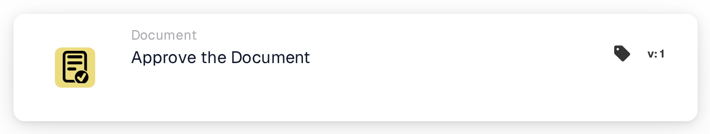
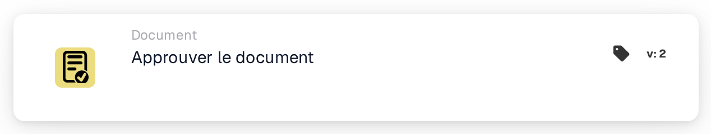

# Approuver le document

<figure><figcaption>
Version 1
</figcaption></figure>

<figure><figcaption>
Version 2
</figcaption></figure>

## **Objectif :**

La carte de workflow **« Approuver le document »** sert à marquer un document comme approuvé. Elle permet au document de progresser vers l'étape suivante du workflow, autorisant l'exécution de traitements automatisés ou de workflows d'approbation. Cette carte aide à rationaliser les processus de gestion des documents, garantissant que seuls les documents approuvés avancent vers des actions complémentaires.

## **Composants de la carte :**

1. **Statut d'approbation**
   * **Descriptif** : ce composant marque le document comme approuvé.
   * **Détail** : lorsque cette carte est déclenchée, le statut d'approbation du document est mis à jour pour indiquer l'approbation. Cette action peut être définie en fonction des conditions des sections **« Quand »** et **« Et »**.

## **Fonctionnalité :**

* **Évaluation de la condition** : le système évalue les conditions définies dans les sections **« Quand »** et **« Et »**.
  * Si **les deux conditions sont vraies**, le document sera marqué comme approuvé.
  * Si **l'une des conditions est fausse**, la carte ne s'exécute pas et le statut d'approbation du document reste inchangé.
* **Exécution de l'action** : lorsque les conditions sont satisfaites, le document est approuvé. Cette modification se reflète dans le statut du document, lui permettant de poursuivre dans le workflow.

## **Conclusion :**

La carte de workflow **« Approuver le document »** est un composant clé pour automatiser l'approbation des documents dans les workflows métier. En garantissant que seuls les documents satisfaisant des critères spécifiques sont approuvés, elle aide à maintenir la cohérence, réduit la supervision manuelle et permet un traitement plus fluide des documents.

<!-- workflow-card-practical-example-20261021 -->

## Exemple pratique

**Quand utiliser :** Approuver un document une fois que toutes les conditions d'examen requises ont été remplies.

**Configuration :** Placez cette action après les conditions de révision dans la branche réussie. Utilisez un document de démonstration en attente d'approbation.

**Résultat attendu et contre-exemple :** L'action approuve ce document. Un document qui ne répond pas à une condition antérieure n'atteint jamais cette action ; l’approbation à elle seule ne constitue pas la preuve d’une exportation ERP terminée.

Il s’agit d’une configuration illustrative et du résultat attendu. Utilisez les champs, utilisateurs et groupes configurés dans votre organisation de test ; cela ne veut pas dire que cet exemple a été exécuté.
