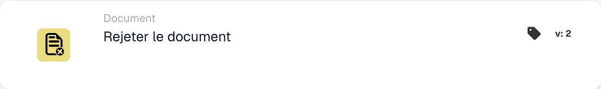

# Rejeter le document

<figure><figcaption>
Champs de la carte dans la version affichée. Les champs ne sont pas encore renseignés.
</figcaption></figure>

## **Objectif :**

La carte de workflow **« Rejeter le document »** sert à marquer un document comme rejeté au sein d'un workflow. Cette action interrompt la progression du document et l'empêche de passer à l'étape suivante du workflow. Elle garantit que les documents qui ne satisfont pas les conditions ou critères nécessaires sont signalés et empêchés de poursuivre leur traitement.

## **Composants de la carte :**

1. **Statut de rejet**
   * **Descriptif** : ce composant marque le document comme rejeté, signalant qu'il n'a pas satisfait les conditions requises pour l'approbation.
   * **Détail** : lorsqu'elle est déclenchée, cette carte met à jour le statut du document en « rejected ». Cette décision est prise en fonction des conditions définies dans les sections **« Quand »** et **« Et »**.

## **Fonctionnalité :**

* **Évaluation de la condition** : le système évalue les conditions définies dans les sections **« Quand »** et **« Et »**.
  * Si **les deux conditions sont vraies**, le document sera rejeté.
  * Si **l'une des conditions est fausse**, la carte ne s'exécute pas et le statut du document reste inchangé.
* **Exécution de l'action** : lorsque les conditions sont satisfaites, le document est marqué comme rejeté. Cette action garantit que seuls les documents satisfaisant des critères spécifiques poursuivent, tandis que les autres sont signalés et interrompus pour examen ou correction.

## **Conclusion :**

La carte de workflow **« Rejeter le document »** est un outil essentiel pour contrôler le flux des documents dans les processus automatisés. En permettant le rejet des documents non conformes, elle garantit que seuls les documents valides et exacts poursuivent dans le workflow, améliorant l'efficacité et la précision de la gestion des documents.

<!-- workflow-card-practical-example-20261021 -->

## Exemple pratique

**Quand utiliser :** Rejetez un document qui répond à une règle de rejet définie.

**Configuration :** Acheminez un document de démonstration délibérément invalide vers cette action, par exemple après une décision de rejet explicite.

**Résultat attendu et contre-exemple :** Le document est rejeté. Un document valide doit suivre une branche différente et ne doit pas exécuter cette action.

Il s’agit d’une configuration illustrative et du résultat attendu. Utilisez les champs, utilisateurs et groupes configurés dans votre organisation de test ; cela ne veut pas dire que cet exemple a été exécuté.
