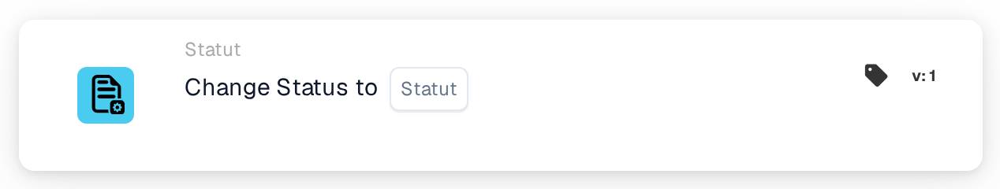
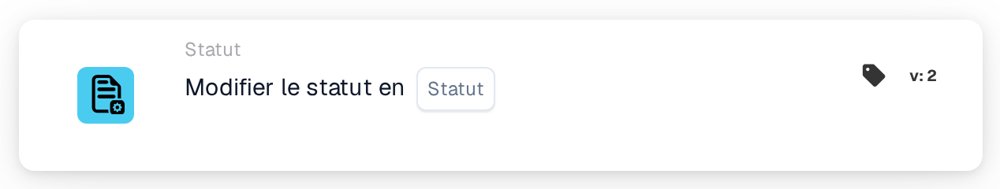
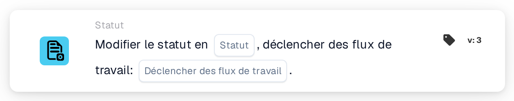

# Changer le statut en

<figure><figcaption>
Version 1
</figcaption></figure>

<figure><figcaption>
Version 2
</figcaption></figure>

<figure><figcaption>
Version 3
</figcaption></figure>

## **Objectif :**

La carte de workflow **« Change Status »** sert à changer le statut d'un document en l'un des états prédéfinis — **Erreur, Rejeté, Prêt pour validation, En attente d'approbation, En attente de deuxième approbation** — et, en option, à déclencher des workflows associés en fonction du changement de statut. Cette carte automatise le processus de mise à jour des statuts et de déclenchement de workflows, garantissant une gestion efficace des documents et une bonne gestion des erreurs.

## **Composants de la carte :**

1. **Statut**
   * **Descriptif** : spécifie le nouveau statut à appliquer au document.
   * **Possibilités** :
     * **Error** : marque le document comme ayant rencontré une erreur.
     * **Rejeté** : indique que le document a été rejeté et ne poursuivra pas.
     * **Prêt pour la validation** : place le document en attente d'examen et de validation par l'utilisateur ou le processus système suivant.
     * **En attente d'approbation** : place le document dans un état d'attente d'approbation.
     * **En attente de deuxième approbation** : met le document en attente d'un second niveau d'approbation, le cas échéant.
2. **Déclencher des workflows**
   * **Descriptif** : détermine si des workflows ultérieurs doivent être déclenchés après le changement de statut.
   * **Possibilités** :
     * **True** : lance tous les workflows pertinents en fonction du changement de statut.
     * **False** : empêche l'exécution de workflows après le changement de statut.

## **Fonctionnalité :**

* **Évaluation de la condition** : le système évalue les conditions définies dans les sections **« Quand »** et **« Et »**. Si ces conditions sont vraies, la carte procède au changement du statut du document vers la valeur sélectionnée.
* **Mise à jour du statut** : une fois les conditions satisfaites, le statut du document est mis à jour vers l'une des options prédéfinies (Error, Rejected, Ready for Validation, Pending Approval, Pending Second Approval), selon la sélection de l'utilisateur.
* **Action de déclenchement de workflow** : si **Déclencher des flux de travail** est défini sur **True**, le système lance automatiquement tous les workflows associés à la suite de la mise à jour du statut. S'il est défini sur **False**, aucun workflow supplémentaire n'est déclenché et le processus se termine avec le changement de statut.

## **Mise en place et configuration :**

Pour configurer cette carte, les utilisateurs doivent :

1. Spécifier le **Statut** souhaité sur lequel le document sera défini lors de l'évaluation de la condition (Error, Rejected, Ready for Validation, Pending Approval ou Pending Second Approval).
2. Choisir de **Déclencher des flux de travail** après le changement de statut en sélectionnant **True** ou **False**.
3. La carte n'exécute son action que si les deux conditions des sections **« Quand »** et **« Et »** sont évaluées comme vraies.

## **Conclusion :**

La carte de workflow **« Change Status »** offre une approche rationalisée pour gérer les statuts des documents et déclencher les workflows associés. Elle garantit que les documents sont automatiquement acheminés vers le bon statut et que les actions nécessaires sont effectuées, selon le changement de statut. En définissant des conditions d'exécution claires, elle réduit l'effort manuel et améliore l'efficacité du workflow.

<!-- workflow-card-practical-example-20261021 -->

## Exemple pratique

**Quand l’utiliser:** Transmettre un document vérifié à l’étape d’approbation.

**Où:** Concepteur de workflows standard → Dans ce cas → Statut → Modifier le statut en.

**Configuration:** Sélectionnez la version 3 de `staus_change`, le statut Validé en attente d'approbation (`validated_pending_approval`) et le déclenchement des autres workflows sur `false` (`trigger_docflow=false`). Utilisez une facture synthétique isolée dont les contrôles précédents sont satisfaits.

**Résultat attendu et contre-exemple:** Une mise à jour autorisée et réussie place le document dans le statut choisi. Si une condition précédente est fausse, cette action n’est pas atteinte et ne modifie aucun statut. Une mise à jour refusée ou échouée de l’API n’est pas un succès : vérifiez le statut réel et les journaux. La carte n’effectue pas elle-même une exportation.

### Versions de la carte

Le réglage explicite du déclenchement des workflows est disponible en v3. Les versions 1 et 2 ne le proposent pas ; leur ancienne méthode de mise à jour utilise le comportement de déclenchement par défaut. Ne supposez pas qu’un réglage `false` de v3 s’applique après un passage à une version antérieure.

Configuration et résultat attendu vérifiés dans le code d’exécution. Aucun workflow ni changement de statut n’a été exécuté.
