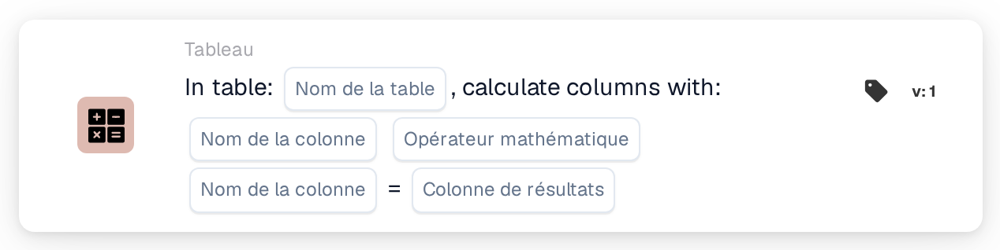
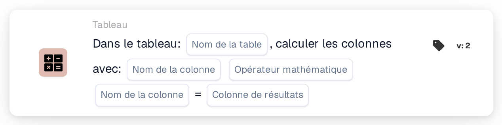

# Calculer les colonnes avec

<figure><figcaption>
Version 1
</figcaption></figure>

<figure><figcaption>
Version 2
</figcaption></figure>

## Objectif :

Cette carte de workflow calcule, ligne par ligne, une valeur à partir de deux colonnes d'un tableau du document et enregistre le résultat dans une colonne de résultat. Elle peut servir, par exemple, à calculer des totaux de ligne à partir de la quantité et du prix unitaire.

## Vidéo d’administration :



[Lire la vidéo avec des sous-titres français](https://docbits-videos.fra1.cdn.digitaloceanspaces.com/settings-assistant/workflow-card-calc-columns-admin/v1/fr.html) · [Lire la transcription](https://docbits-videos.fra1.cdn.digitaloceanspaces.com/settings-assistant/workflow-card-calc-columns-admin/v1/fr.txt)

## Composants de la carte :

1. **Tableau**
   * **Description :** le tableau du document dans lequel le calcul est effectué.
2. **Première colonne**
   * **Description :** la colonne contenant la première valeur de chaque ligne.
3. **Opération**
   * **Options :**
     * **+** ajoute la deuxième valeur à la première.
     * **-** soustrait la deuxième valeur de la première.
     * **\*** multiplie les deux valeurs.
     * **/** divise la première valeur par la deuxième.
4. **Deuxième colonne**
   * **Description :** la colonne contenant la deuxième valeur de chaque ligne.
5. **Colonne de résultat**
   * **Description :** la colonne dans laquelle le résultat de chaque ligne est enregistré.
   * **Détail :** le nom est enregistré en majuscules, les espaces étant remplacés par des traits de soulignement (`total amount` devient `TOTAL_AMOUNT`). Si la colonne n'existe pas encore, la carte l'ajoute ; si elle existe, ses valeurs sont remplacées.

Les versions 1 et 2 de la carte ont les mêmes paramètres et fonctionnent de la même manière.

## Fonctionnalité :

* **Calcul :** pour chaque ligne du tableau, la carte lit les deux colonnes (la casse des noms de colonnes n'a pas d'importance), applique l'opération et écrit le résultat dans la colonne de résultat. Les résultats sont arrondis à quatre décimales. Le document est ensuite enregistré avec les nouvelles valeurs.
  * Une valeur vide ou manquante compte comme `0`. Si les deux valeurs d'une ligne sont vides, le résultat de cette ligne reste vide.
  * Une division par zéro laisse vide le résultat de cette ligne.
  * Avec **+**, deux valeurs qui ne sont pas des nombres sont jointes par une espace au lieu d'être additionnées. Avec les autres opérations, une valeur qui n'est pas un nombre provoque une erreur, et aucun résultat n'est enregistré.
* **Exécution de l'action :** si le calcul et l'enregistrement réussissent, le workflow continue avec les cartes suivantes. Si le tableau n'existe pas sur le document, si une valeur ne peut pas être calculée ou si le document ne peut pas être enregistré, la carte signale une erreur dans le journal du workflow.
* **Tester la carte :** lorsque la carte est exécutée avec **Tester la carte**, le calcul est seulement simulé et le document n'est pas modifié.

## Mise en place et configuration :

* La carte peut être ajoutée comme action Then depuis la catégorie **Tableau**. Ensuite, le tableau, les deux colonnes, l'opération et la colonne de résultat sont sélectionnés.
* **Exemple :** tableau `INVOICE_TABLE`, `QUANTITY` **\*** `UNIT_PRICE`, colonne de résultat `TOTAL_AMOUNT`. Une ligne avec une quantité de 2 et un prix unitaire de 10 obtient 20, une ligne avec 3 et 4 obtient 12.
* Comme une valeur vide compte comme `0`, un prix manquant donne un résultat de `0`. Vérifier que les colonnes d'entrée sont renseignées, par exemple avec une condition avant cette carte, peut aider à éviter des totaux erronés.
* Pour la soustraction et la division, l'ordre des deux colonnes est important.

## Conclusion :

La carte de workflow « Calculate Columns with » ajoute automatiquement des valeurs calculées aux lignes du tableau. Les totaux de ligne et les valeurs similaires sont disponibles pour les cartes suivantes et pour l'export, sans calcul manuel.
