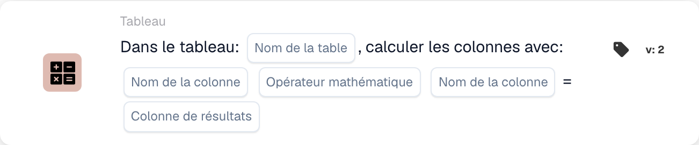

# Calculer les colonnes avec

<figure><figcaption>
Champs de la carte dans la version affichée. Les champs ne sont pas encore renseignés.
</figcaption></figure>

## **Objectif :**

La carte de workflow **« Calculer les colonnes dans le tableau »** sert à effectuer des calculs entre les colonnes d'un tableau sélectionné. Elle permet aux utilisateurs de sélectionner des colonnes, d'appliquer une opération mathématique et de stocker le résultat dans une colonne de résultat spécifiée.

## **Composants de la carte :**

1. **Nom de la table**
   * **Descriptif :** spécifie la **table** dans laquelle les colonnes seront calculées.
   * **Détail :** une liste déroulante de toutes les **tables** disponibles est proposée pour la sélection.
2. **Column Name (1re colonne)**
   * **Descriptif :** spécifie la **première colonne** à impliquer dans le calcul.
   * **Détail :** une liste de toutes les **colonnes** disponibles est proposée pour la sélection.
3. **Opération**
   * **Descriptif :** définit l'opération mathématique à appliquer entre les colonnes sélectionnées.
   * **Possibilités :**
     * **Add (+) :** ajoute la valeur de la seconde colonne à la valeur de la première colonne.
     * **Soustraire (-) :** soustrait la valeur de la seconde colonne de la valeur de la première colonne.
     * **Multiply (\*) :** multiplie la valeur de la première colonne par la valeur de la seconde colonne.
     * **Diviser (/) :** divise la valeur de la première colonne par la valeur de la seconde colonne.
4. **Column Name (2e colonne)**
   * **Descriptif :** spécifie la **seconde colonne** à impliquer dans le calcul.
   * **Détail :** une liste des **colonnes** disponibles est proposée pour la sélection.
5. **Colonne de résultat**
   * **Descriptif :** spécifie la **colonne** où le résultat du calcul sera stocké.
   * **Détail :** une liste des **colonnes** disponibles est proposée, où la valeur calculée sera enregistrée.

## **Fonctionnalité :**

* **Évaluation de la condition :**\
  La carte n'exécute son action que si les sections **« Quand »** et **« Et »** sont toutes deux évaluées comme vraies.
* **Calcul de colonnes :**\
  La carte effectue l'opération mathématique sélectionnée entre les deux colonnes choisies.
* **Stockage du résultat :**\
  Le résultat du calcul est stocké dans la **colonne de résultat** sélectionnée.

## **Mise en place et configuration :**

* **Sélectionner la table :**\
  Choisissez la **table** où les colonnes seront calculées.
* **Choisir les colonnes :**\
  Sélectionnez la **première colonne** et la **seconde colonne** qui seront utilisées dans le calcul.
* **Sélectionner l'opération :**\
  Choisissez l'opération mathématique (**Add (+)**, **Soustraire (-)**, **Multiply (\*)**, **Divide (/)**) à appliquer entre les colonnes.
* **Sélectionner la colonne de résultat :**\
  Choisissez la **colonne de résultat** où le calcul sera stocké.

## **Conclusion :**

La carte de workflow **« Calculer les colonnes dans le tableau »** permet aux utilisateurs d'effectuer des calculs dynamiques entre les colonnes d'un tableau et de stocker les résultats dans une colonne désignée. La carte offre la flexibilité d'appliquer différentes opérations mathématiques et garantit que le résultat est stocké dans la colonne spécifiée.

<!-- workflow-card-practical-example-20261021 -->

## Exemple pratique

**Quand utiliser :** Calculez les totaux de ligne à partir de la quantité et du prix unitaire.

**Configuration :** Sélectionnez le tableau `lines`, les colonnes `quantity` et `unit_price`, la colonne de multiplication et de résultat `line_total`.

**Résultat attendu et contre-exemple :** Une ligne contenant `2` et `10` produit `20`. Testez une autre ligne indépendamment et diagnostiquez les entrées manquantes ou non numériques plutôt que de les traiter comme un total valide.

Il s’agit d’une configuration illustrative et du résultat attendu. Utilisez les champs, utilisateurs et groupes configurés dans votre organisation de test ; cela ne veut pas dire que cet exemple a été exécuté.
