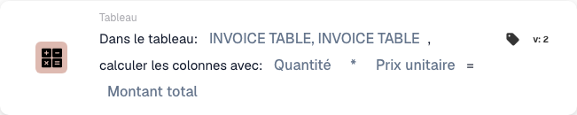

# Calculer les colonnes avec

La carte applique une opération à deux colonnes d’un tableau et enregistre le résultat dans une autre colonne, pour chaque ligne.

## Quand et où l’utiliser

Utilisez-la pour calculer les montants des lignes avant l’action suivante du workflow, par exemple **quantité × prix unitaire**. Ajoutez-la dans la section **Dans ce cas**, catégorie **Tableau**. Vérifiez d’abord que les deux colonnes d’entrée contiennent des nombres et que les données sont complètes.

<figure><figcaption>
Carte version 2 : INVOICE_TABLE, Quantité × Prix unitaire → TOTAL_AMOUNT. L’interface répète le nom du tableau.
</figcaption></figure>

## Vidéo d’administration

**41 secondes · français.** Alain explique quand utiliser la carte, configure la multiplication et montre les résultats enregistrés.



[Lire la vidéo avec des sous-titres français](https://docbits-videos.fra1.cdn.digitaloceanspaces.com/settings-assistant/workflow-card-calc-columns-admin/v1/fr.html) · [Lire la transcription](https://docbits-videos.fra1.cdn.digitaloceanspaces.com/settings-assistant/workflow-card-calc-columns-admin/v1/fr.txt)

L’administrateur et sa voix sont synthétiques. La démonstration utilise l’interface réelle de DocBits et une facture fictive.

## Configuration de la carte

| Champ | Sélection de l’exemple |
| --- | --- |
| Tableau | `INVOICE_TABLE` |
| Première colonne | `QUANTITY` — Quantité |
| Opération | `*` — multiplication |
| Deuxième colonne | `UNIT_PRICE` — Prix unitaire |
| Colonne de résultat | `TOTAL_AMOUNT` — Montant total |

Les opérations `+` (addition), `-` (soustraction) et `/` (division) sont également disponibles. L’ordre des colonnes compte pour la soustraction et la division. Sélectionnez les identifiants configurés dans votre organisation.

<!-- workflow-card-practical-example-20261021 -->

## Exemple pratique

La facture contient deux lignes. La colonne de résultat n’existe pas encore avant le calcul :

| Ligne | Quantité | Prix unitaire | Résultat enregistré dans `TOTAL_AMOUNT` |
| --- | ---: | ---: | ---: |
| 1 | 2 | 10 | 20 |
| 2 | 3 | 4 | 12 |

Dans la démonstration, la carte crée la colonne de résultat. Les valeurs **20,00** et **12,00** restent visibles après la réouverture de la facture. Les colonnes d’entrée et les montants d’origine de `NET_AMOUNT` sont conservés dans cet exemple. Si la colonne de résultat choisie contient déjà des valeurs, le calcul les remplace.

## Vérifications et contre-exemples

- Contrôlez les deux colonnes d’entrée et vérifiez les résultats enregistrés après le calcul.
- Dans l’exemple illustré, un prix manquant peut donner zéro. Ce zéro ne prouve pas que les données sont complètes : validez les entrées avant de calculer.
- Un texte tel que `ABC` à la place d’un nombre provoque une erreur de calcul. Corrigez la saisie, puis vérifiez à nouveau le cas.
- Les cas de prix manquant et de texte non numérique du schéma sont des résultats attendus pour illustrer les contrôles ; ce ne sont pas des exécutions de la facture à deux lignes montrée.
