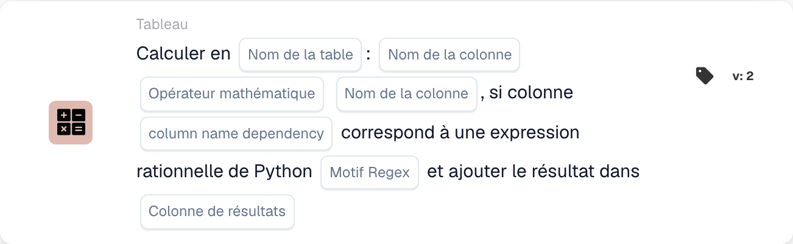

# Calculer en

<figure><figcaption>
Champs de la carte dans la version affichée. Les champs ne sont pas encore renseignés. Certains libellés de cette version de la carte ont encore une traduction incomplète ou incorrecte dans l’interface. Les explications de cette page emploient les termes corrects.
</figcaption></figure>

## **Objectif :**

La carte de workflow **« Calculer avec la dépendance Regex »** permet aux utilisateurs d'effectuer des calculs entre les colonnes d'un tableau sélectionné, avec une condition supplémentaire basée sur un motif d'expression régulière (regex) appliqué à une colonne de dépendance. Si le motif correspond, le calcul est effectué et le résultat est stocké dans la colonne de résultat spécifiée.

## **Composants de la carte :**

1. **Nom de la table**
   * **Descriptif :** spécifie la **table** dans laquelle les colonnes seront calculées.
   * **Détail :** une liste déroulante de toutes les **tables** disponibles est proposée pour la sélection.
2. **Column Name (1re colonne)**
   * **Descriptif :** spécifie la **première colonne** impliquée dans le calcul.
   * **Détail :** une liste de toutes les **colonnes** disponibles est proposée pour la sélection.
3. **Opération**
   * **Descriptif :** définit l'opération mathématique à appliquer entre les colonnes sélectionnées.
   * **Possibilités :**
     * **Add (+) :** ajoute la valeur de la seconde colonne à la valeur de la première colonne.
     * **Soustraire (-) :** soustrait la valeur de la seconde colonne de la première colonne.
     * **Multiply (\*) :** multiplie la valeur de la première colonne par la valeur de la seconde colonne.
     * **Diviser (/) :** divise la valeur de la première colonne par la seconde colonne.
4. **Column Name (2e colonne)**
   * **Descriptif :** spécifie la **seconde colonne** impliquée dans le calcul.
   * **Détail :** une liste de toutes les **colonnes** disponibles est proposée pour la sélection.
5. **Nom de la colonne (dépendance)**
   * **Descriptif :** spécifie la **colonne de dépendance** à laquelle le motif regex sera appliqué.
   * **Détail :** une liste de toutes les **colonnes** disponibles est proposée pour la correspondance de motif.
6. **Modèle Regex**
   * **Descriptif :** définit le **motif regex** qui sera utilisé pour la correspondance avec la colonne de dépendance.
   * **Détail :** si la valeur de la colonne de dépendance correspond au motif regex, le calcul sera effectué.
7. **Colonne de résultat**
   * **Descriptif :** spécifie la **colonne de résultat** où le résultat du calcul sera stocké.
   * **Détail :** il peut s'agir d'une colonne nouvelle ou existante où la valeur calculée sera stockée.

## **Fonctionnalité :**

* **Évaluation de la condition :**
  * La carte n'exécute son action que si les sections **« Quand »** et **« Et »** sont toutes deux évaluées comme vraies.
  * La carte n'exécute son action que si la valeur de la colonne de dépendance correspond au **motif regex** fourni.
* **Calcul de colonnes :**\
  Si le motif regex correspond, la carte effectue l'opération mathématique sélectionnée entre les deux colonnes choisies.
* **Stockage du résultat :**\
  Le résultat du calcul est stocké dans la **colonne de résultat** sélectionnée.

## **Mise en place et configuration :**

* **Sélectionner la table :**\
  Choisissez la **table** où les colonnes seront calculées.
* **Choisir les colonnes :**\
  Sélectionnez la **première colonne** et la **seconde colonne** qui seront utilisées dans le calcul.
* **Sélectionner l'opération :**\
  Choisissez l'opération mathématique (**Add (+)**, **Soustraire (-)**, **Multiply (\*)**, **Divide (/)**) à appliquer entre les colonnes.
* **Sélectionner la colonne de dépendance :**\
  Choisissez la **colonne de dépendance** à laquelle le motif regex sera appliqué.
* **Définir le motif regex :**\
  Saisissez le **motif regex** auquel la colonne de dépendance doit correspondre.
* **Sélectionner la colonne de résultat :**\
  Choisissez la **colonne de résultat** où la valeur calculée sera stockée.

## **Conclusion :**

La carte de workflow **« Calculer avec la dépendance Regex »** offre un moyen puissant d'effectuer des calculs avec une logique conditionnelle basée sur un motif regex. Cela garantit que seules les lignes où la colonne de dépendance correspond au motif spécifié feront l'objet du calcul spécifié, et que le résultat est stocké dans la colonne de résultat choisie.

<!-- workflow-card-practical-example-20261021 -->

## Exemple pratique

**Quand utiliser :** Calcule uniquement les lignes du tableau sélectionnées.

**Configuration :** Utilisez la table de démonstration `lines` avec les colonnes numériques `quantity` et `unit_price`. Sélectionnez les lignes correspondantes via la colonne de dépendance et l'expression régulière, multipliez les colonnes numériques et écrivez dans `line_total`.

**Résultat attendu et contre-exemple :** Une ligne sélectionnée avec `2` et `10` reçoit `20`. Une ligne non correspondante doit être vérifiée séparément pour confirmer qu'elle n'a pas été sélectionnée pour le calcul.

Il s’agit d’une configuration illustrative et du résultat attendu. Utilisez les champs, utilisateurs et groupes configurés dans votre organisation de test ; cela ne veut pas dire que cet exemple a été exécuté.
