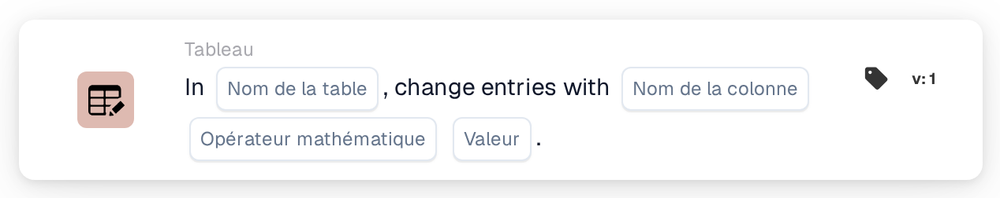
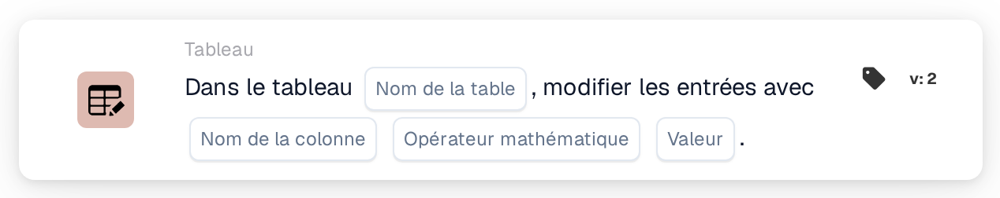

# Modifier les entrées avec

<figure><figcaption>
Version 1
</figcaption></figure>

<figure><figcaption>
Version 2
</figcaption></figure>

## **Objectif :**

La carte de workflow **« Change Entries in Table »** sert à mettre à jour les entrées d'une table de base de données spécifiée. Elle vous permet de sélectionner une **table** et une **colonne**, puis d'effectuer des opérations mathématiques (addition, soustraction, multiplication ou division) sur les valeurs de cette colonne, à l'aide d'une valeur spécifiée.

## **Composants de la carte :**

1. **Nom de la table**
   * **Descriptif :** spécifie la **table** dans laquelle les entrées seront mises à jour.
   * **Détail :** une liste déroulante des **tables** disponibles est proposée, vous permettant de sélectionner la table cible pour la mise à jour des entrées.
2. **Nom de la colonne**
   * **Descriptif :** spécifie la **colonne** de la table sélectionnée à mettre à jour.
   * **Détail :** une liste de toutes les **colonnes** disponibles sera proposée pour la sélection.
3. **Opération**
   * **Descriptif :** définit l'opération mathématique à effectuer sur les valeurs de la **colonne**.
   * **Possibilités :**
     * **Add (+) :** ajoute une **valeur** spécifiée à la valeur actuelle de la colonne sélectionnée.
     * **Soustraire (-) :** soustrait une **valeur** spécifiée de la valeur actuelle de la colonne sélectionnée.
     * **Multiply (\*) :** multiplie la valeur actuelle de la colonne sélectionnée par une **valeur** spécifiée.
     * **Diviser (/) :** divise la valeur actuelle de la colonne sélectionnée par une **valeur** spécifiée.
4. **Valeur**
   * **Descriptif :** spécifie la **valeur** à utiliser dans l'opération sélectionnée.
   * **Détail :** il s'agit du nombre qui sera ajouté, soustrait, multiplié ou divisé avec les entrées de la colonne sélectionnée.

## **Fonctionnalité :**

* **Évaluation de la condition :**\
  La carte n'exécute son action que si les sections **« Quand »** et **« Et »** sont toutes deux évaluées comme vraies.
* **Mise à jour des entrées de la table :**\
  La carte effectue l'opération sélectionnée (**+**, **-**, **\*** ou **/**) sur les valeurs de la **colonne** choisie de la **table** sélectionnée, à l'aide de la **valeur** spécifiée.

## **Mise en place et configuration :**

* **Sélectionner la table :**\
  Choisissez la **table** où les modifications seront appliquées.
* **Choisir la colonne :**\
  Sélectionnez la **colonne** de la table que vous souhaitez mettre à jour.
* **Sélectionner l'opération :**\
  Choisissez l'opération mathématique (**+**, **-**, **\***, **/**) à appliquer aux valeurs de la colonne sélectionnée.
* **Saisir la valeur :**\
  Fournissez la **valeur** à utiliser dans l'opération sélectionnée.

## **Conclusion :**

La carte de workflow **« Change Entries in Table »** permet des mises à jour automatisées des entrées de base de données en sélectionnant une **table**, une **colonne** et une **opération mathématique** souhaitée. Cette carte est essentielle pour effectuer des modifications de données en masse ou des calculs au sein de votre base de données.

<!-- workflow-card-practical-example-20261021 -->

## Exemple pratique

**Quand utiliser :** Appliquer un ajustement numérique à une colonne de tableau existante.

**Configuration :** Sélectionnez la table de démonstration `lines`, la colonne numérique `quantity`, l'addition et la valeur `1`.

**Résultat attendu et contre-exemple :** Une quantité existante de `2` devient `3`. La répétition de cette action produit `4`, utilisez-la donc uniquement lorsque des ajouts répétés sont prévus.

Il s’agit d’une configuration illustrative et du résultat attendu. Utilisez les champs, utilisateurs et groupes configurés dans votre organisation de test ; cela ne veut pas dire que cet exemple a été exécuté.
