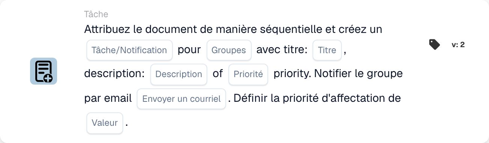

# Attribuer un document et créer une tâche/notification pour le groupe

<figure><figcaption>
Champs de la carte dans la version affichée. Les champs ne sont pas encore renseignés.
</figcaption></figure>

## **Objectif**

La carte de workflow « **Attribuer un document et créer une tâche/notification pour le groupe** » assigne un document à un groupe spécifié, crée une tâche ou une notification avec des détails personnalisables, et envoie éventuellement une notification par e-mail au groupe. Cette carte prend également en charge l'attribution d'une valeur de priorité numérique pour déterminer l'ordre d'exécution.

## **Composants de la carte**

1. **Nom du groupe**
   * **Descriptif :** spécifie le groupe qui recevra la tâche ou la notification.
   * **Détail :** une liste déroulante pour choisir le nom du groupe auquel le document et la tâche/notification seront assignés.
2. **Tâche/Notification**
   * **Descriptif :** spécifie le type d'action à créer pour le groupe.
   * **Détail :** une liste déroulante pour sélectionner « Task » ou « Notification » selon l'action souhaitée.
3. **Titre**
   * **Descriptif :** fournit le titre de la tâche ou de la notification.
   * **Détail :** un champ pour ajouter un titre concis et descriptif à la tâche ou à la notification.
4. **Descriptif**
   * **Descriptif :** décrit plus en détail la tâche ou la notification.
   * **Détail :** un champ pour fournir des détails supplémentaires sur l'objet de la tâche ou le contenu de la notification.
5. **Priorité**
   * **Descriptif :** définit le niveau d'urgence de la tâche ou de la notification.
   * **Possibilités :**
     * **High :** nécessite une attention immédiate.
     * **Moyen :** important mais non urgent.
     * **Low :** peut être traité plus tard.
6. **Envoyer un courrier**
   * **Descriptif :** configure si une notification par e-mail est envoyée au groupe.
   * **Possibilités :**
     * **True :** envoie une notification par e-mail.
     * **False :** n'envoie pas d'e-mail.
7. **Valeur**
   * **Descriptif :** définit la priorité numérique de l'attribution du document.
   * **Détail :** un champ pour saisir une valeur numérique, où un nombre plus faible indique une priorité plus élevée.

## **Fonctionnalité**

* **Évaluation de la condition :**\
  La carte n'exécute ses actions que si les conditions de workflow configurées sont satisfaites.
* **Attribution du document et création de tâche/notification :**\
  Le document est assigné au groupe spécifié dans le champ « Group Name ». Une tâche ou une notification est créée avec le titre, la description et le niveau de priorité configurés.
* **Notification par e-mail :**\
  Si « Send Mail » est défini sur True, une notification par e-mail est envoyée au groupe pour l'informer de la tâche ou de la notification.

## **Mise en place et configuration**

1. **Définir le Group Name :**
   * Saisissez le nom du groupe dans le champ Group Name.
2. **Sélectionner Task/Notification :**
   * Choisissez « Task » ou « Notification » dans la liste déroulante Task/Notification.
3. **Définir les détails de la tâche/notification :**
   * Saisissez le Title et la Description de la tâche ou de la notification.
   * Sélectionnez la Priorité dans la liste déroulante (Haute, Moyenne ou Basse).
4. **Activer la notification par e-mail :**
   * Configurez l'option Send Mail sur True ou False, selon qu'une notification par e-mail doit être envoyée.
5. **Attribuer la priorité numérique :**
   * Saisissez une valeur numérique dans le champ Value pour déterminer la priorité de l'attribution, où les valeurs les plus faibles ont la préséance.
6. Enregistrez la configuration de la carte et activez le workflow.

## **Conclusion**

La carte de workflow « Assign Document and Create Task/Notification for Group » garantit que les documents sont assignés au groupe approprié tout en créant des tâches ou des notifications avec des options personnalisables de priorité et de notification par e-mail. Cela rationalise la gestion des documents et améliore l'efficacité du workflow.

<!-- workflow-card-practical-example-20261021 -->

## Exemple pratique

**Quand utiliser :** Créez une tâche d'équipe parallèlement à l'attribution de documents prioritaires.

**Configuration :** Sélectionnez `Demo Finance`, le titre `Review invoice` et les priorités des tâches et des affectations.

**Résultat attendu et contre-exemple :** Vérifiez séparément l'affectation du document de groupe et la tâche/notification. Une tâche à elle seule ne constitue pas une preuve de l’approbation d’un document.

Il s’agit d’une configuration illustrative et du résultat attendu. Utilisez les champs, utilisateurs et groupes configurés dans votre organisation de test ; cela ne veut pas dire que cet exemple a été exécuté.
