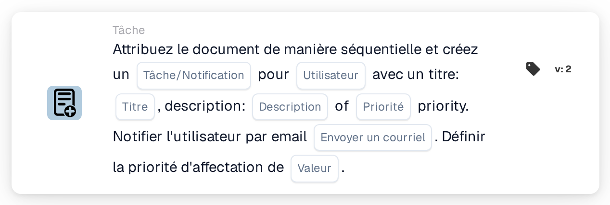

# Attribuer un document et créer une tâche/notification pour l'utilisateur

<figure><figcaption>
Version 2
</figcaption></figure>

## **Objectif**

La carte de workflow « **Attribuer un document et créer une tâche/notification pour l'utilisateur** » assigne un document à un utilisateur spécifié, crée une tâche ou une notification avec des détails configurables, et envoie éventuellement une notification par e-mail à l'utilisateur. Cette carte permet également de définir une valeur de priorité numérique pour déterminer l'ordre d'exécution.

## **Composants de la carte**

1. **Utilisateur**
   * **Descriptif :** spécifie l'utilisateur qui recevra la tâche ou la notification.
   * **Détail :** un menu déroulant pour sélectionner l'utilisateur auquel le document et la tâche/notification seront assignés.
2. **Tâche/Notification**
   * **Descriptif :** spécifie le type d'action à créer pour l'utilisateur.
   * **Détail :** une liste déroulante pour choisir « Task » ou « Notification » selon l'action prévue.
3. **Titre**
   * **Descriptif :** le titre de la tâche ou de la notification.
   * **Détail :** un champ pour fournir un titre concis et descriptif à la tâche ou à la notification.
4. **Descriptif**
   * **Descriptif :** des détails supplémentaires sur la tâche ou la notification.
   * **Détail :** un champ pour décrire l'objet de la tâche ou fournir un contexte à la notification.
5. **Priorité**
   * **Descriptif :** définit le niveau d'urgence de la tâche ou de la notification.
   * **Possibilités :**
     * **High :** nécessite une attention immédiate.
     * **Moyen :** important mais non urgent.
     * **Low :** peut être traité plus tard.
6. **Envoyer un courrier**
   * **Descriptif :** configure si une notification par e-mail est envoyée à l'utilisateur.
   * **Possibilités :**
     * **True :** envoie une notification par e-mail à l'utilisateur.
     * **False :** aucune notification par e-mail n'est envoyée.
7. **Valeur**
   * **Descriptif :** définit la priorité numérique de l'attribution du document.
   * **Détail :** un champ pour saisir une valeur numérique, où les nombres les plus faibles indiquent une priorité plus élevée.

## **Fonctionnalité**

* **Évaluation de la condition :**\
  La carte n'exécute ses actions que si les conditions de workflow configurées sont satisfaites.
* **Attribution du document et création de tâche/notification :**\
  Le document est assigné à l'utilisateur spécifié dans le champ « User ». Une tâche ou une notification est créée avec le titre, la description et le niveau de priorité fournis.
* **Notification par e-mail :**\
  Si « Send Mail » est défini sur True, un e-mail est envoyé à l'utilisateur pour l'informer de la tâche ou de la notification.

## **Mise en place et configuration**

1. **Sélectionner l'utilisateur :**
   * Choisissez l'utilisateur dans le menu déroulant User.
2. **Configurer les détails de la tâche/notification :**
   * Sélectionnez « Task » ou « Notification » dans la liste déroulante Task/Notification.
   * Saisissez le Title et la Description de la tâche ou de la notification.
   * Définissez la Priority en sélectionnant High, Medium ou Low dans la liste déroulante.
3. **Activer la notification par e-mail :**
   * Configurez l'option Send Mail sur True ou False, selon qu'une notification par e-mail doit être envoyée.
4. **Définir la priorité numérique :**
   * Saisissez une valeur numérique dans le champ Value pour déterminer la priorité de l'attribution, où les valeurs les plus faibles sont traitées en premier.
5. Enregistrez la configuration de la carte et activez le workflow.

## **Conclusion**

La carte de workflow « Assign Document and Create Task/Notification for User » garantit que les documents sont assignés à l'utilisateur approprié tout en créant des tâches ou des notifications avec des priorités définies et des notifications par e-mail facultatives. Cette carte aide à rationaliser la délégation des tâches et améliore l'efficacité du workflow.

<!-- workflow-card-practical-example-20261021 -->

## Exemple pratique

**Quand utiliser :** Créez une tâche de révision par l'utilisateur parallèlement à l'attribution de documents prioritaires.

**Configuration :** Sélectionnez `Demo Reviewer A`, le titre de la tâche `Review invoice`, la priorité de la tâche et la priorité de l'affectation.

**Résultat attendu et contre-exemple :** Vérifiez que l'affectation du document et la tâche/notification existent pour l'utilisateur sélectionné, avec les priorités prévues.

Il s’agit d’une configuration illustrative et du résultat attendu. Utilisez les champs, utilisateurs et groupes configurés dans votre organisation de test ; cela ne veut pas dire que cet exemple a été exécuté.
