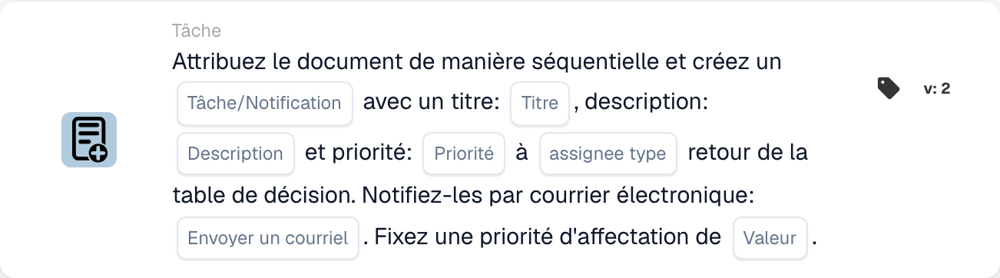

# Attribuer un document et créer une tâche/notification

<figure><figcaption>
Champs de la carte dans la version affichée. Les champs ne sont pas encore renseignés. Certains libellés de cette version de la carte ont encore une traduction incomplète ou incorrecte dans l’interface. Les explications de cette page emploient les termes corrects.
</figcaption></figure>

## **Objectif**

La carte de workflow « **Attribuer un document et créer une tâche/notification basée sur la table de décision** » assigne un document et crée une tâche ou une notification avec des détails configurables. Le destinataire est déterminé par le retour d'une table de décision, et la carte permet de définir des priorités et d'envoyer des notifications par e-mail.

## **Composants de la carte**

1. **Type de destinataire**
   * **Descriptif :** spécifie si le retour de la table de décision assigne le document et la tâche/notification à un utilisateur ou à un groupe.
   * **Détail :** un champ pour configurer le type de destinataire comme « User » ou « Group » en fonction de la sortie de la table de décision.
2. **Tâche/Notification**
   * **Descriptif :** spécifie le type d'action à créer pour le destinataire.
   * **Détail :** une liste déroulante pour sélectionner « Task » ou « Notification » selon les besoins du workflow.
3. **Titre**
   * **Descriptif :** le titre de la tâche ou de la notification.
   * **Détail :** un champ pour fournir un titre concis qui identifie la tâche ou la notification.
4. **Descriptif**
   * **Descriptif :** des détails supplémentaires sur la tâche ou la notification.
   * **Détail :** un champ pour décrire l'objet et le contexte de la tâche ou de la notification.
5. **Priorité**
   * **Descriptif :** définit le niveau d'urgence de la tâche ou de la notification.
   * **Possibilités :**
     * **High :** nécessite une attention immédiate.
     * **Moyen :** important mais non urgent.
     * **Low :** peut être traité plus tard.
6. **Type de destinataire**
   * **Descriptif :** ce champ détermine le type de destinataire (User ou Group) auquel le document et la tâche/notification sont assignés.
   * **Détail :** un menu déroulant pour sélectionner si la tâche/notification est assignée à un utilisateur ou à un groupe en fonction de la sortie de la table de décision.
7. **Envoyer un courrier**
   * **Descriptif :** configure si une notification par e-mail est envoyée au destinataire.
   * **Possibilités :**
     * **True :** envoie une notification par e-mail.
     * **False :** aucune notification par e-mail n'est envoyée.
8. **Valeur**
   * **Descriptif :** définit la priorité numérique de l'attribution du document.
   * **Détail :** un champ pour saisir une valeur numérique, où les nombres les plus faibles indiquent une priorité plus élevée.

## **Fonctionnalité**

* **Évaluation de la condition :**\
  La carte n'exécute ses actions que si les conditions du workflow sont satisfaites.
* **Évaluation de la table de décision :**\
  La table de décision détermine si le document et la tâche/notification sont assignés à un utilisateur ou à un groupe.
* **Attribution du document et création de tâche/notification :**\
  Le document est assigné au résultat de la table de décision. Une tâche ou une notification est créée avec le titre, la description et le niveau de priorité spécifiés.
* **Notification par e-mail :**\
  Si « Send Mail » est défini sur True, une notification par e-mail est envoyée au destinataire.

## **Mise en place et configuration**

1. **Définir le type de destinataire :**
   * Configurez le champ Assignee Type sur « User » ou « Group » en fonction de la sortie de la table de décision.
2. **Sélectionner Task/Notification :**
   * Choisissez « Task » ou « Notification » dans la liste déroulante Task/Notification.
3. **Définir les détails de la tâche/notification :**
   * Saisissez le Title et la Description de la tâche ou de la notification.
   * Sélectionnez la Priorité (Élevée, Moyenne ou Basse) dans la liste déroulante.
4. **Activer la notification par e-mail :**
   * Définissez l'option Send Mail sur True ou False, selon qu'une notification par e-mail doit être envoyée.
5. **Définir la priorité numérique :**
   * Saisissez une valeur numérique dans le champ Value pour déterminer la priorité de l'attribution, où les nombres les plus faibles sont traités en premier.
6. Enregistrez la configuration de la carte et activez le workflow.

## **Conclusion**

La carte de workflow « Assign Document and Create Task/Notification Based on Decision Table » garantit que les tâches ou notifications sont assignées dynamiquement à l'utilisateur ou au groupe approprié en fonction des résultats de la table de décision. Cette carte facilite une délégation efficace des tâches, des priorités personnalisables et des notifications par e-mail facultatives pour améliorer la réactivité du workflow.

<!-- workflow-card-practical-example-20261021 -->

## Exemple pratique

**Quand utiliser :** Utilisez un résultat de table de décision pour attribuer un document et créer une tâche de révision en séquence.

**Configuration :** Sélectionnez la table de décision de démonstration, le titre de la tâche `Review invoice`, la description et la priorité. Configurez le format de retour du destinataire et l'option de courrier électronique requis par la version sélectionnée.

**Résultat attendu et contre-exemple :** Le destinataire correspondant renvoyé reçoit l'affectation du document documenté et la tâche/notification. Vérifiez les deux résultats ; un retour de table vide n'est pas une affectation réussie.

Il s’agit d’une configuration illustrative et du résultat attendu. Utilisez les champs, utilisateurs et groupes configurés dans votre organisation de test ; cela ne veut pas dire que cet exemple a été exécuté.
