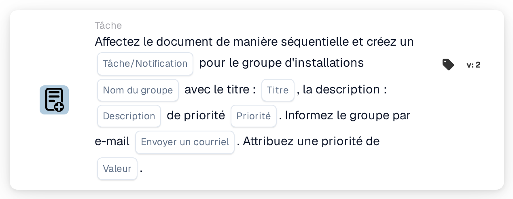

# Attribuer au groupe d'établissement et créer une tâche/notification

<figure><figcaption>
Version 2
</figcaption></figure>

## Objectif :

Cette carte de workflow ajoute le groupe responsable de l'établissement du bon de commande du document à l'attribution séquentielle de ce document et associe une tâche ou une notification à cette étape. L'établissement est repris des bons de commande auxquels le document est rapproché, et le groupe est trouvé par son nom, qui contient à la fois le nom de groupe saisi sur la carte et le code d'établissement. La tâche ou la notification appartient à l'étape du groupe dans la séquence.

## Composants de la carte :

1. **Tâche/Notification**
   * **Description :** définit si une tâche ou une notification est créée pour le groupe.
   * **Options :**
     * **Tâche :** une tâche est créée.
     * **Notification :** une notification est créée.
2. **Nom du groupe**
   * **Description :** la partie du nom que les groupes d'établissement ont en commun.
   * **Détail :** un texte comparé aux noms des groupes d'utilisateurs de l'organisation. Un groupe correspond si son nom contient ce texte et le code d'établissement du bon de commande. La comparaison ne tient pas compte des majuscules et des minuscules. Par exemple, avec le nom de groupe **Approver** et un bon de commande pour l'établissement **1000**, un groupe nommé **Approver 1000** correspondrait.
3. **Titre**
   * **Description :** le titre de la tâche ou de la notification.
   * **Détail :** un texte court qui identifie la tâche ou la notification.
4. **Description**
   * **Description :** des précisions supplémentaires sur la tâche ou la notification.
   * **Détail :** un texte qui décrit ce qui devrait être fait ou pourquoi le groupe est informé.
5. **Priorité**
   * **Description :** l'urgence de la tâche ou de la notification.
   * **Options :**
     * **poids élevé :** la tâche ou la notification est créée avec une priorité élevée.
     * **poids moyen :** la tâche ou la notification est créée avec une priorité moyenne.
     * **poids léger :** la tâche ou la notification est créée avec une priorité faible.
6. **Envoyer un courriel**
   * **Description :** définit si le groupe est également informé de la tâche par e-mail.
   * **Options :**
     * **Vrai :** une notification par e-mail est envoyée au groupe.
     * **Faux :** aucune notification par e-mail n'est envoyée.
7. **Valeur**
   * **Description :** la priorité du groupe au sein de l'attribution séquentielle.
   * **Détail :** un nombre entier. Les nombres les plus faibles passent en premier, 0 étant la priorité la plus élevée. Si aucune valeur n'est saisie, ou si une valeur négative est saisie, la priorité 1 est utilisée.

## Fonctionnalité :

* **Détermination de l'établissement :** la carte lit les bons de commande auxquels le document est rapproché et relève le code d'établissement (le site du bon de commande) de chacun d'eux.
* **Détermination du groupe :** pour chaque code d'établissement, la carte recherche les groupes d'utilisateurs dont le nom contient à la fois le **Nom du groupe** indiqué sur la carte et le code d'établissement. Les codes d'établissement pour lesquels aucun groupe n'est trouvé sont listés dans le journal du workflow.
* **Exécution de l'action :** chaque groupe correspondant est ajouté à l'attribution séquentielle avec la priorité du champ **Valeur**, accompagné de la tâche ou de la notification. L'attribution elle-même a lieu à la fin de l'exécution du workflow : l'entrée dont le numéro de priorité est le plus faible est attribuée en premier et sa tâche ou sa notification est créée. Toutes les entrées, y compris la première, sont enregistrées sur le document comme ses demandes d'approbation, et les étapes suivantes de la séquence en sont tirées par ordre croissant de priorité. Si une autre carte a déjà attribué directement le document au cours de la même exécution, cette première attribution séquentielle est ignorée et sa tâche ou sa notification n'est pas créée lors de cette exécution.
* **Valeurs par défaut :** si aucune priorité de tâche n'est définie, **poids moyen** est utilisé. Si **Envoyer un courriel** n'est pas défini, aucun e-mail n'est envoyé. Si **Tâche/Notification** n'est pas défini, une tâche est créée et le journal du workflow signale le paramètre manquant.
* **Données manquantes :**
  * Si le nom du groupe, le titre ou la description est vide, la carte ne s'exécute pas et signale les données manquantes dans le journal du workflow.
  * Si le document n'est rapproché d'aucun bon de commande, la carte signale les données manquantes au lieu d'ajouter un groupe.
  * Si aucun groupe ne correspond à l'un des codes d'établissement, aucun groupe n'est ajouté et le journal du workflow indique qu'aucun groupe correspondant n'a été trouvé.

## Mise en place et configuration :

* Les groupes d'utilisateurs devraient être nommés de sorte que chaque nom contienne la partie commune du nom et le code d'établissement, par exemple **Approver 1000**, **Approver 2000**.
* La carte peut être ajoutée depuis la catégorie **Tâche**. Ensuite, le type (**Tâche** ou **Notification**), la partie commune du nom des groupes, le titre, la description, la priorité de la tâche, le paramètre d'e-mail et la position dans la séquence (**Valeur**) peuvent être configurés.
* Pour former une chaîne d'approbateurs, plusieurs cartes séquentielles peuvent être combinées dans le workflow, chacune avec sa propre **Valeur**.

## Conclusion :

La carte de workflow « Assign to Facility Group and Create a Task/Notification » place l'équipe d'établissement responsable à une position définie dans une approbation séquentielle et lui confie une tâche claire pour son étape. Une seule carte couvre tous les établissements, à condition que les groupes d'utilisateurs suivent un schéma de nommage cohérent comprenant le code d'établissement.
