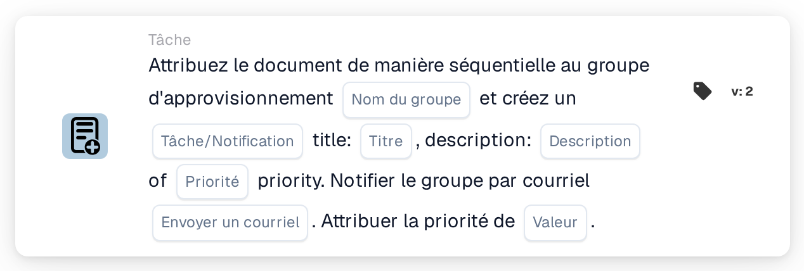

# Attribuer au groupe d'approvisionnement et créer une tâche/notification

<figure><figcaption>
Version 2
</figcaption></figure>

## **Objectif**

La carte de workflow « **Attribuer un document au groupe d'approvisionnement et créer une tâche/notification** » assigne un document à un groupe d'approvisionnement spécifié, crée une tâche ou une notification avec des détails définis, et notifie éventuellement le groupe par e-mail. Elle hiérarchise l'exécution des tâches selon une valeur de priorité numérique configurable.

## **Composants de la carte**

1. **Nom du groupe**
   * **Descriptif :** spécifie le groupe d'approvisionnement responsable du traitement du document.
   * **Détail :** un champ où l'utilisateur peut saisir manuellement le nom du groupe d'approvisionnement.
2. **Tâche/Notification**
   * **Descriptif :** définit si une tâche ou une notification est créée pour le groupe.
   * **Détail :** un champ où l'utilisateur peut choisir entre créer une tâche ou une notification.
3. **Titre**
   * **Descriptif :** le titre de la tâche ou de la notification créée pour le groupe.
   * **Détail :** un champ pour fournir un titre concis et identifiable à la tâche ou à la notification.
4. **Descriptif**
   * **Descriptif :** des détails supplémentaires sur la tâche ou la notification.
   * **Détail :** un champ pour décrire l'objet de la tâche et fournir un contexte ou des instructions.
5. **Priorité**
   * **Descriptif :** définit le niveau d'urgence de la tâche ou de la notification.
   * **Possibilités :**
     * **High :** la tâche nécessite une attention immédiate.
     * **Moyen :** la tâche est importante mais non urgente.
     * **Low :** la tâche peut être traitée plus tard.
6. **Envoyer un courrier**
   * **Descriptif :** configure si une notification par e-mail doit être envoyée au groupe.
   * **Possibilités :**
     * **True :** envoie une notification par e-mail au groupe d'approvisionnement.
     * **False :** aucune notification par e-mail n'est envoyée.
7. **Valeur**
   * **Descriptif :** définit la priorité numérique de l'exécution de la tâche.
   * **Détail :** un champ pour saisir une valeur numérique, où un nombre plus faible représente une priorité plus élevée.

## **Fonctionnalité**

* **Évaluation de la condition :**\
  La carte n'effectue ses actions que si les conditions de workflow définies sont satisfaites.
* **Attribution au groupe et création de tâche/notification :**\
  Le document est assigné au groupe d'approvisionnement spécifié. Une tâche ou une notification est créée avec le titre, la description et la priorité fournis.
* **Notification par e-mail :**\
  Si « Send Mail » est défini sur True, le groupe reçoit un e-mail concernant la tâche ou la notification.

## **Mise en place et configuration**

1. **Définir le Group Name :**
   * Saisissez le nom du groupe d'approvisionnement dans le champ Group Name.
2. **Configurer les détails de la tâche/notification :**
   * Spécifiez le Title et la Description de la tâche ou de la notification.
   * Sélectionnez la Priorité dans le menu déroulant (Haute, Moyenne ou Basse).
3. **Activer la notification par e-mail :**
   * Définissez « Send Mail » sur True ou False selon que le groupe doit recevoir un e-mail.
4. **Définir la priorité numérique :**
   * Saisissez une valeur numérique dans le champ Value pour déterminer la priorité de la tâche, où les valeurs les plus faibles sont traitées en premier.
5. Enregistrez la configuration de la carte et activez le workflow.

## **Conclusion**

La carte de workflow « Assign Document to Procurement Group and Create Task/Notification » garantit que les documents sont dirigés vers le groupe approprié avec des instructions de tâche claires et des niveaux de priorité. En permettant des notifications par e-mail facultatives, cette carte améliore la visibilité des tâches et garantit une exécution fluide du workflow.

<!-- workflow-card-practical-example-20261021 -->

## Exemple pratique

**Quand utiliser :** Combinez une mission d'approvisionnement prioritaire avec une tâche de révision.

**Configuration :** Sélectionnez `Demo Procurement`, le titre `Review order variance`, la priorité des tâches et la priorité des affectations.

**Résultat attendu et contre-exemple :** La cible d'approvisionnement configurée reçoit l'affectation et la tâche/notification documentées. Vérifiez les deux ainsi que leurs priorités dans le résultat.

Il s’agit d’une configuration illustrative et du résultat attendu. Utilisez les champs, utilisateurs et groupes configurés dans votre organisation de test ; cela ne veut pas dire que cet exemple a été exécuté.
