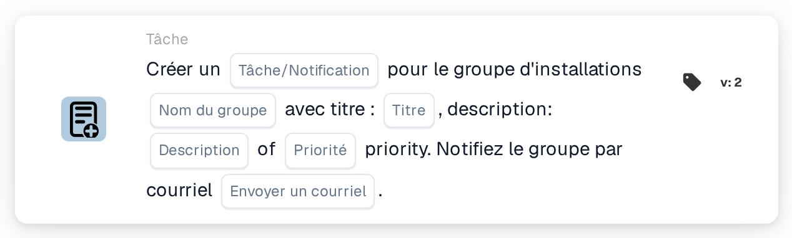

# Créer une nouvelle tâche et l'attribuer au groupe d'établissement

<figure><figcaption>
Version 2
</figcaption></figure>

## Objectif :

Cette carte de workflow crée une tâche ou une notification pour le groupe responsable de l'établissement du bon de commande du document. L'établissement n'est pas sélectionné sur la carte : il est repris des bons de commande auxquels le document est rapproché. La carte recherche ensuite un groupe d'utilisateurs dont le nom contient à la fois le nom de groupe saisi sur la carte et le code d'établissement, puis crée la tâche pour ce groupe. Le document lui-même n'est pas réattribué.

Pour une carte qui attribue en outre le document au groupe d'établissement dans le cadre d'une attribution séquentielle, **Assign to Facility Group and Create a Task/Notification** peut être utilisée.

## Composants de la carte :

1. **Tâche/Notification**
   * **Description :** définit si une tâche ou une notification est créée pour le groupe.
   * **Options :**
     * **Tâche :** une tâche est créée.
     * **Notification :** une notification est créée.
2. **Nom du groupe**
   * **Description :** la partie du nom que les groupes d'établissement ont en commun.
   * **Détail :** un texte comparé aux noms des groupes d'utilisateurs de l'organisation. Un groupe correspond si son nom contient ce texte et le code d'établissement du bon de commande. La comparaison ne tient pas compte des majuscules et des minuscules. Par exemple, avec le nom de groupe **Warehouse** et un bon de commande pour l'établissement **1000**, un groupe nommé **Warehouse 1000** correspondrait.
3. **Titre**
   * **Description :** le titre de la tâche ou de la notification.
   * **Détail :** un texte court qui identifie la tâche ou la notification.
4. **Description**
   * **Description :** des précisions supplémentaires sur la tâche ou la notification.
   * **Détail :** un texte qui décrit ce qui devrait être fait ou pourquoi le groupe est informé.
5. **Priorité**
   * **Description :** l'urgence de la tâche ou de la notification.
   * **Options :**
     * **poids élevé :** la tâche ou la notification est créée avec une priorité élevée.
     * **poids moyen :** la tâche ou la notification est créée avec une priorité moyenne.
     * **poids léger :** la tâche ou la notification est créée avec une priorité faible.
6. **Envoyer un courriel**
   * **Description :** définit si le groupe est également informé de la tâche par e-mail.
   * **Options :**
     * **Vrai :** une notification par e-mail est envoyée au groupe.
     * **Faux :** aucune notification par e-mail n'est envoyée.

## Fonctionnalité :

* **Détermination de l'établissement :** la carte lit les bons de commande auxquels le document est rapproché et relève le code d'établissement (le site du bon de commande) de chacun d'eux.
* **Détermination du groupe :** pour chaque code d'établissement, la carte recherche les groupes d'utilisateurs dont le nom contient à la fois le **Nom du groupe** indiqué sur la carte et le code d'établissement. Les codes d'établissement pour lesquels aucun groupe n'est trouvé sont listés dans le journal du workflow.
* **Création de la tâche :** une tâche ou une notification comportant le titre, la description et la priorité indiqués sur la carte est créée pour le groupe correspondant et liée au document. Si plusieurs groupes correspondent, la tâche n'est créée que pour l'un d'eux ; la carte ne détermine pas lequel.
* **Valeurs par défaut :** si aucune priorité n'est définie, **poids moyen** est utilisé. Si **Envoyer un courriel** n'est pas défini, aucun e-mail n'est envoyé. Si **Tâche/Notification** n'est pas défini, une tâche est créée et le journal du workflow signale le paramètre manquant.
* **Données manquantes :**
  * Si le nom du groupe, le titre ou la description est vide, la carte ne s'exécute pas et signale les données manquantes dans le journal du workflow.
  * Si le document n'est rapproché d'aucun bon de commande, la carte signale les données manquantes au lieu de créer une tâche.
  * Si aucun groupe ne correspond à l'un des codes d'établissement, aucune tâche n'est créée et le journal du workflow indique qu'aucun groupe correspondant n'a été trouvé.

## Mise en place et configuration :

* Les groupes d'utilisateurs devraient être nommés de sorte que chaque nom contienne la partie commune du nom et le code d'établissement, par exemple **Warehouse 1000**, **Warehouse 2000**.
* La carte peut être ajoutée depuis la catégorie **Tâche**. Ensuite, le type (**Tâche** ou **Notification**), la partie commune du nom des groupes, le titre, la description, la priorité et le paramètre d'e-mail peuvent être configurés.

## Conclusion :

La carte de workflow « Create a New Task and assign it to Facility Group » intègre au processus l'équipe de l'établissement concerné sans modifier la personne à laquelle le document est attribué. Une seule carte couvre tous les établissements, à condition que les groupes d'utilisateurs suivent un schéma de nommage cohérent comprenant le code d'établissement.
