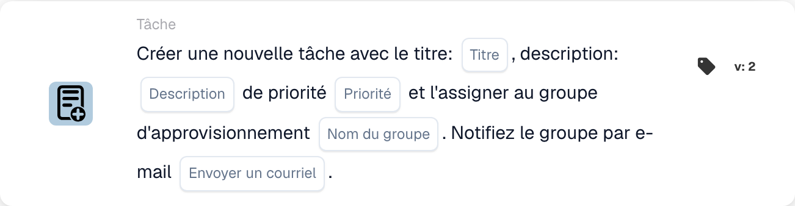

# Créer une nouvelle tâche et l'attribuer au groupe d'approvisionnement

<figure><figcaption>
Champs de la carte dans la version affichée. Les champs ne sont pas encore renseignés.
</figcaption></figure>

## **Objectif :**

La carte de workflow **« Créer une tâche pour le groupe d'approvisionnement »** crée une nouvelle tâche assignée dynamiquement au groupe d'approvisionnement spécifié dans la configuration. Cette tâche peut être assignée avec différents niveaux de priorité, et une notification par e-mail facultative peut être envoyée pour informer le groupe de la tâche. Cette carte garantit que la bonne équipe est alertée en fonction des conditions du workflow.

## **Composants de la carte :**

1. **Titre**
   * **Descriptif :** spécifie le titre de la tâche.
   * **Détail :** ce champ identifie la tâche créée, fournissant un titre concis pour une identification facile.
2. **Descriptif**
   * **Descriptif :** fournit des détails supplémentaires sur la tâche.
   * **Détail :** ce champ sert à décrire l'objectif de la tâche ainsi que tout contexte ou instruction nécessaire.
3. **Priorité**
   * **Descriptif :** définit l'urgence de la tâche.
   * **Possibilités :**
     * **High :** la tâche nécessite une attention immédiate.
     * **Moyen :** la tâche est importante mais non urgente.
     * **Low :** la tâche peut être traitée plus tard.
4. **Nom du groupe**
   * **Descriptif :** spécifie le groupe d'approvisionnement auquel la tâche sera assignée.
   * **Détail :** ce champ désigne le groupe d'approvisionnement responsable de la tâche. Il garantit que la tâche est dirigée vers la bonne équipe.
5. **Notification par e-mail**
   * **Descriptif :** configure si une notification par e-mail doit être envoyée au groupe d'approvisionnement assigné.
   * **Possibilités :**
     * **True :** envoie une notification par e-mail au groupe d'approvisionnement.
     * **False :** aucune notification par e-mail n'est envoyée.

## **Fonctionnalité :**

* **Évaluation de la condition :**\
  La carte n'exécute son action que si les sections **« Quand »** et **« Et »** sont toutes deux évaluées comme vraies.
* **Création de la tâche :**\
  La carte crée une nouvelle tâche, en l'assignant au groupe d'approvisionnement défini dans le champ « Group Name ». Cette tâche inclura le titre, la description et le niveau de priorité spécifiés.
* **Notification par e-mail :**\
  Si l'option de notification par e-mail est définie sur true, un e-mail est envoyé au groupe d'approvisionnement pour l'informer de la tâche.

## **Mise en place et configuration :**

* **Définir les détails de la tâche :**\
  Saisissez le titre, la description et le niveau de priorité de la tâche.
* **Sélectionner le groupe d'approvisionnement :**\
  Choisissez le groupe d'approvisionnement qui sera responsable de la tâche.
* **Activer la notification par e-mail :**\
  Indiquez si une notification par e-mail doit être envoyée au groupe lors de la création de la tâche.

## **Conclusion :**

La carte de workflow « Create Task for Procurement Group » garantit que les tâches sont automatiquement assignées au groupe d'approvisionnement approprié avec des priorités définies. Cette carte peut également notifier le groupe par e-mail pour garantir que les tâches sont traitées rapidement, améliorant l'efficacité du workflow et la gestion des tâches.

<!-- workflow-card-practical-example-20261021 -->

## Exemple pratique

**Quand utiliser :** Demandez à l'équipe d'achat d'examiner une exception de facture.

**Configuration :** Sélectionnez `Demo Procurement`, titre `Review order variance`, description et priorité.

**Résultat attendu et contre-exemple :** Une tâche est créée pour le groupe d'approvisionnement sélectionné. Vérifiez le responsable de la tâche et sa description ; la création à elle seule ne confirme pas que l’écart a été résolu.

Il s’agit d’une configuration illustrative et du résultat attendu. Utilisez les champs, utilisateurs et groupes configurés dans votre organisation de test ; cela ne veut pas dire que cet exemple a été exécuté.
