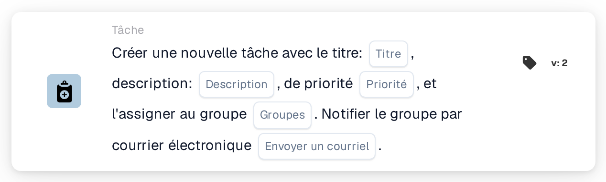
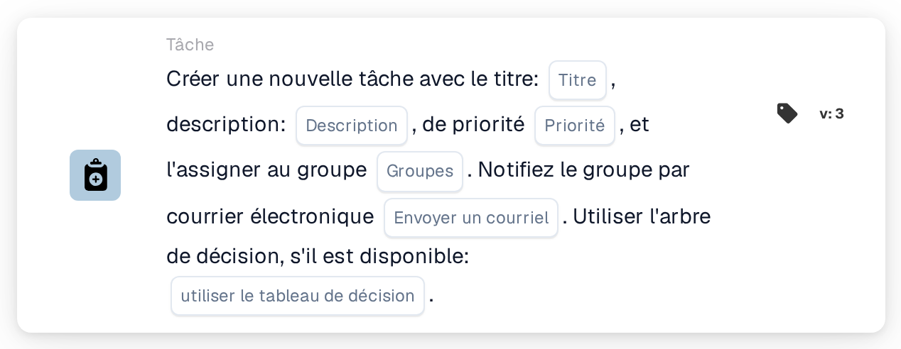
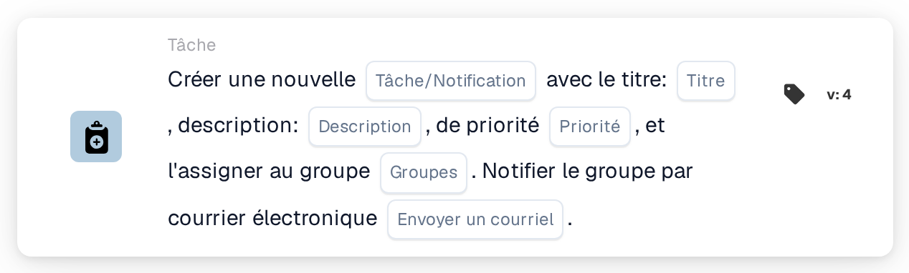

# Créez une nouvelle tâche et attribuez-la au groupe

<figure><figcaption>
Version 2
</figcaption></figure>

<figure><figcaption>
Version 3
</figcaption></figure>

<figure><figcaption>
Version 4
</figcaption></figure>

## **Objectif :**

La carte de workflow **« Créer une tâche ou une notification de groupe »** facilite la création de tâches ou de notifications pour des groupes spécifiés, garantissant une communication et une gestion des tâches efficaces. Enrichie d'une fonctionnalité d'arbre de décision dans les versions ultérieures, elle détermine dynamiquement le groupe assigné ou la méthode, rationalisant les opérations.

## **Composants de la carte :**

1. **Titre**
   * **Descriptif** : spécifie le titre de la tâche ou de la notification.
   * **Détail** : sert d'identifiant à la tâche ou à la notification créée.
2. **Descriptif**
   * **Descriptif** : décrit le contexte ou les détails de la tâche ou de la notification.
   * **Détail** : apporte de la clarté sur son objet.
3. **Priorité**
   * **Descriptif** : définit le niveau d'importance de la tâche.
   * **Possibilités** :
     * **High** : nécessite une action immédiate.
     * **Moyen** : important mais moins urgent.
     * **Low** : peut être traité plus tard.
4. **Groupe attribué**
   * **Descriptif** : spécifie le groupe responsable de la tâche ou de la notification.
   * **Détail** : sélectionné dans une liste déroulante de groupes disponibles.
5. **Notification par e-mail**
   * **Descriptif** : permet d'envoyer un e-mail pour notifier le groupe assigné.
   * **Possibilités** :
     * **True** : envoie une notification par e-mail.
     * **False** : aucune notification par e-mail n'est envoyée.

## **Composants supplémentaires dans la Version 3 et la Version 4**

1. **Arbre de décision (Version 3 uniquement)**
   * **Descriptif** : permet d'utiliser un arbre de décision pour la création dynamique de tâches.
   * **Possibilités** :
     * **True** : active le traitement par arbre de décision.
     * **False** : désactive le traitement par arbre de décision.
2. **Task/Notification Option (Version 4 uniquement)**
   * **Descriptif** : permet de créer soit une tâche, soit une notification.
   * **Possibilités** :
     * **Tâche** : crée une tâche pour le groupe sélectionné.
     * **Notification** : envoie une notification au lieu de créer une tâche.

## **Fonctionnalité :**

* **Évaluation de la condition** :\
  Exécute l'action de la carte uniquement lorsque les sections **« Quand »** et **« Et »** sont vraies.
* **Création de tâche ou de notification** :
  * Une tâche est créée pour le groupe sélectionné avec le titre, la description et la priorité spécifiés.
  * Dans la Version 4, la carte peut créer une notification au lieu d'une tâche.
* **Attribution dynamique (Version 3 uniquement)** :\
  Si elle est activée, l'arbre de décision détermine dynamiquement le groupe cible.
* **Notification par e-mail** :\
  Envoie une notification par e-mail au groupe si l'option e-mail est définie sur true.

## **Mise en place et configuration :**

1. **Définir les détails de la tâche ou de la notification** : saisissez le titre, la description et la priorité.
2. **Assigner à un groupe** : sélectionnez un groupe dans la liste déroulante pour l'attribution de la tâche ou de la notification.
3. **Activer la notification par e-mail** : indiquez si le groupe doit être notifié par e-mail.
4. **Utiliser l'Arbre de Décision (Version 3 uniquement)** : activez l'arbre de décision pour assigner dynamiquement le groupe.
5. **Sélectionner le type de sortie (Version 4 uniquement)** : choisissez si la carte crée une tâche ou une notification.

## **Conclusion :**

La carte de workflow **« Créer une tâche ou une notification de groupe »** simplifie la gestion des tâches et des notifications en ciblant directement les groupes. Sa fonctionnalité d'attribution dynamique, rendue possible par l'arbre de décision, renforce la flexibilité, tandis que les notifications par e-mail garantissent une communication en temps utile. Les Versions 3 et 4 ajoutent des fonctionnalités avancées, en faisant un outil polyvalent pour une exécution efficace du workflow.

<!-- workflow-card-practical-example-20261021 -->

## Exemple pratique

**Quand utiliser :** Donnez à une équipe partagée une tâche de révision concrète.

**Configuration :** Sélectionnez le groupe `Demo Finance`, le titre `Review invoice`, une description utile et une priorité. Désactivez la messagerie électronique pour le premier test.

**Résultat attendu et contre-exemple :** Le groupe reçoit la tâche. Confirmez le titre et le responsable dans la liste des tâches ; la livraison par e-mail est une vérification distincte lorsqu'elle est activée.

Il s’agit d’une configuration illustrative et du résultat attendu. Utilisez les champs, utilisateurs et groupes configurés dans votre organisation de test ; cela ne veut pas dire que cet exemple a été exécuté.
