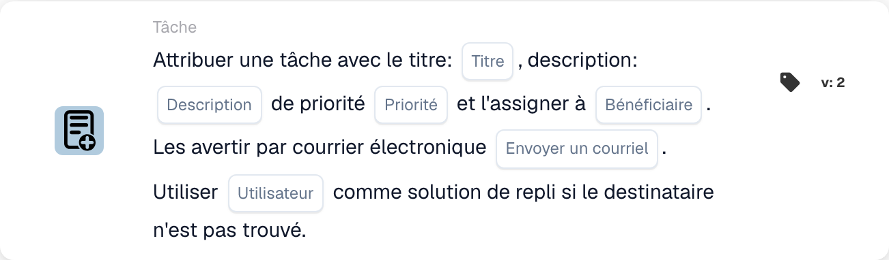

# Créez une nouvelle tâche et attribuez-la au destinataire

<figure><figcaption>
Champs de la carte dans la version affichée. Les champs ne sont pas encore renseignés.
</figcaption></figure>

## **Objectif :**

La carte de workflow **« Créer une tâche avec repli »** assure une délégation efficace des tâches en les assignant à des rôles spécifiques — Disponent ou Purchaser — tout en intégrant un mécanisme de repli pour éviter les échecs d'attribution de tâches. Cette carte améliore la fiabilité et l'adaptabilité du workflow dans des scénarios dynamiques.

## **Composants de la carte :**

1. **Titre**
   * **Descriptif** : spécifie le titre de la tâche créée.
   * **Détail** : fournit un identifiant concis à la tâche.
2. **Descriptif**
   * **Descriptif** : décrit l'objet ou le contexte de la tâche.
   * **Détail** : clarifie les détails de la tâche.
3. **Priorité**
   * **Descriptif** : définit le niveau d'urgence de la tâche.
   * **Possibilités** :
     * **High** : nécessite une attention immédiate.
     * **Moyen** : important mais non urgent.
     * **Low** : peut être traité plus tard.
4. **Rôle attribué**
   * **Descriptif** : spécifie le rôle principal auquel la tâche est assignée.
   * **Possibilités** :
     * **Disponent** : assigne la tâche au Disponent.
     * **Acheteur** : assigne la tâche au Purchaser.
5. **Notification par e-mail**
   * **Descriptif** : permet de notifier l'utilisateur assigné par e-mail.
   * **Possibilités** :
     * **True** : envoie une notification par e-mail à l'utilisateur.
     * **False** : aucune notification par e-mail n'est envoyée.
6. **Utilisateur de secours**
   * **Descriptif** : fournit une option de repli pour l'attribution de la tâche si le rôle destinataire n'est pas trouvé.
   * **Détail** : permet de sélectionner un utilisateur dans une liste déroulante pour garantir la délégation de la tâche.

## **Fonctionnalité :**

* **Évaluation de la condition** :\
  La carte ne s'exécute que si les conditions des sections **« Quand »** et **« Et »** sont satisfaites.
* **Attribution de la tâche** :
  * La tâche est assignée au rôle sélectionné (Disponent ou Purchaser).
  * Si le rôle spécifié n'est pas trouvé, la tâche est assignée à un utilisateur de la liste déroulante de repli.
* **Notification par e-mail** :\
  Envoie un e-mail à l'utilisateur assigné si la notification par e-mail est activée.

## **Mise en place et configuration :**

1. **Spécifier les détails de la tâche** : saisissez le titre, la description et la priorité de la tâche.
2. **Sélectionner le rôle principal** : choisissez le rôle auquel la tâche sera assignée (Disponent ou Purchaser).
3. **Configurer l'utilisateur de repli** : sélectionnez un utilisateur de repli dans la liste déroulante pour garantir l'attribution de la tâche si le rôle principal n'est pas trouvé.
4. **Activer la notification par e-mail** : indiquez si l'utilisateur assigné doit recevoir une notification par e-mail.

## **Conclusion :**

La carte de workflow **« Créer une tâche avec repli »** assure une délégation des tâches fluide en intégrant un mécanisme de repli. En assignant les tâches en fonction des rôles et en proposant une option d'utilisateur alternatif, elle renforce la fiabilité et la flexibilité des processus de gestion des tâches.

<!-- workflow-card-complete-example-20261021 oc_task -->

### Exemple de tâche de destinataire

**Configuration :** Saisissez un titre `Review delivery date`, une description identifiant le document synthétique, une priorité, un rôle Acheteur et un utilisateur de secours configuré `DEMO_REVIEWER`. Désactivez la notification par e-mail pour cette configuration illustrative.

**Résultat attendu et contre-exemple :** Lorsqu'un acheteur peut être résolu, la nouvelle tâche est attribuée à cet utilisateur. Si le rôle ne peut pas être résolu, la solution de secours configurée est utilisée. Vérifier la propriété réelle des tâches ; un destinataire principal manquant ne prouve pas que l'utilisateur de secours existe ou qu'une tâche a été créée.

Il s'agit d'une configuration de test illustrative et du résultat attendu ; il n'a pas été exécuté. Utilisez les données et les destinataires configurés dans votre organisation de test.
