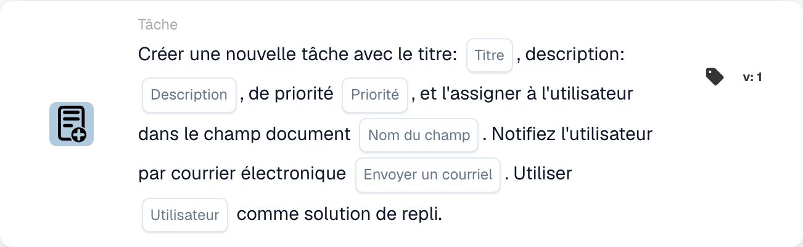

# Créez une nouvelle tâche et attribuez-la à l'utilisateur dans le champ du document

<figure><figcaption>
Champs de la carte dans la version affichée. Les champs ne sont pas encore renseignés.
</figcaption></figure>

## **Objectif :**

La carte de workflow **« Créer une tâche ou une notification basée sur un champ »** sert à créer des tâches ou des notifications assignées dynamiquement à des utilisateurs identifiés dans des champs de document spécifiques. Cette carte offre un mécanisme de repli facultatif pour garantir une exécution fluide du workflow même lorsque le champ de document ne spécifie pas d'utilisateur valide.

## **Composants de la carte :**

1. **Titre**
   * **Descriptif** : spécifie le titre de la tâche ou de la notification.
   * **Détail** : sert à nommer et à identifier la tâche ou la notification créée.
2. **Descriptif**
   * **Descriptif** : fournit des détails supplémentaires sur la tâche ou la notification.
   * **Détail** : garantit que le destinataire comprend l'objet et le contexte de la tâche ou de la notification.
3. **Priorité**
   * **Descriptif** : définit l'urgence de la tâche ou de la notification.
   * **Possibilités** :
     * **High** : nécessite une attention immédiate.
     * **Moyen** : important mais moins urgent.
     * **Low** : peut être traité plus tard.
4. **Nom du champ**
   * **Descriptif** : spécifie le champ de document qui sera utilisé pour assigner la tâche ou la notification.
   * **Détail** : le champ sélectionné déterminera dynamiquement l'utilisateur auquel la tâche ou la notification sera assignée. Si le champ est vide ou invalide, la tâche ou la notification sera assignée à l'utilisateur de repli sélectionné dans la liste déroulante.
5. **Notification par e-mail**
   * **Descriptif** : configure si l'utilisateur assigné est notifié par e-mail.
   * **Possibilités** :
     * **True** : envoie une notification par e-mail à l'utilisateur assigné.
     * **False** : aucune notification par e-mail n'est envoyée.
6. **Utilisateur de secours**
   * **Descriptif** : permet de sélectionner un utilisateur dans une liste déroulante pour assigner la tâche ou la notification lorsqu'aucun utilisateur valide n'est trouvé dans le champ de document.
   * **Détail** : garantit que la tâche ou la notification est assignée même si le champ de document est vide ou invalide.

## **Composants supplémentaires dans la Version 3 :**

1. **Type de notification**
   * **Descriptif** : spécifie si la carte crée une tâche ou une notification.
   * **Possibilités** :
     * **Tâche** : crée une tâche assignée à l'utilisateur spécifié.
     * **Notification** : envoie une notification au lieu de créer une tâche.

## **Fonctionnalité :**

* **Évaluation de la condition** :\
  La carte n'exécute son action que si les sections **« Quand »** et **« Et »** sont toutes deux évaluées comme vraies.
* **Création de tâche ou de notification** :
  * Assigne la tâche ou la notification à l'utilisateur identifié dans le champ de document.
  * Dans la Version 3, permet de créer soit une tâche, soit une notification.
* **Mécanisme de repli** :\
  Si le champ de document n'identifie pas d'utilisateur valide, la carte assigne la tâche ou la notification à l'utilisateur de repli sélectionné dans la liste déroulante.
* **Notification par e-mail** :\
  Envoie une notification par e-mail à l'utilisateur assigné si elle est configurée pour cela.

## **Mise en place et configuration :**

1. **Définir les détails de la tâche ou de la notification** : saisissez le titre, la description et la priorité.
2. **Sélectionner le champ de document** : choisissez le champ qui spécifie l'utilisateur de l'attribution de la tâche ou de la notification.
3. **Activer la notification par e-mail** : indiquez si une notification par e-mail doit être envoyée à l'utilisateur assigné.
4. **Sélectionner l'utilisateur de repli** : choisissez un utilisateur de repli dans la liste déroulante pour l'attribution si le champ de document n'identifie pas d'utilisateur valide.
5. **Spécifier le type de notification (Version 3)** : indiquez si la carte crée une tâche ou une notification.

## **Conclusion :**

La carte de workflow **« Créer une tâche ou une notification basée sur un champ »** rationalise la gestion des tâches et des notifications en assignant dynamiquement les responsabilités en fonction des champs de document. Son mécanisme d'utilisateur de repli et ses options enrichies dans la Version 3 offrent de la flexibilité, garantissant que les tâches ou notifications sont toujours assignées, même lorsque les données du document sont incomplètes.

<!-- workflow-card-practical-example-20261021 -->

## Exemple pratique

**Quand utiliser :** Créez une tâche de révision pour l'utilisateur nommé dans les données du document.

**Configuration :** Sélectionnez `reviewer_name`, utilisateur de secours `Demo Reviewer A`, titre `Review invoice` et priorité.

**Résultat attendu et contre-exemple :** Un utilisateur résoluble sur le terrain reçoit la tâche. Un champ vide ou insoluble utilise la solution de repli configurée ; testez les deux chemins.

Il s’agit d’une configuration illustrative et du résultat attendu. Utilisez les champs, utilisateurs et groupes configurés dans votre organisation de test ; cela ne veut pas dire que cet exemple a été exécuté.
