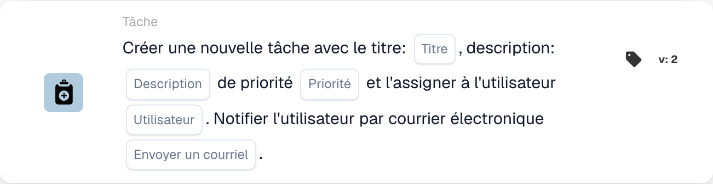

# Créez une nouvelle tâche et attribuez-la à l'utilisateur

<figure><figcaption>
Champs de la carte dans la version affichée. Les champs ne sont pas encore renseignés.
</figcaption></figure>

## **Objectif**

La carte de workflow **« Créer une tâche ou une notification »** rationalise la gestion des tâches et des notifications au sein des workflows. Selon la version, la carte peut créer des tâches, envoyer des notifications et tirer parti de fonctionnalités supplémentaires telles que les arbres de décision pour un traitement dynamique.

## **Composants de la carte**

1. **Titre**
   * **Descriptif** : définit le titre de la tâche ou de la notification créée.
   * **Détail** : le titre fournit un identifiant clair et concis à la tâche ou à la notification.
2. **Descriptif**
   * **Descriptif** : fournit des détails sur la tâche ou la notification.
   * **Détail** : aide à clarifier l'objet ou le contexte de la tâche ou de la notification pour l'utilisateur assigné.
3. **Priorité**
   * **Descriptif** : définit le niveau d'urgence de la tâche.
   * **Possibilités** :
     * **High** : nécessite une attention immédiate.
     * **Moyen** : important mais non urgent.
     * **Low** : peut être traité plus tard.
4. **Utilisateur attribué**
   1. **Descriptif** : spécifie l'utilisateur auquel la tâche est assignée.
   2. **Détail** : les utilisateurs sont sélectionnés dans une liste déroulante du personnel disponible.
5. **Notification par e-mail**
   * **Descriptif** : détermine si l'utilisateur assigné reçoit une notification par e-mail.
   * **Possibilités** :
     * **True** : envoie une notification par e-mail à l'utilisateur.
     * **False** : aucune notification par e-mail n'est envoyée.

## Composants supplémentaires **dans la Version 3 et la Version 4**

1. **Arbre de décision (Version 3 uniquement)**
   * **Descriptif** : permet d'utiliser un arbre de décision pour la création dynamique de tâches.
   * **Possibilités** :
     * **True** : active le traitement par arbre de décision.
     * **False** : désactive le traitement par arbre de décision.
2. **Task or Notification (Version 4 uniquement)**
   * **Descriptif** : permet de choisir entre créer une tâche ou une notification.
   * **Possibilités** :
     * **Tâche** : crée une tâche.
     * **Notification** : crée une notification au lieu d'une tâche.

## **Fonctionnalité :**

* **Évaluation de la condition** :\
  Cette carte n'est déclenchée que si les conditions des sections **« Quand »** et **« Et »** sont satisfaites.
* **Création de tâche ou de notification** :
  * Versions 2 et 3 : une tâche est créée avec le titre, la description, la priorité et l'utilisateur assigné spécifiés.
  * Version 4 : permet de créer soit une tâche, soit une notification.
* **Attribution dynamique** :
  * Dans la Version 3, l'arbre de décision détermine dynamiquement l'utilisateur auquel la tâche doit être assignée en fonction des paramètres du workflow.
* **Notification par e-mail** :\
  Envoie un e-mail à l'utilisateur assigné si l'option de notification est activée.

## **Mise en place et configuration :**

1. **Sélectionner la version** : choisissez la version de la carte en fonction de la fonctionnalité requise :
   * Version 2 : création de tâche basique avec attribution manuelle de l'utilisateur et notifications par e-mail.
   * Version 3 : inclut la fonctionnalité d'arbre de décision pour l'attribution dynamique de l'utilisateur.
   * Version 4 : ajoute la possibilité de créer une notification au lieu d'une tâche.
2. **Saisir les détails de la tâche** : spécifiez le titre, la description et la priorité de la tâche ou de la notification.
3. **Assigner l'utilisateur** :
   * Pour les Versions 2 et 4, sélectionnez manuellement un utilisateur dans la liste déroulante.
   * Pour la Version 3, activez l'arbre de décision pour déterminer dynamiquement l'utilisateur assigné.
4. **Activer la notification par e-mail** : indiquez si l'utilisateur assigné doit recevoir une notification par e-mail.
5. (Pour la Version 4) **Choisir tâche ou notification** : indiquez s'il faut créer une tâche ou une notification.

## **Conclusion :**

La carte de workflow **« Créer une tâche ou une notification »** est un outil polyvalent pour gérer les tâches et les notifications. En prenant en charge l'attribution dynamique des utilisateurs via des arbres de décision et en offrant des options de création de tâche ou de notification, elle renforce l'adaptabilité du workflow et l'efficacité de la collaboration.

<!-- workflow-card-practical-example-20261021 -->

## Exemple pratique

**Quand utiliser :** Donnez à un évaluateur une action explicite.

**Configuration :** Sélectionnez `Demo Reviewer A`, titre `Review invoice`, description et priorité.

**Résultat attendu et contre-exemple :** L'utilisateur sélectionné reçoit la nouvelle tâche. Confirmez le titre de la tâche et le responsable ; la tâche reste à accomplir par l’examinateur.

Il s’agit d’une configuration illustrative et du résultat attendu. Utilisez les champs, utilisateurs et groupes configurés dans votre organisation de test ; cela ne veut pas dire que cet exemple a été exécuté.
