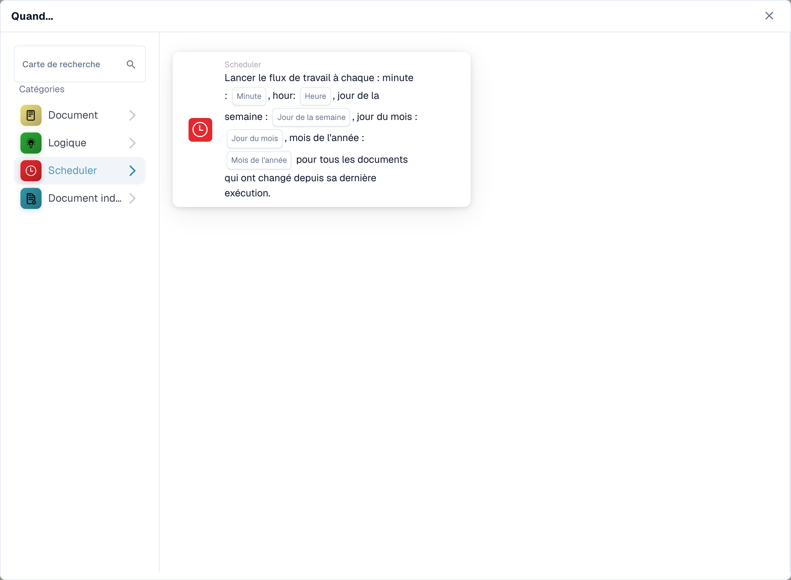
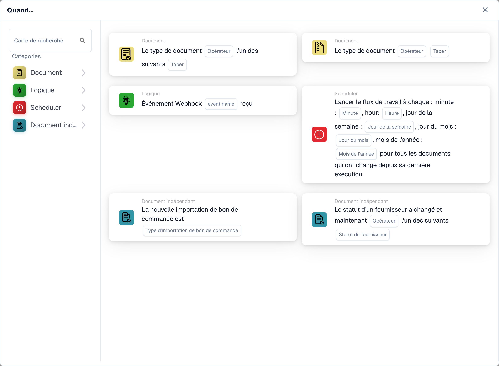
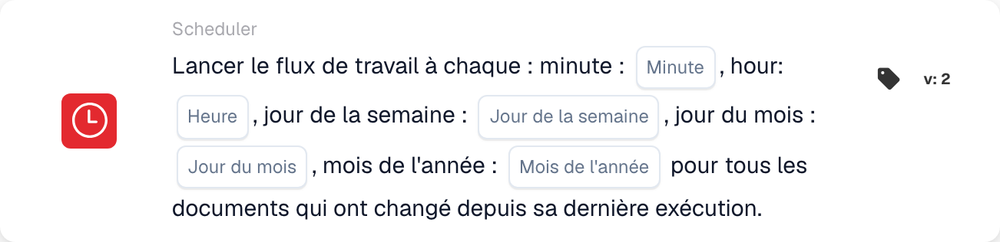

# Quand

Les cartes de cette catégorie, affichées dans la bibliothèque **Ajouter une carte** du Workflow Builder :

<figure><figcaption>
Cartes disponibles dans la catégorie sélectionnée. Renseignez les champs avant utilisation. Certains libellés de cette version de la carte ont encore une traduction incomplète ou incorrecte dans l’interface. Les explications de cette page emploient les termes corrects.
</figcaption></figure>

<figure><figcaption>
Cartes disponibles dans la catégorie sélectionnée. Renseignez les champs avant utilisation. Certains libellés de cette version de la carte ont encore une traduction incomplète ou incorrecte dans l’interface. Les explications de cette page emploient les termes corrects.
</figcaption></figure>

#### Comprendre le « quand » dans les configurations de flux de travail

**Objectif de "Quand"**

* La section « Quand » dans une configuration de flux de travail définit les conditions de déclenchement qui lancent une action de flux de travail particulière. Ces conditions sont basées sur des critères spécifiés liés aux attributs du document ou aux activités des utilisateurs au sein du système ERP.

**Comment ça marche**

* Dans votre interface, « Quand » semble être un point de départ où les utilisateurs peuvent sélectionner différentes cartes de déclenchement. Chaque carte spécifie les conditions dans lesquelles les actions ultérieures (définies dans la section « Et ») seront exécutées.

**Cartes d'état du type de document**

* Les cartes avec l'icône de document affichée dans la capture d'écran sont des variantes des conditions « Type de document », qui sont utilisées pour déclencher des flux de travail en fonction du type de document en cours de traitement. Voici une répartition de chaque type de carte de condition affichée :
  * **Type de document (Opérateur) un des (Type)** : Cette carte déclenche une action lorsque le type d'un document correspond à l'un des types spécifiés dans une liste. L'opérateur peut inclure des options telles que « est » ou « n'est pas », permettant des conditions inclusives ou exclusives.
  * **Type de document (Opérateur) (Type)** : Cette variante plus simple se déclenche en fonction d'une seule condition de type de document. Il vérifie généralement si le type de document « est » ou « n'est pas » un type spécifique, sans la possibilité de sélectionner parmi plusieurs types.
  *

**Battage de céleri**

* La carte avec l'icône d'horloge dans la capture d'écran est une condition « Celery Beat », utilisée pour déclencher des flux de travail basés sur la date et l'heure.

#### Configuration d'une carte de déclenchement « Quand »

1. **Sélection du type de condition** : les utilisateurs commencent par sélectionner un type de condition pertinent pour le flux de travail qu'ils souhaitent automatiser. Dans ce cas, les types de documents sont au centre des préoccupations.
2. **Définition de l'opérateur** : les utilisateurs doivent décider de l'opérateur logique, tel que "est" ou "n'est pas", qui définit la base de comparaison des types de documents réels avec les conditions définies.
3. **Spécification des types de documents** : en fonction de la carte, les utilisateurs peuvent sélectionner un ou plusieurs types de documents qui déclencheront le flux de travail lorsque les documents de ces types seront traités.
4. **Finalisation du déclencheur** : Une fois la condition définie, elle devient la base du déclenchement d'actions spécifiques définies dans le workflow. Si un document remplit la condition définie, les actions définies seront automatiquement lancées.

#### Application pratique

En pratique, ces cartes de déclenchement sont cruciales pour automatiser des processus tels que les approbations, les notifications ou toute procédure dépendant du type de document traité. Par exemple, si un type de document « est » une « Facture » et qu'il correspond aux conditions définies dans la carte « Quand », le flux de travail peut acheminer automatiquement le document pour le traitement du paiement.

Cette configuration garantit que les flux de travail sont non seulement efficaces, mais également adaptés aux besoins opérationnels spécifiques de l'organisation, réduisant ainsi la surveillance manuelle et accélérant les processus de traitement des documents.

En résumé, la partie « Quand » de la configuration de votre flux de travail consiste à préparer le terrain pour des actions automatisées basées sur des conditions spécifiques et prédéfinies. Il s'agit d'un outil puissant permettant de garantir que votre système ERP réagit de manière dynamique aux besoins de l'entreprise, améliorant à la fois la productivité et la précision de la gestion documentaire.

[Référence de déclenchement de changement de variable et d'événement webhook](../cards-overview/logic-cards-guide.md).

<!-- workflow-card-example-celery_beat-20261021 -->

### Traitement programmé

<figure><figcaption>
Champs de la carte dans la version affichée. Les champs ne sont pas encore renseignés.
</figcaption></figure>

`CELERY_BEAT` · version 2

Utilisez un déclencheur planifié pour les documents modifiés depuis l'exécution précédente. Pour un programme de démonstration quotidien, sélectionnez la minute `0`, l'heure `9` et les valeurs quotidiennes/mois proposées. Vérifiez le fuseau horaire configuré du planificateur et la prochaine exécution planifiée. Ce déclencheur ne constitue pas une preuve que les documents inchangés sont retraités.
