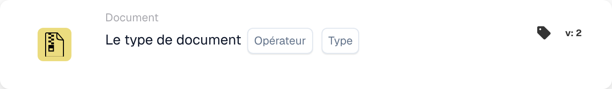
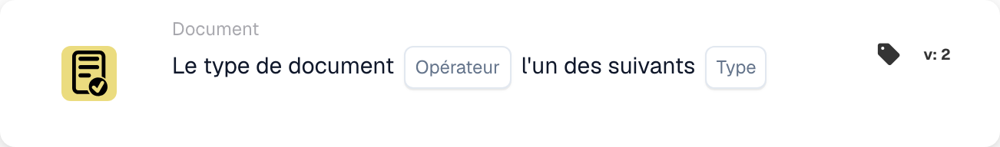

# Description de la carte

## **Cartes When : type de document**

Un workflow peut être démarré avec ces deux cartes. Vous pouvez ici décider avec quel type de document le workflow commence, ou s'il ne doit pas concerner certains types de documents.

\\

<figure><figcaption>
Champs de la carte dans la version affichée. Les champs ne sont pas encore renseignés.
</figcaption></figure>

<figure><figcaption>
Champs de la carte dans la version affichée. Les champs ne sont pas encore renseignés.
</figcaption></figure>

Cette carte peut également être utilisée pour indiquer plusieurs types de documents que le workflow doit concerner.
